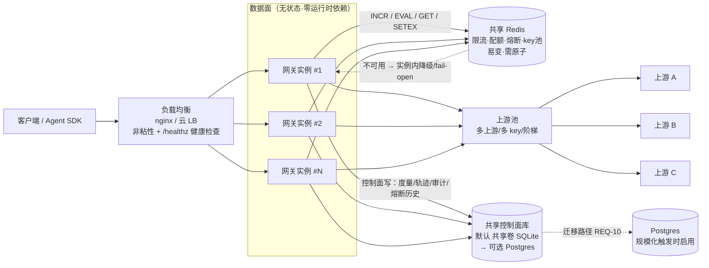
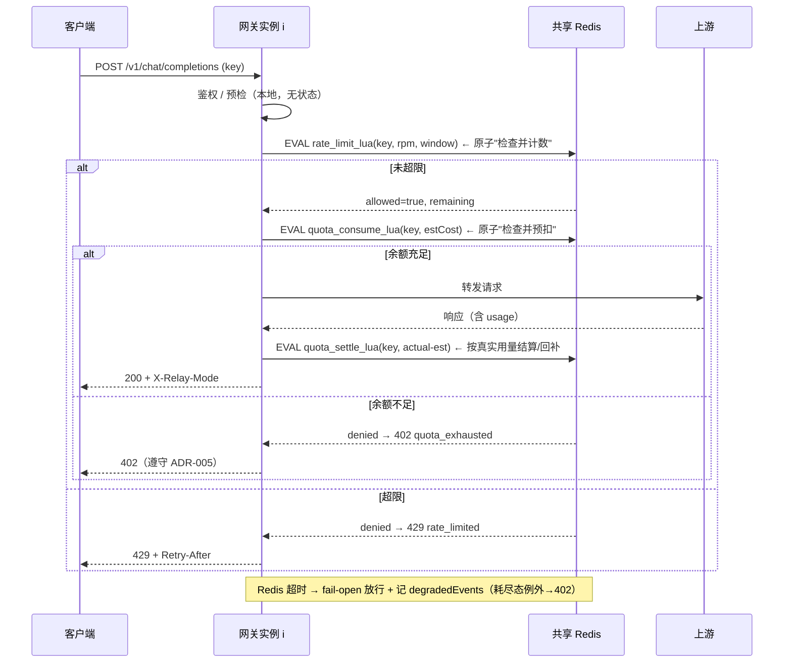
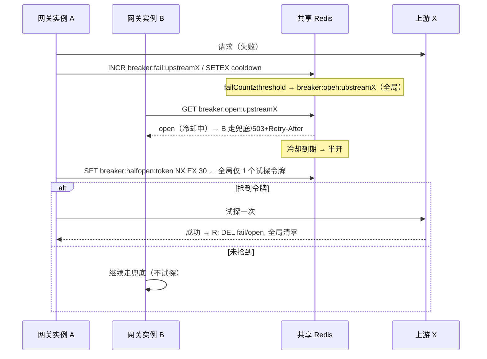

# 多实例 / 分布式状态改造需求规格书（A4 短板修复）

> 项目：api-relay（OpenAI 兼容的多上游聚合中转网关 + 内嵌 Preact 管理面板）
> 文档类型：**技术改造需求规格书（Tech Requirement Spec，非代码、非设计稿）**
> 作者：需求分析师（析客）｜版本：v1.0.0｜日期：2026-10-25
> 输入上游：`project/README.md`（§6.2 刻意不做 / §11 已知边界）、`project/DECISIONS.md`（ADR-002/018/024 等）、`design-proto/04-review.md`、`design-proto/01-discovery.md`（§5 边界 / §6 约束 / N10 多租户）
> 定位：把已知的**致命短板 A4「单实例、无分布式」**及三项能力薄弱点，转化为**可验收、可排期、可回滚**的改造需求，供路线图（RICE）与后续工程实施使用。

---

## §0 问题陈述（Background & Problem Statement）

> 各节统一标注：**目标 / 输入 / 产出物 / 关键决策 / 风险与待办**。

- **目标**：用证据把"A4 无分布式"这个致命短板说清，界定它破坏的语义、影响的人群与量级，作为后续所有需求与优先级的总纲。
- **输入**：`README.md` §11「已知边界」、`DECISIONS.md` ADR-002、ADR-018、`design-proto/01-discovery.md` §5.2/§6。
- **产出物**：本问题的量化描述 + 短板清单（A4 主症 + 3 个并发症）。
- **关键决策**：把 A4 定为**「平台化硬伤」而非普通缺陷**——它是"能不能多实例部署"的门槛问题，不修则前述平台化能力（多租户/多协议/成本自动化）都建在沙地上。
- **风险与待办**：① 本规格只定义"做什么/怎么验收"，不定义"怎么做"到实现细节；② 估算工作量为**单维护者口径**（见 ADR-011 单人体量约束），多人力可并行压缩。

### 0.1 主症：A4「单实例、无分布式」

**原文证据（不可抵赖）**：

| 出处 | 原文（节选） | 含义 |
|---|---|---|
| `README.md` §11 | 「未做分布式限流（多实例部署时限流/额度是**每实例独立**的）。需要时把 `Store.incrRate` / `quotaSnapshot` 换成 Redis 实现即可，**接口已隔离**。」 | 限流/配额是**实例内**状态，N 个实例 = 有效速率宽松 N 倍 |
| `DECISIONS.md` ADR-002 | 「限流与额度是**每实例**的。多实例下**下线速会宽松 N 倍**。需要精确时换 Redis 实现的 `Store`。」 | 明确承认代价，并指出扩展点 |
| `DECISIONS.md` ADR-002 | 「转发链路（鉴权、预检、路由、透传、归因）**不依赖数据库**……只有度量、轨迹、**熔断状态**、key 元数据落 SQLite。」 | 熔断状态同样落单实例 SQLite → 多实例下熔断各算各的 |
| `DECISIONS.md` ADR-018 | 「一个部署 = 一个 `storage.path`……换一份配置 = 换一个钥匙串。」 | key 元数据绑单库，多实例共享/迁移是悬空的运维动作 |

**后果（可量化）**：设平台承诺某 key 层 `rpm=1200`、`并发=128`、周期额度 `5M token`。部署 N 个网关实例且不做外置状态时：
- **有效 rpm 上限 ≈ N × 1200**（超发）；
- **有效并发上限 ≈ N × 128**；
- **周期额度消耗 ≈ 实际值 / N**（本该花完即停的 key，永远停不下来）；
- **熔断**：实例 A 观察到的上游故障，实例 B 不知道 → 已坏上游被反复撞击，故障转移滞后；
- **key 池冷却**：实例 A 冷却的 key，实例 B 仍在轮换使用 → 报废/短冷却语义失效。

对"厂商单模型"（1 个上游）影响有限（单实例足以）；对**"聚合平台"（多上游、多客户、按量计费）**是收入与信任的双重硬伤：客户按 token 计费却拿不到承诺的限速，平台侧额度闸形同虚设。

### 0.2 并发症（本次一并纳入的技术改造清单）

| 编号 | 短板 | 证据出处 | 与 A4 的关系 |
|---|---|---|---|
| **A4-a** | 流水式能力薄弱：**mid-stream 错误未注入 SSE `error` 帧** | `README.md` §11「流式内容的 mid-stream 错误目前只记录在 transcript 里，尚未注入 SSE `error` 帧回传客户端」 | 独立，但同属"链路完备性"，且是核心差异化「错误对 Agent 可执行」的**唯一盲区** |
| **A4-b** | **无原生 Anthropic / Gemini**，非 OpenAI 兼容上游按 OpenAI 处理 | `README.md` §11「Anthropic / Gemini 原生协议只留了实现位」 | 独立，属协议适配 |
| **A4-c** | **成本优化依赖手工配 `providers[].cost`**，未配置即退化为优先级路由 | `README.md` §11 | 独立，属运营自动化；与 A4 同源于"手工运维负担" |
| **A4-d** | **多租户仅"单实例逻辑隔离"**，`tenantId` 字段已存在但客户面无过滤（仅注释标为待办） | `design-proto/01-discovery.md` L147/L291（N10, P1）、Q6 | 独立，属平台化；多实例下逻辑隔离更难自证 |

### 0.3 一站式摘要（给路线图引用）

> **一句话**：A4 是"多实例语义正确性"缺失，三个并发症是"协议/流式完备性、成本自动化、租户隔离"缺失；四者共同构成"从可跑的单实例网关 → 可售卖的聚合平台"之间最后一道硬门槛。

---

## §1 改造目标（3 个正交目标）与非目标

- **目标**：定义 3 个**互不重叠、可独立并行**的改造目标，并**同等重要地**列出非目标，防止范围蔓延。
- **输入**：§0 短板清单、`README.md` §6.2「刻意不是」、`01-discovery.md` §5.2「不做」。
- **产出物**：目标/非目标清单 + 目标↔需求映射。
- **关键决策**：三目标按**"横（一致性）—纵（完备性）—台（运营）"** 三个维度切分，保证任一目标达成**不依赖**另两个，可分开排期与验收。
- **风险与待办**：非目标清单为**硬边界**，任何需求池条目若与服务它冲突，一律驳回（见 §2 追溯列）。

### 1.1 三个正交目标

| 目标 | 名称 | 解决的根问题 | 正交性说明（为什么可独立验收） | 主要承载需求 |
|---|---|---|---|---|
| **G1** | **状态一致性**（Horizontal Consistency） | A4：多实例下限流/配额/熔断语义被稀释 N 倍 | 只改"状态放哪、谁来仲裁"，不动协议与租户；即使不做 G2/G3，G1 也可独立交付并验收 | REQ-01/02/09 |
| **G2** | **协议与流式完备性**（Protocol & Streaming Completeness） | A4-a / A4-b：错误路径在流式与异构协议上存在盲区 | 只改"怎么翻译协议/在流里怎么回错误"，不依赖共享状态（单实例也成立）；可独立交付 | REQ-03/05/06 |
| **G3** | **平台化运营能力**（Operability & Isolation） | A4-c / A4-d：成本依赖手工配、租户隔离不成体系、审计留存悬空 | 只改"运营与合规面"，不依赖分布式状态即可先行（如成本推断、审计表落库）；可独立交付 | REQ-04/07/08/10 |

> **正交性自检**：G1 的验收不涉及 Anthropic 协议；G2 的成功不改变多实例语义；G3 的成本推断单实例即可起效。任一目标的完成都**不给**另两个目标"打折"，符合"每次新增范围必须伴随移除或延长"的范围管理原则（见 §6 停车场）。

### 1.2 非目标（明确不做，与产品边界严格一致）

> 以下为**硬边界**。任何需求若暗示下列任一能力，视为越界，需退回主理人裁决。依据：`README.md` §6.2、`DECISIONS.md` ADR-003、`01-discovery.md` §5.2。

| 不做 | 原因（既有立场，逐字可回溯） | 本次是否放行 |
|---|---|---|
| **P1 服务端改写成功响应** | 动摇"我只是管道"的信任假设 | **仍不做** |
| **P6 响应缓存** | 命中即零 token 零收入；LLM 非确定性下返回陈旧结果是信任灾难 | **仍不做** |
| **P7 同轮去重** | 没有"轮"的概念；降级为只统计不干预（`duplicateInWindow`） | **仍不做**（仅可增强观测） |
| **P4 跨请求意图栈** | 要求会话内容留存；降级为 P4-lite 无状态指纹 | **仍不做**（Redis 用途**不**包含会话留存） |
| **Agent 编排 / Agent 平台能力** | 中转站只看得到单请求；一旦"帮用户编排"就不是中转站 | **仍不做** |
| **物理多租户**（每租户独立进程/独立库） | 与"单维护者、低认知负担"冲突；本轮只做**逻辑强隔离** | **仍不做物理隔离** |
| **跨系统合并**（厂商单模型 ↔ 聚合平台） | ADR-011 明确两系统独立运营；触发条件未出现 | **仍不做** |
| **把"降损省 40%"写入对外话术** | ADR-003 已证伪并删除 | **仍不做** |

**边界澄清（针对本次改造）**：
- **引入 Redis/Postgres ≠ 破坏"零运行时依赖"**：仅在**数据面**保持 `dependencies: {}`（见 §3 关键决策），控制面允许构建期依赖（ADR-024 先例）。这**不是**新增产品边界，而是 ADR-001/024 已有边界的延续。
- **多租户强隔离 ≠ 物理隔离**：仅指"任何人不能通过客户面 API 越过 `tenantId` 边界读到他人数据"（ADR-016 同源的"证据可对照"原则）。

---

## §2 需求池（P0 / P1 / P2）

- **目标**：把 §1 目标拆成**可验收、可估算、有依赖**的需求条目，覆盖任务要求的全部 8 类（分布式限流配额、分布式熔断、多租户隔离、多协议适配、SSE error 帧、成本路由自动化、审计留存、及其配套设施）。
- **输入**：`Store` 扩展点（`incrRate`/`quotaSnapshot`/`record`，接口已隔离）、ADR-002/005/008/013/016/018。
- **产出物**：需求汇总表 + 每条的**验收标准（Given/When/Then + 检查清单）**、估算工作量（人日，单维护者口径）、依赖、追溯。
- **关键决策**：**P0 = 不做就无法多实例上线**（语义正确性）；**P1 = 平台可售卖/可合规的关键补齐**；**P2 = 规模化与体验增强**。估算采用**人日（1 人全职）**，含单测；不含联调环境搭建。
- **风险与待办**：估算区间为**初步值**，需在实现前用"1 天 spike"校准 Redis/Postgres 客户端选型（见 §3）；依赖关系若形成环，优先打断"控制面存储"这一环。

### 2.1 需求汇总表

| 编号 | 需求 | 优先级 | 目标 | 估算（人日） | 依赖 |
|---|---|---|---|---|---|
| **REQ-01** | 分布式限流与配额（Redis 外置，替换 `Store.incrRate`/`quotaSnapshot`） | **P0** | G1 | 5 ± 2 | Redis 客户端选型（§3） |
| **REQ-02** | 分布式熔断 / 半开状态外置 | **P0** | G1 | 3 ± 1 | REQ-01（共用 Redis 通道） |
| **REQ-03** | 流式 SSE `error` 帧注入 | **P0** | G2 | 4 ± 1.5 | 无（单实例即可） |
| **REQ-04** | 成本路由自动化（无 `cost` 时的推断 / 回退策略） | **P0** | G3 | 3 ± 1 | 无 |
| **REQ-05** | 原生 Anthropic Messages API 适配 | **P1** | G2 | 6 ± 2 | REQ-03（流式适配共用） |
| **REQ-06** | 原生 Gemini generateContent 适配 | **P1** | G2 | 6 ± 2 | REQ-03、REQ-05（适配框架） |
| **REQ-07** | 多租户隔离升级（`tenantId` → 强隔离） | **P1** | G3 | 5 ± 2 | REQ-10（控制面库） |
| **REQ-08** | 审计留存落地（事件流不可篡改 / 可导出） | **P1** | G3 | 4 ± 1.5 | REQ-10 |
| **REQ-09** | 分布式 key 池（轮换 / 冷却 / 报废跨实例一致） | **P1** | G1 | 4 ± 1.5 | REQ-01（共用 Redis 通道） |
| **REQ-10** | 控制面存储由"共享 SQLite"演进为 Postgres（可选路径） | **P1** | G1/G3 | 8 ± 3 | REQ-07、REQ-08 |
| **REQ-11** | 成本路由外部价格源同步（价目表拉取 / 定时刷新） | **P2** | G3 | 4 ± 2 | REQ-04 |
| **REQ-12** | 分布式可观测（Prometheus/OTel 指标导出） | **P2** | G1/G3 | 5 ± 2 | REQ-01 |
| **REQ-13** | 滚动升级与服务排空（graceful drain） | **P2** | G1 | 3 ± 1 | REQ-01/02 |
| **REQ-14** | 控制面读写分离 / 只读副本 | **P2** | G3 | 4 ± 2 | REQ-10 |

**优先级条数**：**P0 = 4 条**（REQ-01/02/03/04）；**P1 = 6 条**（REQ-05/06/07/08/09/10）；**P2 = 4 条**（REQ-11/12/13/14）。合计 **14 条**。

### 2.2 P0 需求详述

#### REQ-01 · 分布式限流与配额（P0｜G1｜估算 5±2 人日）

**需求**：把每实例的限流/配额判定改为**跨实例共享**的外置状态，使多实例部署下 `rpm` / 并发 / 周期额度（token 与 `quotaCny` 预算两种口径）与单实例语义**等价**。

**现状与差距**：`Store.incrRate` / `quotaSnapshot` 目前是实例内（内存或单库）；ADR-002 明确其为每实例；接口已隔离，替换成本可控但需定义**原子性**与**降级**策略。

**验收标准（可测试）**：
- **Given** N=3 个网关实例共享同一 Redis、某 free 层 key 配置 `rpm=20`，
  **When** 3 个实例并发发起 60 次请求（每实例 20 次），
  **Then** 全程**恰好 20 次返回 200、40 次返回 429 `rate_limited`**（±0 容差，允许时钟边界 1 次误差需显式记录）。
- **Given** 某 key 周期额度 `quotaCny=¥10`、输入¥3/M 输出¥6/M，
  **When** 3 实例并发把该 key 花到 `¥9.9`，
  **Then** 第 4 次可花费的请求被拒为 **402 `quota_exhausted`**（非 429，遵守 ADR-005），且 Redis 中余额**不为负**（token/预算不超扣）。
- **Given** Redis 不可用（连接超时）且配置 `failOpenOnRedisDown=true`，
  **When** 请求到达，
  **Then** 请求**照常转发**（fail-open，遵守红线 3），并记 `degradedEvents=redis_unavailable`，面板"预检降级放行数"类计数可见；
  **Given** 同一场景但 key 处于**已耗尽**状态（本地缓存余额 ≤0），**Then** 仍返回 402（耗尽态允许 fail-close 到 402，不误放行）。

**检查清单**：
- [ ] 限流与配额判定**全部**走外置状态；任何实例不再用本地计数判定放行/拒绝
- [ ] 两种口径独立判断：`额度(token)` 与 `预算(¥)` 各有一套原子计数，互不冒充
- [ ] 计数操作**原子**（INCR / Lua / 事务），并发下不出现"检查-使用"竞态导致的超发
- [ ] Redis 宕机 → fail-open 放行 + 记降级事件；**耗尽态例外**按 402 返回
- [ ] `429` / `402` 语义不变（限流 429、余额不足 402，遵守 ADR-005）
- [ ] 响应头 `X-Relay-Mode` 与限流/额度决策一致，透明可核
- [ ] 有 N≥3 实例的**并发对拍测试**（非仅单进程单测）

**依赖**：Redis 客户端选型（§3，建议最小 RESP2 自研客户端以守住数据面零依赖）。
**追溯**：直接服务 G1 与 A4；不新增产品边界。
**风险与待办**：周期额度的时间窗切分（滚动窗口 vs 自然周期）需与 ADR-011"计量口径一致"对齐；跨实例时钟偏差需显式约束（建议以 Redis/服务端时间为准）。

#### REQ-02 · 分布式熔断 / 半开状态（P0｜G1｜估算 3±1 人日）

**需求**：把"连续失败计数、熔断冷却、半开试探一次"的状态外置，使任一实例观察到的上游故障**全局生效**。

**现状与差距**：熔断状态落单实例 SQLite（ADR-002）；`breakerThreshold`/`breakerCooldownMs`/半开逻辑已实现（`README` §9.1），但**实例间不共享**。

**验收标准（可测试）**：
- **Given** 上游 `agnes` 配置 `breakerThreshold=5`，实例 A 连续 5 次失败，
  **When** 实例 B 收到同模型请求，
  **Then** 实例 B **立即**感知熔断（走兜底/返回 503 附 `Retry-After`，遵守 ADR-013 五分类中的 `all_breaker_open`），**不**再从 0 起计。
- **Given** 熔断冷却到期，
  **When** 任一实例命中半开，
  **Then** **全局仅允许 1 个试探请求**（令牌化半开），其余实例继续走兜底，试探成功则全局清零计数、失败则全局重新熔断一轮。
- **Given** Redis 不可用，
  **Then** 熔断退化为**实例内**判定（fail-open，不因状态层故障而拒绝请求），并记降级事件。

**检查清单**：
- [ ] 失败计数、熔断开关、冷却到期时间跨实例共享
- [ ] 半开试探**全局令牌化**（同一时刻仅 1 次试探），避免 N 实例齐发试探打垮刚恢复的上游
- [ ] 熔断导致的 503 附标准 `Retry-After`（ADR-013）
- [ ] `NoRouteError` 五分类口径不变（`all_breaker_open` 与 `model_not_found` 绝不混淆，ADR-013 不变量）
- [ ] Redis 故障 → 实例内降级 + 降级事件可见
- [ ] 有"N=3 实例 × 单实例触发熔断 → 全局生效"的集成测试

**依赖**：REQ-01（共用 Redis 通道与客户端）。
**追溯**：服务 G1 / A4；与 ADR-008（fatal vs tried）、ADR-021（双线路）语义兼容。
**风险与待办**：半开令牌的"占位-释放"若实例崩溃需 TTL 兜底，防令牌永久占用；熔断状态是否需要与"人工摘除"（`all_disabled`）分开存储需明确。

#### REQ-03 · 流式 SSE `error` 帧注入（P0｜G2｜估算 4±1.5 人日）

**需求**：当流式响应**已开始回传**、随后发生上游 mid-stream 错误（断连/内容过滤/超限/5xx 中途）时，网关向客户端**注入符合 OpenAI 流式约定的 `error` 帧**，把"错误对 Agent 可执行"的差异化能力补齐到流式路径。

**现状与差距**：目前 mid-stream 错误**只记录在 transcript**，客户端拿到的是**静默截断**的流（常见表现为半截 JSON 或直接 EOF），无法区分"正常结束"与"上游崩了"。

**验收标准（可测试）**：
- **Given** 一次流式请求，上游在第 3 个 chunk 后断开，
  **When** 网关检测到 mid-stream 失败，
  **Then** 客户端收到一个 SSE `data:` 帧，内容为 `{"error":{...,"type":"upstream_error"},"relay_attribution":{...}}`（pro 层含完整归因；standard 层仅 `X-Relay-Attribution` 头 + 最小 `error` 帧；free 层**纯管道、不注入**），随后流正常 `[DONE]` 或按约定结束。
- **Given** `free` 层 key，
  **When** 发生 mid-stream 错误，
  **Then** **不注入任何自定义帧**（守住"零附加"承诺），仅按原样结束/断开。
- **Given** 上游正常结束，
  **Then** 客户端字节流与"未开启本能力"时**逐字节一致**（不得新增任何帧）。

**检查清单**：
- [ ] 仅在**已开始回传之后的失败**注入，正常结束路径零改动（红线 1：成功路径一字节不动）
- [ ] 注入帧遵守 OpenAI 流式错误约定（`data: {...}` + 结束语义），不破坏客户端 SSE 解析
- [ ] 分层投递：free=off / standard=header+最小帧 / pro=full（与 ADR-004 一致）
- [ ] 注入帧内的 `error` 补齐 OpenAI schema 必填字段（`type`/`param`/`code`，ADR 归因契约）
- [ ] mid-stream 失败仍**如实落 transcript/trace**，不因注入而丢失排障证据
- [ ] 对"上游只发了一半帧就断"的**半截 JSON** 有明确处理（补齐/丢弃策略有文档与测试）
- [ ] 有 mock 上游注入"流中断"并可复现（复用 ADR-007 的 `mock/upstream.ts`）

**依赖**：无（单实例即可交付，属 G2）。
**追溯**：服务 G2 / A4-a；补全核心差异化（README「卖的是错误对 Agent 可执行」）。
**风险与待办**：需确认主流客户端（`openai-node`/`openai-python`/Vercel AI SDK）对"流中 error 帧"的接受度（呼应 ADR-003 待决策表"严格客户端是否拒绝成功响应新增字段"）；建议先做客户端兼容实测再定稿帧格式。

#### REQ-04 · 成本路由自动化（P0｜G3｜估算 3±1 人日）

**需求**：当 `providers[].cost` **未配置**时，网关**不再静默退化为纯优先级路由**，而是给出**可解释的推断或显式回退**，让"成本优先"这件事不依赖手工配置的完整性。

**现状与差距**：`README` §11「模型路由的成本优化依赖 `providers[].cost` 配置；未配置时自动退化为优先级路由」——无告警、面板不可见、用户不知道自己在按非预期策略路由。

**验收标准（可测试）**：
- **Given** 两个上游声明同一模型、均**未**配 `cost`，且路由策略为 `cost`，
  **When** 请求到达，
  **Then** 路由**不静默**：返回的 route 决策附带 `route_reason`（如 `cost_unknown_fallback_priority`），且启动横幅/面板"上游"页以**显式提示**列出"缺失 cost 的模型数"。
- **Given** 仅部分上游配了 `cost`，
  **Then** 已配者按成本排序、未配者**排到已配者之后**（保守偏序），并在 trace 里标注。
- **给定** 提供了内置"参考价目"（可选数据文件），**When** 某模型命中参考价，
  **Then** 使用参考价并标注来源 `cost_source=reference`（与"实测配置" `cost_source=config` 可区分）。

**检查清单**：
- [ ] `cost` 缺失时**必有可见信号**（route_reason / 启动横幅 / 面板计数三处至少两处）
- [ ] 提供保守偏序：已知成本优先于未知成本，未知不参与数值比较
- [ ] 成本路由决策**可解释**（trace 里能回答"为什么走这家"）
- [ ] 缺失 cost 时**不改变**"同价承诺"与现有路由正确性（不引入错误路由）
- [ ] 有单测覆盖：全缺失 / 部分缺失 / 全配置 / 参考价命中 四种组合

**依赖**：无（单实例即可）。
**追溯**：服务 G3 / A4-c；非目标 P6 缓存仍不做，此处仅做"路由"，不缓存、不改写响应。
**风险与待办**：参考价目的**准确性口径**（汇率/时效）需与 ADR-021 的"美元→人民币 1:7.2"口径统一；参考价目来源与更新成本见 REQ-11。

### 2.3 P1 需求详述（要点式）

> P1 条目同样可验收，此处给出**核心验收标准**，实现细节留待实施阶段细化。

#### REQ-05 · 原生 Anthropic Messages API 适配（P1｜G2｜6±2 人日）
- **需求**：新增 Anthropic `/v1/messages` 协议的**入站适配**（客户端可用 Anthropic SDK 直连本网关），内部转换为统一路由/归因/计量链路。
- **验收**：
  - **Given** 客户端用 Anthropic SDK（`anthropic` / `@anthropic-ai/sdk`）指向本网关，**When** 发起 `messages` 请求，**Then** 返回合法的 Anthropic 响应结构（含 `content` blocks、`stop_reason`），且 SSE 流式事件（`message_start`/`content_block_delta`/`message_stop`）正确。
  - **Given** 上游为 OpenAI 兼容上游，**When** 走 Anthropic 入口，**Then** 网关完成**协议互译**且归因/计量口径与 OpenAI 入口一致（token 数、`failure_reason` 枚举不变，遵守 ADR-011 口径一致）。
- **检查清单**：入站协议识别 / 出站协议互译 / 错误归因枚举复用（不新增口径）/ 流式事件映射 / 与 `X-Relay-Mode` 透明头兼容 / 契约测试（对拍）。
- **依赖**：REQ-03（流式错误帧需在 Anthropic 事件流里同样成立）。
- **风险**：Anthropic 的 `system` 参数、tool use 语义与 OpenAI 不完全等价，"互译"可能丢失语义 → 需明确**支持子集**并显式报错而非静默丢字段。

#### REQ-06 · 原生 Gemini generateContent 适配（P1｜G2｜6±2 人日）
- **需求**：新增 Google Gemini `generateContent` / `streamGenerateContent` 适配，语义同 REQ-05。
- **验收**：Gemini SDK 直连本网关可通；`candidates`/`parts` 与 OpenAI `choices` 互译正确；流式 SSE 分帧正确；归因/计量口径一致。
- **依赖**：REQ-03、REQ-05（共用适配框架）。
- **风险**：Gemini 的 `safetyRatings`（含被拦的 `finish_reason`）必须映射为可归因错误（呼应"HTTP 200 里的失败信号"盲区）。

#### REQ-07 · 多租户隔离升级（P1｜G3｜5±2 人日）
- **需求**：`tenantId` 从"创建时可填、读取不隔离"升级为**客户面强隔离**：任何客户面 API 只能在自身 `tenantId` 内读写。
- **验收**：
  - **Given** 租户 A 的 key，**When** 请求读取/操作租户 B 的资源，**Then** 返回 **403**（不泄漏 B 的存在性），并有审计事件。
  - **Given** 同一实例承载多租户，**Then** 面板/报表/账单/Key 列表按 `tenantId` 过滤，无跨租户数据泄漏（对拍测试：构造跨租户样本，断言零泄漏）。
- **检查清单**：所有客户面端点强制 `tenantId` 谓词 / 越权返回 403 且不泄漏存在性 / RBAC 与租户隔离叠加 / 审计留痕 / 跨租户对拍测试。
- **依赖**：REQ-10（隔离谓词需稳定的控制面库）；非目标：**不做物理隔离**。
- **风险**：`tenantId` 缺失的老数据迁移策略（默认归入"默认租户"）；与 ADR-016"未鉴权流量单独成桶"口径不得冲突。

#### REQ-08 · 审计留存落地（P1｜G3｜4±1.5 人日）
- **需求**：把"每次写操作都进事件流（`relay_event`）"从**可有无**升级为**可留存、可导出、防篡改**的审计能力（合规诉求）。
- **验收**：
  - **Given** 任一管理写操作，**Then** 生成审计记录（actor / tenantId / action / 目标 / 时间 / 结果），且**不可被普通配置动作删除**。
  - **Given** 时间范围查询，**Then** 支持导出（JSON/CSV），字段齐全；**明文密钥永不入审计**（仅指纹，遵守 ADR-016）。
- **检查清单**：写操作全覆盖 / 明文零落盘 / 时间范围导出 / 留存周期可配 / 追加写不可篡改（链式哈希可选）/ 与"未被鉴权流量单独成桶"口径一致。
- **依赖**：REQ-10（Postgres 下更易做留存与导出；SQLite 追加表亦可先行）。
- **风险**：当前 `04-review.md` 指出"审计留存为声明式占位（L1240）"——需从"界面声明"变成"后端实在能力"。

#### REQ-09 · 分布式 key 池（P1｜G1｜4±1.5 人日）
- **需求**：多 key 池的**轮换位置、被拒 key 的短冷却/报废**跨实例一致，避免"A 冷却的 key，B 继续用"。
- **验收**：
  - **Given** 上游配 2 个 key、实例 A 使 key1 触发 401 报废，**When** 实例 B 下次轮询，**Then** B **不**再选 key1（除非冷却到期、且配置允许复活）。
  - **Given** 两实例并发轮询，**Then** 两个 key 的使用次数**近似均衡**（偏差有上界，避免全部打到同一 key）。
- **检查清单**：轮换游标共享 / 冷却与报废状态共享 / Redis 故障降级为实例内 / 明细可观测。
- **依赖**：REQ-01（共用 Redis）。
- **风险**：与"用户无感切换"承诺兼容——任何共享状态故障都不得让用户看到 key 错误（fail-open）。

#### REQ-10 · 控制面存储演进：共享 SQLite → Postgres（P1｜G1/G3｜8±3 人日）
- **需求**：为多实例共享控制面（key 元数据、审计、度量、tenant）提供**可选**的 Postgres 路径；默认仍可用"共享卷上的 SQLite"，Postgres 作为**规模化触发条件**下的迁移目标。
- **验收**：
  - **Given** 配置 `storage.driver=postgres`，**When** 多实例启动，**Then** 控制面读写一致，无 SQLite 单写者锁竞争；`key_meta`、审计、度量均可并发写。
  - **Given** `storage.driver=sqlite`（共享卷），**Then** 行为与当前一致（向后兼容，零回归）。
  - **Given** Postgres 不可用，**Then** 转发链路**照常**（控制面故障不得阻断数据面，遵守 ADR-002 红线）。
- **检查清单**：驱动可切换 / 迁移脚本（含 `key_meta` 哈希迁移，ADR-018）/ 数据面不依赖控制面 / 迁移回滚脚本 / 新旧驱动对拍。
- **依赖**：REQ-07、REQ-08。
- ****关键决策**：Postgres 客户端是**控制面**依赖，允许（ADR-024 边界）；**数据面**（`src/gateway/`+`src/upstream/`+`src/store/`）仍须零运行时依赖。
- **风险**：Postgres 客户端引入供应链面（与"零依赖"文化冲突）→ 建议放到 **devDependencies/可选依赖** 或用极简 wire 协议自研；触发条件需量化（如控制面写 > X 次/秒或多实例共库锁等待 > Y ms）。

### 2.4 P2 需求详述（简述）

| 编号 | 需求 | 验收要点（摘要） |
|---|---|---|
| **REQ-11** | 成本路由外部价格源同步 | 价目表可定时拉取/热更新；命中标注 `cost_source=external`；失效时回退 REQ-04 保守策略 |
| **REQ-12** | 分布式可观测（Prometheus/OTel） | `/metrics` 导出核心计数器（限流命中/熔断/额度/降级事件）；多实例聚合口径一致 |
| **REQ-13** | 滚动升级与服务排空 | 收到 SIGTERM 后停止接新请求、在途请求排空（含流式）再退出；健康检查 `inflight` 可见 |
| **REQ-14** | 控制面读写分离 | 报表/账单阅读走只读副本；主库仅承担写入；延迟与主库一致性窗口有界且可测 |

---

## §3 关键流程图：多实例部署架构

- **目标**：给出改造后的目标部署拓扑与关键运行时序（限流裁决 / 熔断半开），作为实现与运维的共识基线。
- **输入**：ADR-002（数据面无状态）、ADR-019（守护与健康检查）、本规格 REQ-01/02/09/10/13。
- **产出物**：拓扑图（Mermaid + ASCII）+ 两张关键时序图。
- **关键决策**：**负载均衡默认非粘性**（数据面无状态，见 ADR-002）；**共享 Redis 承载"易变、需原子"的状态**（限流/配额/熔断/key 池）；**控制面数据库承载"稳定、需留存"的数据**（key 元数据/审计/度量/租户）。两者**故障域隔离**：Redis 挂 → 降级但仍服务；控制面库挂 → 数据面零影响。
- **风险与待办**：Redis 成为新的**关键路径依赖**，需 HA（哨兵/集群）与连接池策略；LB 健康检查须对接 `/healthz`（ADR-019 的"健康检查驱动"）。

### 3.1 目标拓扑（Mermaid）



### 3.2 目标拓扑（ASCII 备用视图）

```
 客户端/Agent SDK
        │
        ▼
 ┌──────────────────────────┐
 │ 负载均衡 LB（非粘性）      │◀── /healthz 健康检查（ADR-019）
 └──────┬───────┬───────┬───┘
        │       │       │
   ┌────▼──┐ ┌──▼───┐ ┌─▼────┐
   │ 网关#1 │ │ 网关#2 │ │ 网关#N │   ← 数据面无状态·零运行时依赖
   └───┬───┘ └───┬──┘ └───┬───┘
       │         │        │
       ├─────────┼────────┤  限流/配额/熔断/key池（INCR|EVAL|SETEX，原子）
       ▼         ▼        ▼
   ┌──────────────────────────┐
   │   共享 Redis（HA）         │   易变状态；不可用 → 降级 fail-open
   └──────────────────────────┘
       │         │        │
       └─────────┼────────┘  上游池（多上游/多 key/阶梯/故障转移）
                 ▼
        ┌────────────────┐
        │   上游池 → 上游 │  A / B / C ...
        └────────────────┘
       │         │        │
       └─────────┼────────┘  控制面写：度量/轨迹/审计/租户
                 ▼
   ┌──────────────────────────┐
   │ 共享控制面库（SQLite 共享卷）│──(REQ-10 触发)──▶ Postgres
   └──────────────────────────┘   数据面不依赖它（ADR-002 红线）
```

### 3.3 关键时序 A：跨实例限流 / 配额裁决（REQ-01）



### 3.4 关键时序 B：熔断与令牌化半开（REQ-02）



---

## §4 迁移路径与回滚方案

- **目标**：给出从**当前单实例（每实例 SQLite/内存）**到**分布式状态**的**平滑、可分阶段、可回滚**迁移路径，并明确旧数据（尤其 key 哈希）的兼容策略。
- **输入**：ADR-002（数据面无状态）、ADR-018（key 哈希可迁移）、REQ-01~REQ-14。
- **产出物**：分阶段迁移步骤 + 兼容策略 + 回滚方案 + 验收门。
- **关键决策**：**"双写-影子比对-切换"三步法**（灰度切换），而非"停机大爆炸"。默认**保留 SQLite 路径**作为永久回退开关（`storage.driver` / `state.backend` 可切）。
- **风险与待办**：状态外置后**Redis 成为关键路径**，迁移期需同时保证"旧实例仍可服务"（滚动切换）；key 哈希迁移必须**只迁哈希、不涉明文**（ADR-018）。

### 4.1 迁移前的状态盘点

| 状态类型 | 当前位置 | 目标位置 | 迁移方式 | 要求 |
|---|---|---|---|---|
| 限流计数 | 实例内存/单库 | Redis | 重算（无需迁历史） | 切换时清零即可（限流窗口短期） |
| 周期额度 | 单库（`quotaSnapshot`） | Redis + 控制面库双备份 | **必须迁移**（历史消耗） | 切换不得"重置客户已用额度" |
| 熔断/半开 | 单实例 SQLite | Redis | 重算（可重置） | 迁移后允许"冷启动从 0 计" |
| key 元数据 | `key_meta`（哈希） | 共享控制面库 | **必须迁移（哈希可迁，ADR-018）** | 用户客户端 key **原样继续可用** |
| 审计/度量/轨迹 | SQLite | 共享库/Postgres | 增量迁移 | 留存期内数据可导出 |

### 4.2 分阶段迁移步骤（平滑）

**阶段 M0 · 准备（不动线上）**
1. 选定 Redis 客户端与拓扑（§3 关键决策），打通连接与 HA 演练。
2. 为 `Store` 抽象新增**外置后端实现**，保留原后端；用**配置开关**选择（默认仍走原后端）。
3. 建立"状态对拍"工具：同一操作在原后端与外置后端各执行一次，比对结果。

**阶段 M1 · 影子比对（只读旁路）**
4. 线上仍以**原后端**判定；**影子写**外置后端（Fire-and-forget，不影响决策）。
5. 采集对拍差异率（目标：**限流/配额判定差异 = 0**，熔断差异在容差内）。
6. 门禁：差异率达标且持续 N 小时后方可进入 M2。

**阶段 M2 · 单实例切换（金丝雀）**
7. 选 1 个实例把**判定源**切到外置后端（其余实例仍用原后端）。
8. 观察超发/误拒/降级事件；确认无回归后逐个实例切换（滚动，配合 REQ-13 排空）。
9. 每次切换前看 `/healthz` 的 `inflight`（ADR-022 教训：改配置/重启前先看在途请求）。

**阶段 M3 · 数据迁移（控制面）**
10. `key_meta`：**按行迁移哈希**（不涉明文），迁移后校验"同一明文 key 的指纹一致"。
11. 周期额度：把各 key 的历史消耗**合并汇总**写入外置后端（保留"已用额度"语义，不重置）。
12. 审计/度量：增量同步到共享库；对齐 ADR-011"计量口径一致"。

**阶段 M4 · Postgres（可选，触发式）**
13. 仅当触发条件成立（控制面写热点/锁竞争超阈值）才实施 REQ-10；否则长期停留在"共享卷 SQLite"。

### 4.3 兼容策略（旧 key / 哈希可迁移）

- **明文永不迁移**：面板只存 `sha256("relay-key:"+key)` 前 8 位作为指纹（ADR-016）；迁移只搬哈希行。
- **迁移后行为不变**：用户客户端里**已经配好的那串 key 原样继续可用**（ADR-018 已实证 `k_17tcxww6`）。
- **`tenantId` 缺省**：老 key 无 `tenantId` 时归入"默认租户"，不因新增隔离列而失效（REQ-07）。
- **`storage.path` → `storage.driver`**：旧配置继续可读（向后兼容）；新配置支持 `driver=sqlite|postgres`。
- **接口契约不变**：对外 HTTP 契约（`X-Relay-Mode`、402≠429、错误 schema）**一个字节都不动**（ADR-004/005/009）。

### 4.4 回滚方案

| 层级 | 回滚动作 | 触发条件 | 结果 |
|---|---|---|---|
| **判定源** | 配置切回 `state.backend=local`（重启/热载） | 外置判定出现超发/误拒 | 立即退回每实例语义（宽松，但不误拒） |
| **Redis 故障** | 自动 fail-open（无需人工） | 连接超时/不可用 | 服务不中断，记降级事件 |
| **控制面库** | 切回原 `storage.path` | 新库不可用/数据异常 | 数据面零影响（ADR-002 红线） |
| **数据迁移** | 保留迁移前库快照（ADR-019 每 24h 备份） | 迁移后发现额度/哈希错位 | 回滚到快照，key 指纹不变 |
| **Postgres** | `driver=sqlite` 切回 | 触发条件误判 | 回到共享卷 SQLite |

> **回滚不变量**：任何回滚都**不得**导致"用户手上的 key 失效"或"成功响应被改写"。

### 4.5 迁移验收门（Go/No-Go）

- [ ] 影子比对：限流/配额判定差异 = 0，持续 ≥ N 小时
- [ ] 金丝雀实例：误拒率与超发率均为 0（对比迁移前基线）
- [ ] `key_meta` 迁移后：抽检 10 个历史 key 的指纹一致、客户端可原样调用
- [ ] 周期额度迁移后：抽检 key 的"已用额度"与迁移前一致（不重置、不多扣）
- [ ] Redis 主动宕机演练：服务不中断、降级事件可见、耗尽态仍 402
- [ ] 回滚演练：`state.backend=local` 一键切回，服务无中断

---

## §5 验收标准清单（可勾选，≥20 条）与风险 / 待办

- **目标**：把全规格的"完成定义（DoD）"收敛为一张可勾选清单，供路线图与验收使用。
- **输入**：§2 各需求验收标准、§4 迁移门。
- **产出物**：全局验收清单 + 风险登记册 + 待办（Open Questions）。
- **关键决策**：验收以**可对拍测试**为准（复用 ADR-007 的 mock 上游与 ADR-016 的对拍方法），拒收"改了就算"的口头完成。
- **风险与待办**：清单中带 ⚠ 者为**需先确认再实现**（客户端兼容性/触发阈值/口径）。

### 5.1 全局验收清单（G1 状态一致性）

- [ ] **AC-01（REQ-01）** 3 实例共享 Redis 并发 60 次、`rpm=20`，恰好 20 次 200 / 40 次 429（±边界显式记录）
- [ ] **AC-02（REQ-01）** 预算 `¥10` 跨实例并发花到 `¥9.9` 后，下一次被拒为 **402**，Redis 余额不为负
- [ ] **AC-03（REQ-01）** Redis 不可用 → 请求照常转发 + 记 `degradedEvents`；耗尽态仍返回 402
- [ ] **AC-04（REQ-01）** 限流 429 / 额度 402 语义不变（ADR-005）；`X-Relay-Mode` 与判定一致
- [ ] **AC-05（REQ-02）** 单实例触发熔断后，其他实例立即生效（`all_breaker_open` 语义，ADR-013）
- [ ] **AC-06（REQ-02）** 半开试探**全局令牌化**：同一时刻仅 1 次试探，成功全局清零、失败全局重熔
- [ ] **AC-07（REQ-02）** 熔断导致的 503 附标准 `Retry-After`；Redis 故障退化为实例内判定
- [ ] **AC-08（REQ-09）** 实例 A 报废的 key，实例 B 不再选用（除非冷却到期且允许复活）
- [ ] **AC-09（REQ-09）** 多实例并发轮询下，多 key 使用次数偏差有界（近似均衡）
- [ ] **AC-10（REQ-13）** SIGTERM 后停止接单、在途（含流式）请求排空后退出；`/healthz` 反映 `inflight`

### 5.2 全局验收清单（G2 协议与流式完备性）

- [ ] **AC-11（REQ-03）** 流式 mid-stream 失败 → pro 层注入含归因的 SSE `error` 帧，随后按约定结束
- [ ] **AC-12（REQ-03）** free 层 mid-stream 失败 → **不注入任何自定义帧**（零附加承诺）
- [ ] **AC-13（REQ-03）** 正常流式响应字节流与"未开启本能力"时**逐字节一致**
- [ ] **AC-14（REQ-03）** 注入帧内 `error` 补齐 OpenAI schema 必填字段；trace/transcript 仍完整
- [ ] **AC-15（REQ-03）⚠** 主流客户端（openai-node / openai-python / Vercel AI SDK）对 error 帧兼容实测通过
- [ ] **AC-16（REQ-05）** Anthropic SDK 指向本网关可通；`messages` 响应结构与 SSE 事件合法
- [ ] **AC-17（REQ-05）** Anthropic↔OpenAI 互译不丢必填语义；不支持的字段**显式报错**而非静默丢弃
- [ ] **AC-18（REQ-06）** Gemini SDK 可通；`candidates/parts` 互译与流式分帧正确
- [ ] **AC-19（REQ-06）** Gemini `safetyRatings` 拦截映射为可归因错误（HTTP 200 内的失败信号）
- [ ] **AC-20（REQ-05/06）** 新协议入口的归因枚举与计量口径与 OpenAI 入口**完全一致**（ADR-011）

### 5.3 全局验收清单（G3 平台化运营与合规）

- [ ] **AC-21（REQ-04）** `cost` 缺失时路由**不静默**：route_reason / 启动横幅 / 面板计数可见
- [ ] **AC-22（REQ-04）** 部分配置时已知成本优先、未知排后（保守偏序），决策可解释
- [ ] **AC-23（REQ-07）** 跨租户请求返回 403 且不泄漏目标存在性；客户面全端点强制 `tenantId` 谓词
- [ ] **AC-24（REQ-07）** 跨租户对拍测试零泄漏；RBAC 与租户隔离叠加正确
- [ ] **AC-25（REQ-08）** 管理写操作 100% 生成审计记录且不可被普通配置动作删除
- [ ] **AC-26（REQ-08）** 审计可导出；**明文密钥零落盘**（仅指纹，ADR-016）
- [ ] **AC-27（REQ-10）** `driver=postgres` 多实例并发写一致、无单写者锁竞争；控制面故障不阻断数据面
- [ ] **AC-28（REQ-10）** `driver=sqlite` 向后兼容（零回归）；新旧驱动对拍通过

### 5.4 全局验收清单（迁移与横切红线）

- [ ] **AC-29（§4）** 影子比对差异 = 0（限流/配额）持续达标；金丝雀误拒/超发为 0
- [ ] **AC-30（§4）** key 哈希迁移后：抽检指纹一致、客户端原样可调用、明文不涉
- [ ] **AC-31（§4）** 周期额度迁移后"已用额度"与迁移前一致（不重置、不多扣）
- [ ] **AC-32（§4）** Redis 宕机演练：服务不中断、降级事件可见、回滚 `state.backend=local` 无损
- [ ] **AC-33（横切）** **success 路径零改写**：启动回归套件证明成功响应逐字节透传（红线 1）
- [ ] **AC-34（横切）** **fail-open 语义**：治理层/状态层异常静默回退，唯一 fail-closed 是鉴权（红线 3）
- [ ] **AC-35（横切）** 数据面 `dependencies: {}` 仍成立（Redis/PG 客户端不污染数据面）
- [ ] **AC-36（横切）** 全套既有单测（当前 297+ 项）与 30 项冒烟**零回归**通过

> **清单规模**：共 **36 条**（满足"≥20 条"要求）。其中 **⚠ 需先确认**：AC-15。

### 5.5 风险登记册

| # | 风险 | 等级 | 影响 | 缓解 |
|---|---|---|---|---|
| R1 | **Redis 成为关键路径** | 高 | 状态层故障可能影响可用性 | fail-open 降级 + HA（哨兵/集群）+ 连接池 + 超时熔断 |
| R2 | **数据面零依赖与 Redis/PG 客户端冲突** | 高 | 破坏 ADR-001 纪律 | Redis 用**最小 RESP2 自研客户端**（~200-400 行）；Postgres 归控制面/可选依赖 |
| R3 | **客户端不接受流中 error 帧**（AC-15） | 中 | 注入帧可能让严格客户端崩 | 先做兼容实测；分层投递（free=off）；帧格式遵守 OpenAI 约定 |
| R4 | **协议互译丢语义**（Anthropic/Gemini） | 中 | 静默降级/错误结果 | 仅承诺支持子集，不支持即显式报错；契约对拍测试 |
| R5 | **周期额度时间窗口口径不一致** | 中 | 跨系统对账失真（ADR-011） | 统一口径、统一时钟源（以服务端/Redis 时间为准） |
| R6 | **迁移重置客户已用额度** | 中 | 客户投诉/对账失败 | M3 汇总迁移 + AC-31 门禁 + 迁移前快照 |
| R7 | **Postgres 引入供应链面** | 中 | 与"零依赖"文化冲突 | 触发式实施；或极小自研 wire 客户端；仅控制面 |
| R8 | **半开令牌泄漏/永久占用** | 低 | 上游久久不被试探 | 令牌设 TTL，实例崩溃自动释放 |
| R9 | **LB 粘性假设错误** | 低 | 状态不一致暴露 | 明确非粘性设计 + 数据面无状态（ADR-002） |
| R10 | **scope 蔓延**（偷偷引入缓存/编排） | 中 | 破坏产品边界 | §1.2 非目标为硬门禁；需求池逐条带"追溯"列 |

### 5.6 待办（Open Questions，真正开放）

| # | 开放问题 | 现状 | 需要什么才能定 |
|---|---|---|---|
| Q1 | **Redis 客户端走自研 RESP 还是引入依赖**？ | 倾向自研（保零依赖） | 1 天 spike：自研客户端的边界（Lua EVAL/集群/哨兵）是否够用；不够则该不该为状态层破例 |
| Q2 | **Postgres 迁移的量化触发条件**？ | 未定 | 控制面写入 QPS 与多实例共库锁等待的**实测阈值**（如写 > X/s 或锁 > Y ms） |
| Q3 | **周期额度用滚动窗口还是自然周期**？ | 未定 | 与客户计费合同口径确认；涉及"跨月/跨期"语义 |
| Q4 | **流中 error 帧的最终格式**（15 字兼容）？ | 待实测 | AC-15 实测结果 + OpenAI 官方流式错误约定 |
| Q5 | **多租户 `tenantId` 缺省策略**（老 key 归属）？ | 未定 | 存量 key 盘点；是否允许"默认租户"长期存在 |
| Q6 | **Anthropic/Gemini 支持子集边界**？ | 未定 | 真实客户需求清单（哪些字段/工具语义必须支持） |
| Q7 | **审计留存周期与不可篡改强度**？ | 未定 | 合规要求（是否需要链式哈希/外部 WORM 存储） |
| Q8 | **成本参考价目的来源与更新频率**？ | 未定 | REQ-11 数据源可获得性 + ADR-021 汇率口径 |

---

## §6 里程标与范围管理（Range Guard）

- **目标**：给出**分阶段交付**建议，并用"停车场"承接好想法但不纳入本轮，防止范围蔓延。
- **输入**：§2 估算与依赖、§5 风险。
- **产出物**：建议里程碑（M1~M3）+ 停车场清单。
- **关键决策**：优先顺序 = **先 G2/G3 的"低依赖项"（REQ-03/04）快速兑现差异化与自动化的可见价值，再攻 G1（REQ-01/02）」**——因为 G1 需要 Redis 选型 spike，前置量最大；但 G1 是"平台化硬伤"，必须在**首次多实例部署前**完成，不能无限期滞后。
- **风险与待办**：若 G1 完成前就上多实例，**配额/限流语义失真**（收入与信任损失）——因此**首个多实例部署必须阻塞于 REQ-01/02 完成**。

### 6.1 建议里程碑（不含工期承诺，供路线图排期）

| 里程碑 | 主题 | 关键交付 | 出口门 |
|---|---|---|---|
| **T1** | 军事前哨（零依赖先兑现） | REQ-03（SSE error 帧）、REQ-04（成本路由自动化） | AC-11~15、AC-21~22 通过 |
| **T2** | 状态一致性攻坚 | REQ-01、REQ-02、REQ-09 + §4 M0~M2 迁移 | AC-01~10、AC-29/32 通过 |
| **T3** | 平台化补齐 | REQ-05、REQ-06、REQ-07、REQ-08、REQ-10 | AC-16~28、AC-30/31 通过 |

### 6.2 停车场（Parking Lot：好想法，不在本轮）

| 停车项 | 为什么暂不做 |
|---|---|
| 跨系统故障转移（A↔B 自动切换） | ADR-011 触发条件未出现 |
| 跨系统用量合并计费 | 同上 |
| 语义检索升级（KB 向量化） | 与 A4 改造无关，属 KB 垂直能力单独迭代 |
| 客户端 SDK 生成器（多语言） | 非本规格范围 |
| 价格竞品自动比对看板 | 属运营增强，非硬门槛 |

---

## 附录 A · 需求 ↔ 目标 ↔ 短板 ↔ 非目标 追溯矩阵

| 需求 | 目标 | 短板 | 是否触碰非目标 | 结论 |
|---|---|---|---|---|
| REQ-01 分布式限流配额 | G1 | A4 | 否（仅状态外置） | 准入 |
| REQ-02 分布式熔断 | G1 | A4 | 否 | 准入 |
| REQ-03 SSE error 帧 | G2 | A4-a | 否（仅错误路径，不改成功响应） | 准入 |
| REQ-04 成本路由自动化 | G3 | A4-c | 否（只路由，不缓存） | 准入 |
| REQ-05 Anthropic 适配 | G2 | A4-b | 否 | 准入 |
| REQ-06 Gemini 适配 | G2 | A4-b | 否 | 准入 |
| REQ-07 多租户强隔离 | G3 | A4-d | 否（不做物理隔离） | 准入 |
| REQ-08 审计留存 | G3 | A4-d | 否 | 准入 |
| REQ-09 分布式 key 池 | G1 | A4 | 否 | 准入 |
| REQ-10 Postgres | G1/G3 | A4 | 否（控制面依赖，数据面仍零依赖） | 准入 |
| REQ-11 价格源同步 | G3 | A4-c | 否 | 准入 |
| REQ-12 可观测导出 | G1/G3 | A4 | 否 | 准入 |
| REQ-13 滚动排空 | G1 | A4 | 否 | 准入 |
| REQ-14 读写分离 | G3 | A4 | 否 | 准入 |

## 附录 B · 关键技术选型结论（摘要）

1. **限流/配额/熔断/key 池状态 → Redis**：天然契合"原子计数（INCR/EVAL）+ TTL 冷却 + 跨实例共享"，且接口（`Store.incrRate`/`quotaSnapshot`/`record`）已隔离，替换面收敛。
2. **Redis 客户端 → 倾向最小 RESP2 自研（node:net）**，以**守住数据面 `dependencies: {}`**（ADR-001）。若 spike 证明自研不可行（集群/哨兵支持不足），则该不该破例需**升级为主理人裁决项**。
3. **控制面存储 → 默认"共享卷 SQLite"，Postgres 为触发式可选项（REQ-10）**：SQLite 在"单写者"下足够支撑早期多实例（控制面写远低于数据面读）；Postgres 仅在量化触发条件成立时启用。Postgres 客户端属**控制面**依赖，不污染数据面（延续 ADR-024 边界）。
4. **负载均衡 → 非粘性**（数据面无状态，ADR-002 的前提得到保留）。
5. **多协议适配 → 入站协议识别 + 内部统一链路**（复用现有归因/计量口径，遵守 ADR-011"口径一致"）。

## 附录 C · 与既有决策的兼容性核对

| 既有决策 | 本规格是否违反 | 说明 |
|---|---|---|
| ADR-001 零运行时依赖 | **需裁决**（R2） | 数据面保持零依赖（Redis 自研客户端）；Postgres 归控制面 |
| ADR-002 数据面无状态 / 控制面持久化 | 兼容 | 数据面仍无状态；被外置的是"状态存储位置"，不改变主路径 |
| ADR-003 只做错误路径 | 兼容 | REQ-03 仅在错误路径注入；REQ-04 只路由不缓存 |
| ADR-005 402≠429 | 兼容 | REQ-01 明确保持 |
| ADR-008 fatal vs tried | 兼容 | REQ-02 保留语义 |
| ADR-011 计量口径一致 | 兼容 | REQ-05/06 明确复用口径 |
| ADR-013 NoRoute 五分类 | 兼容 | REQ-02 明确不混淆 |
| ADR-016 指纹 / 未鉴权单桶 | 兼容 | REQ-08 明确明文零落盘 |
| ADR-018 key 哈希可迁移 | 兼容 | §4.3 迁移策略 |
| ADR-024 控制面可构建依赖 | 兼容 | REQ-10 的控制面依赖依据 |
| README §6.2 刻意不做 | 兼容 | §1.2 非目标逐条对齐 |

---

*本规格为技术改造需求基线 v1.0.0，供路线图（RICE）与后续实现验收使用；⚠ 项与 Q1~Q8 开放问题需在实现前确认。*