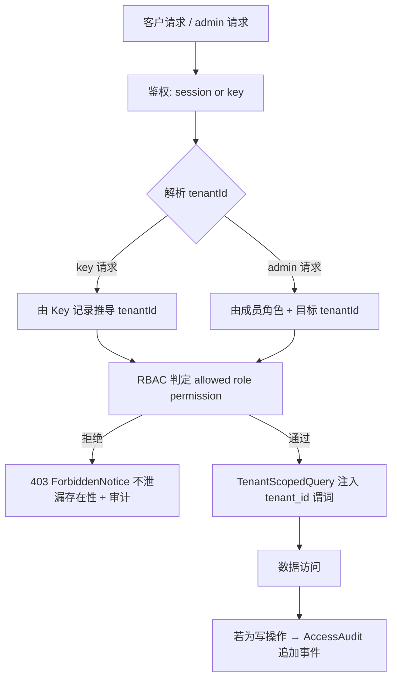
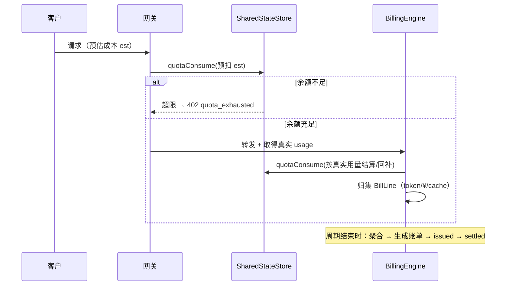
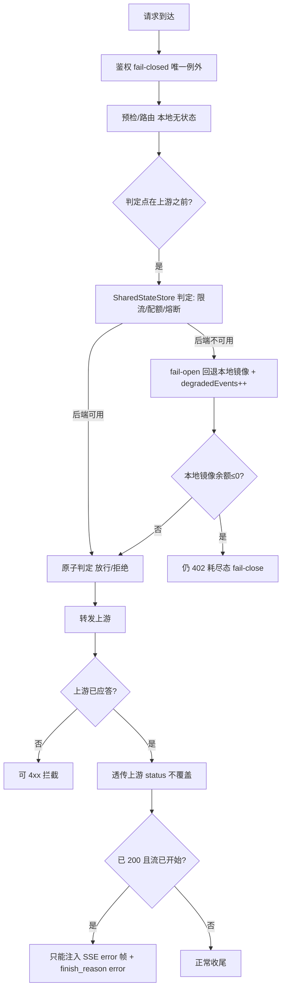
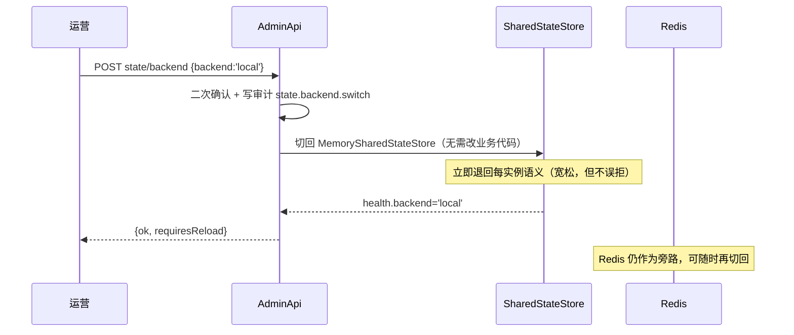
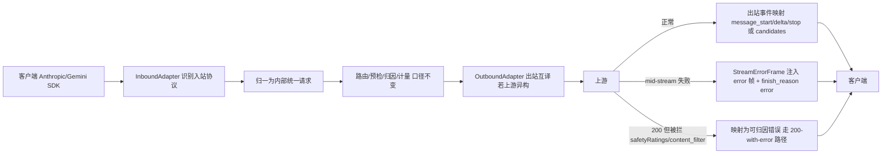
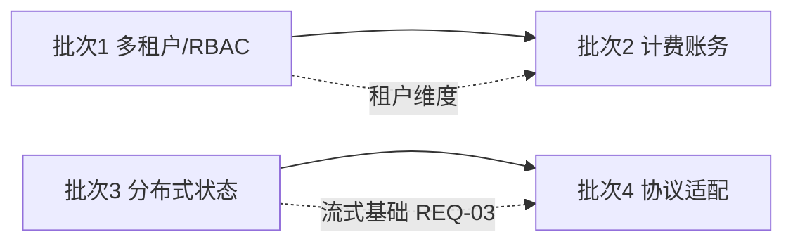

# api-relay 平台化升级 · 四件套可交付方案（评审交付版）

**日期**：2026-10-27
**类型**：产品交付规格（页面清单 + 模块清单 + 组件清单 + 接口契约 + 交互/流程 + 验收标准 + 迁移回滚）
**角色**：产品原型工坊专家团队（产品舵手 主理）
**上游依据**：`deliverables/product-strategy/competitive-analysis-api-relay-platform-2026-10-24.md`、`_parts/multi-instance-tech-plan.md`（REQ-01~14 / AC-01~36）、`project/src/store/shared-state.ts`（REQ-01 最小切片已落地）、`project/src/core/types.ts`（数据契约）、`project/src/admin/api.ts`（路由表）、`project/frontend/src/state.ts`（页面骨架）
**定位**：把"多租户/RBAC、计费账务、分布式状态、协议适配"四件套，从"已知短板"落成**可直接评审、可直接排期、可直接验收**的交付件。本方案**不重复**技术规格书里的实现细节，只补齐产品面（页面/模块/组件/交互）与验收口径，并用编号与既有 REQ/AC 双向映射。

---

## §0 交付说明与编号规则

### 0.1 编号体系（本篇新增，与既有编号正交）

| 前缀 | 含义 | 示例 |
|---|---|---|
| `PG-*` | 页面（Page） | `PG-T01 租户总览` |
| `MOD-*` | 模块（后端/前端能力模块） | `MOD-T1 TenantRegistry` |
| `CMP-*` | 组件（前端可复用组件） | `CMP-T9 TenantSwitcher` |
| `API-*` | 接口（admin/客户面端点） | `API-T3 GET tenants` |
| `DS-*` | 数据模型（新增/变更结构） | `DS-T1 TenantMeta` |
| `AC4-*` | 本篇验收标准（四件套） | `AC4-T01` |

> 映射原则：本篇每条 `AC4-*` 必须能回指一条或多条既有 `AC-01~36`；不产生"新口径"，只把工程验收翻译成**可演示、可点击**的产品验收。

### 0.2 与既有技术规格的边界（不重复造）

- 技术规格书（`multi-instance-tech-plan.md`）回答"**怎么做、怎么对拍、怎么回滚**"；
- 本方案回答"**用户看到什么页面、运营点哪些按钮、客户面被拒时看到什么、评审怎么验收**"；
- 分布式状态的**实现**已在 `shared-state.ts` 落地最小切片，本方案给出**产品面收口**（面板如何展示后端健康、如何切换、如何回滚）与**残留缺口**（并发闸门、key 池、控制面库）的补齐方案。

### 0.3 本方案的 4 个批次（按依赖从低到高）

| 批次 | 件套 | 依赖 | 既有需求映射 | 本批出口门 |
|---|---|---|---|---|
| 批次 1 | 多租户 / RBAC | 无（可单实例先行） | REQ-07 | AC4-T01~T06 |
| 批次 2 | 计费账务（套餐目录/账单/对账） | 批次 1（租户维度） | REQ-04/11 + 竞品 P0 | AC4-B01~B07 |
| 批次 3 | 分布式状态收口 | REQ-01/02/09/10 | REQ-01/02/09/10/13 | AC4-D01~D08 |
| 批次 4 | 协议适配（Anthropic/Gemini） | REQ-03（流式错误帧） | REQ-03/05/06 | AC4-P01~P06 |

---

## §1 全局：四件套的页面 / 模块 / 组件总览

### 1.1 页面清单总表（新增 + 改造）

现有页面骨架（`frontend/src/state.ts`）：总览 / 指标 / 客户 Key / 上游 / 知识库 / Agent / Agent 对话 / 请求账本 / 排障 / 运维 / 信任。

| 编号 | 页面 | 类型 | 归属批次 | 导航分组 | 一句话 |
|---|---|---|---|---|---|
| `PG-T01` | 租户总览 | 新增 | 1 | 配置 | 所有租户的额度/用量/健康一览 |
| `PG-T02` | 租户详情 | 新增 | 1 | 配置 | 单租户的 Key、成员、额度、用量、审计 |
| `PG-T03` | 角色与权限 | 新增 | 1 | 系统 | RBAC 角色-权限矩阵编辑 |
| `PG-T04` | 成员管理 | 新增 | 1 | 系统 | 成员/邀请/角色分配 |
| `PG-T05` | 访问审计 | 新增（复用 diag 事件流） | 1 | 监控 | 越权与敏感操作留痕 |
| `PG-B01` | 套餐目录 | 新增 | 2 | 配置 | 套餐（档位×价格×额度×SLA）定义 |
| `PG-B02` | 账单 | 新增 | 2 | 监控 | 按租户/周期的账单明细 |
| `PG-B03` | 对账报表 | 新增 | 2 | 监控 | WTCS 三段式（计数×单价=金额） |
| `PG-D01` | 状态后端 | 新增 | 3 | 运维 | 共享后端健康/切换/降级事件 |
| `PG-P01` | 协议适配 | 改造上游页 | 4 | 配置 | 每上游声明入站/出站协议 |
| `PG-X01` | 客户端接入向导 | 新增 | 4 | 配置 | 按协议生成 SDK 接入示例 |

**改造（不新增页面，改现有页）**：

| 现有页 | 改造点 | 批次 |
|---|---|---|
| 客户 Key | 增加"租户"列 + 租户筛选 + 批量归属 | 1 |
| 总览 / 指标 / 请求账本 | 顶部加 `租户筛选器`（CMP-T9），数据按 tenantId 过滤 | 1 |
| 上游 | 增加 `protocol`（入站可识别协议）与适配器状态徽标 | 4 |
| 运维 | 增加"状态后端"卡片入口 | 3 |

### 1.2 模块清单总表（后端）

| 编号 | 模块 | 职责 | 归属 |
|---|---|---|---|
| `MOD-T1` | TenantRegistry | 租户元数据 CRUD、默认租户、禁用态 | 1 |
| `MOD-T2` | RbacPolicy | 角色→权限矩阵、判定函数 | 1 |
| `MOD-T3` | TenantScopedQuery | 强制 tenant 谓词的查询封装 | 1 |
| `MOD-T4` | AccessAudit | 越权/敏感操作事件 | 1 |
| `MOD-B1` | Plan（套餐） | 套餐定义、档位绑定、SLA 字段 | 2 |
| `MOD-B2` | BillingEngine | 预扣-结算（复用 `quotaConsume`）与账单归集 | 2 |
| `MOD-B3` | LedgerReport | 周期聚合、对账导出（CSV/JSON） | 2 |
| `MOD-D1` | SharedStateHealth | 后端健康/降级计数（已存在于 `shared-state.ts`） | 3 |
| `MOD-D2` | ConcurrencyLease | 跨实例并发闸门（Redis 租约）——**残留缺口** | 3 |
| `MOD-D3` | DistributedKeyPool | key 轮换/冷却跨实例一致（REQ-09 残留） | 3 |
| `MOD-D4` | ControlPlaneStore | 控制面存储（SQLite 共享卷 → 可选 Postgres） | 3 |
| `MOD-P1` | InboundAdapter | 入站协议识别 + 归一（Anthropic/Gemini） | 4 |
| `MOD-P2` | OutboundAdapter | 出站协议互译（含流式事件映射） | 4 |
| `MOD-P3` | StreamErrorFrame | 流式 mid-stream `error` 帧注入（REQ-03） | 4 |

---

## §2 批次 1 · 多租户 / RBAC

### 2.1 现状与差距（客观）

- **已具备**：`ClientKeyConfig.tenantId`（`types.ts:814`，**必填**）、`KeyRecord.tenantId`、`ClientIdentity.tenantId`（`keys.ts:657`）、meter 记录含 `tenantId`（`meter.ts:290`）、`store` 表有 `tenant_id` 列、匿名流量归 `tenantId='anonymous'`（`engine.ts:1616`）、创建 Key 时有格式校验（`keys.ts:89-94`）。
- **缺失**：① 客户面无 `tenantId` 过滤——`dashboard.ts:1853` 原话"面板以管理令牌鉴权，因此展示全量；**对客户暴露时请按 tenantId 过滤**"仍是注释式待办；② 无 RBAC（现有只有 `adminLogin` / `viewerLogin` 两种登录，`api.ts` 的 `AdminAuth`）；③ 无"租户"实体（租户只是 Key 上的一个字符串，没有元数据、成员、额度帽）。
- **结论**：这是**"差一道谓词 + 一层角色"**的补齐，不是重建。

### 2.2 页面清单

#### `PG-T01` 租户总览

| 区块 | 内容 | 数据来源 |
|---|---|---|
| 顶部统计条 | 租户数 / 活跃租户 / 本周期告警租户 | `GET tenants` 聚合 |
| 租户表 | 列：租户 ID、名称、档位、Key 数、本周期 token、本周期 ¥、状态、健康徽标 | `GET tenants` |
| 筛选 | 按状态（启用/停用/超限）、按档位 | 前端 |
| 行操作 | 进入详情 / 停用 / 重置周期额度（二次确认 + 审计） | `POST tenants/*` |

#### `PG-T02` 租户详情

分 5 个 Tab：**概览 / Key / 成员 / 额度与用量 / 审计**。
- 概览：租户元数据、档位、SLA 徽标、本周期进度条（token 与 ¥ 双口径，**不合并**）。
- Key：该租户的 Key 列表（现有 `keys` 视图按 `tenantId` 过滤）。
- 成员：复用 `PG-T04` 组件，限定本租户。
- 额度与用量：进度 + 充值/调整额度（写操作进审计）。
- 审计：该租户的 `relay_event` 子集。

#### `PG-T03` 角色与权限

- 角色矩阵表：行=权限点（`keys.read` / `keys.write` / `providers.write` / `billing.read` / `billing.write` / `tenants.admin` / `audit.read` …），列=角色（owner / operator / viewer）。
- 交互：勾选即写入 `MOD-T2`；改动进审计；内置角色**不可删**，可复制为自定义角色。
- 约束提示：`tenants.admin` 默认仅 owner；`billing.write` 与 `keys.write` 分离（职责分离，SOD）。

#### `PG-T04` 成员管理

- 成员表：账号、角色、所属租户、最近登录、状态。
- 操作：邀请（生成一次性邀请令牌）、改角色、停用、移出。
- 约束：**任何成员只能被同租户 owner 或平台管理员管理**；跨租户操作返回 403 **且不泄漏目标是否存在**。

#### `PG-T05` 访问审计

- 复用 `diag` 页事件表，增加 `audit` 过滤维度（越权尝试、角色变更、额度调整、Key 轮换）。
- 字段：`actor / tenantId / action / target / result / ts / traceId`。
- 导出：时间范围 CSV/JSON；**明文密钥永不入审计**（仅指纹）。

### 2.3 模块与组件清单

| 编号 | 类型 | 名称 | 职责/接口要点 |
|---|---|---|---|
| `MOD-T1` | 后端 | TenantRegistry | `list/get/create/update/disable`，`default` 租户不可删 |
| `MOD-T2` | 后端 | RbacPolicy | `allowed(role, permission): boolean`；矩阵可热更 |
| `MOD-T3` | 后端 | TenantScopedQuery | 所有客户面查询**必须**经它注入 `tenant_id = ?`；漏加即测试失败 |
| `MOD-T4` | 后端 | AccessAudit | 写 `relay_event`（追加、不可被普通配置删除） |
| `CMP-T9` | 前端 | `TenantSwitcher` | 顶部租户下拉；未选=平台视角（仅平台管理员可见全量） |
| `CMP-T10` | 前端 | `RoleBadge` | 角色徽标（owner/operator/viewer/自定义） |
| `CMP-T11` | 前端 | `ScopeFilter` | 统一的租户/时间/档位筛选条 |
| `CMP-T12` | 前端 | `ForbiddenNotice` | 403 提示，文案**不含**目标租户名（防存在性泄漏） |

### 2.4 接口契约（admin 面，追加到 `api.ts` 路由表）

| 编号 | 方法 | 端点 | 入参 | 出参 | 权限 |
|---|---|---|---|---|---|
| `API-T1` | GET | `/admin/api/tenants` | 无 | `{ tenants: TenantMeta[] }` | `tenants.admin` 或 `viewer`（仅本租户） |
| `API-T2` | POST | `/admin/api/tenants/create` | `{ id, name, tier, quotaCap? }` | `{ ok, tenant }` | `tenants.admin` |
| `API-T3` | POST | `/admin/api/tenants/update` | `{ id, name?, status?, quotaCap? }` | `{ ok }` | `tenants.admin` |
| `API-T4` | GET | `/admin/api/roles` | 无 | `{ roles, permissions }` | `tenants.admin` |
| `API-T5` | POST | `/admin/api/roles/update` | `{ role, permissions[] }` | `{ ok }` | `tenants.admin` |
| `API-T6` | GET | `/admin/api/members` | `?tenantId=` | `{ members }` | `tenants.admin` 或本租户 owner |
| `API-T7` | POST | `/admin/api/members/invite` | `{ tenantId, role }` | `{ ok, inviteToken }` | owner / `tenants.admin` |
| `API-T8` | POST | `/admin/api/members/role` | `{ memberId, role }` | `{ ok }` | owner / `tenants.admin` |

**统一错误口径**（不新增口径，沿用现有错误契约）：
- 越权：`403`，body `{ error: { type: 'access_denied', message: 'forbidden' } }`，**不附带目标 tenantId**；
- 字段非法：`400`（沿用 `keys.ts` 的 tenantId 正则 `^[a-zA-Z0-9_-]{1,64}$`）。

### 2.5 关键流程（请求隔离）



### 2.6 验收标准（AC4-T）

| 编号 | 验收 | 演示动作 | 映射 |
|---|---|---|---|
| `AC4-T01` | 跨租户读取被拒且不泄漏存在性 | 用租户 A 请求租户 B 的 Key 列表 → `403`，响应体不含 `B` 名称/ID | AC-23 |
| `AC4-T02` | 全端点强制 tenant 谓词 | 静态检查 + 对拍：构造 A/B 样本，断言 B 数据在 A 视角为 0 条 | AC-24 |
| `AC4-T03` | RBAC 生效 | viewer 调 `keys/create` → `403`；operator 调 `billing.write` → `403`（SOD） | AC-24 |
| `AC4-T04` | 审计不可被普通动作删除 | 执行 `keys/delete` 后重查审计，记录仍在 | AC-25 |
| `AC4-T05` | 明文零落盘 | 导出审计，正则扫描无明文 key（仅指纹） | AC-26 |
| `AC4-T06` | 老 Key 兼容 | 无 `tenantId` 的存量 Key 归入 `default`，客户端**原样可调用** | AC-30 |

---

## §3 批次 2 · 计费账务

### 3.1 现状与差距（客观）

- **已具备**：`TierPolicy.billing: 'none' | 'token' | 'subscription'`；双口径额度 `periodQuotaTokens` 与 `periodQuotaCny`（`types.ts:36-42`，注释已说明"钱要按钱算"）；周期类型 `quotaPeriod: 'rolling30d' | 'calendarMonth'`（`types.ts:49`）；`meter` 落 `relay.cost.total` 等；"请求账本"页（`ledger`）已存在；WTCS"计数×单价=金额"三段式口径已在竞品分析 §2.2 定义。
- **缺失**：① 没有**套餐（Plan）实体**——档位（free/standard/pro）是内置常量 `DEFAULT_TIERS`，无法对外变成"可售卖套餐目录"；② 没有**账单（Bill）**——用量有，出账没有，"按周期给客户开发票/账单"这条链路断的；③ 没有**对账报表**——客户无法用 `计数 × 单价` 自己复算（这正是对外承诺的可对账性）；④ **成本路由自动化**（REQ-04）未做，`cost` 缺失时静默退化（`README §11`）。
- **结论**：缺的是"**账**"这一层：从"看得见用量"到"能出账、能对账、能解释每一分钱"。

### 3.2 页面清单

#### `PG-B01` 套餐目录

- 套餐表：列 `套餐名 / 绑定档位 / 计费模式 / 周期 / 额度(token) / 额度(¥) / RPM / 并发 / SLA / 价格 / 状态`。
- 编辑抽屉：修改上列字段；`binding tier` 从内置档位选择；改价**必须**写审计并提示"影响后续账单，不追溯历史账单"。
- 校验：`token` 与 `¥` 两种额度**可同时为空（不限）或各自独立设置**，不得用一个冒充另一个（沿用口径纪律）。

#### `PG-B02` 账单

- 顶部筛选：租户 / 周期（自然月或滚动 30 天，随套餐 `quotaPeriod`）/ 档位。
- 账单表（`BillLine`）：`租户 / 套餐 / 周期 / 输入 token / 输出 token / cache 命中 token / 上游成本¥ / 应收¥ / 状态`。
- 明细下钻：点击行 → 该周期请求账本子集（复用 `ledger` 视图）。
- 导出：单租户/全量 CSV/JSON。
- 状态机：`draft → issued → settled`（settled 后不可改，需红冲）。

#### `PG-B03` 对账报表

- 核心表：**WTCS 三段式**——`计数（失败且上游已返回 usage 的请求数 × prompt/completion 单价）/ 单价 / 金额`，逐行给全公式。
- 复核区：客户可输入自己的单价复算，页面即时显示"我方值 vs 客户复算值 vs 差异"。
- 护栏指标区：`relay_error = 0`、`预检降级放行 PD = 0`、`降损层自身开销占比`。
- 导出：对账报表 CSV/JSON（**可对外**）。

### 3.3 模块与组件清单

| 编号 | 类型 | 名称 | 职责/要点 |
|---|---|---|---|
| `MOD-B1` | 后端 | Plan | 套餐 CRUD；`planForTier(tier)`；价格/额度/SLA 字段 |
| `MOD-B2` | 后端 | BillingEngine | 复用 `SharedStateStore.quotaConsume`（预扣/结算）；周期聚合；账单状态机 |
| `MOD-B3` | 后端 | LedgerReport | 周期聚合、WTCS 复算、导出（CSV/JSON）、护栏指标 |
| `CMP-B9` | 前端 | `PlanEditor` | 套餐表单抽屉（含双口径额度校验） |
| `CMP-B10` | 前端 | `BillTable` | 账单表 + 明细下钻 |
| `CMP-B11` | 前端 | `ReconciliationPanel` | 客户复算对照 + 差异高亮 |
| `CMP-B12` | 前端 | `CostSourceBadge` | 成本来源徽标：`config` / `reference` / `unknown` |

### 3.4 接口契约

| 编号 | 方法 | 端点 | 入参 | 出参 | 权限 |
|---|---|---|---|---|---|
| `API-B1` | GET | `/admin/api/plans` | 无 | `{ plans }` | `billing.read` |
| `API-B2` | POST | `/admin/api/plans/update` | `{ id, patch }` | `{ ok }` | `billing.write` |
| `API-B3` | GET | `/admin/api/bills` | `?tenantId&period` | `{ bills: BillLine[] }` | `billing.read` |
| `API-B4` | POST | `/admin/api/bills/issue` | `{ period, tenantId? }` | `{ ok, issued }` | `billing.write` |
| `API-B5` | GET | `/admin/api/recon` | `?tenantId&from&to` | `{ wtcs, guards, lines }` | `billing.read` |
| `API-B6` | GET | `/admin/api/recon/export` | `?tenantId&from&to&format=csv\|json` | 文件流 | `billing.read` |

**错误口径**：额度耗尽 `402`（非 429，沿用 ADR-005）；账单状态非法流转 `409`。

### 3.5 数据模型（新增）

```ts
// DS-B1 Plan（套餐）
interface Plan {
  id: string;              // 如 'pro-2026q4'
  label: string;
  tier: TierId;            // 绑定内置档位
  billing: 'none' | 'token' | 'subscription';
  quotaPeriod: 'rolling30d' | 'calendarMonth';
  periodQuotaTokens: number | null;
  periodQuotaCny: number | null;
  rpm: number | null;
  maxConcurrency: number | null;
  sla?: { uptime?: string; ttfbP95Ms?: number };
  priceCny?: number;       // 订阅价（billing=subscription 时）
  status: 'draft' | 'active' | 'archived';
}

// DS-B2 BillLine（账单行，只加不改历史）
interface BillLine {
  tenantId: string;
  planId: string;
  period: string;          // '2026-10'
  inputTokens: number;
  outputTokens: number;
  cachedTokens: number;
  upstreamCostCny: number; // 上游实付
  receivableCny: number;   // 应收
  status: 'draft' | 'issued' | 'settled';
}
```

### 3.6 关键流程（预扣-结算-出账）



### 3.7 验收标准（AC4-B）

| 编号 | 验收 | 演示动作 | 映射 |
|---|---|---|---|
| `AC4-B01` | 双口径独立不冒充 | 同一 Key 设 token 额度=不限、¥ 额度=¥10，花到 ¥9.9 → 第 4 次 `402`，且 token 计数正常继续 | AC-02 |
| `AC4-B02` | 成本缺失不静默 | 上游无 `cost` → 上游页/启动横幅显示"缺失 cost 模型数"，路由 trace 带 `route_reason` | AC-21 |
| `AC4-B03` | 保守偏序可解释 | 部分上游有 cost → trace 能回答"为什么走这家" | AC-22 |
| `AC4-B04` | 账单可复算 | 任取一条 BillLine：`Σ usage × 单价 = 应收`，客户在 `ReconciliationPanel` 复算差异=0 | 竞品 §2.2 |
| `AC4-B05` | 账单状态机 | `issued` 后直接改 → 被拒 `409`，需红冲 | 本篇 |
| `AC4-B06` | 对账可导出 | 导出 CSV/JSON，字段齐全且**明文密钥零出现** | AC-26 |
| `AC4-B07` | 周期口径一致 | `calendarMonth` 与 `rolling30d` 两模式切换后，额度重置时刻正确（取周期起点与重置时刻较晚者） | 竞品 §2.5 |

---

## §4 批次 3 · 分布式状态收口（含迁移与回滚）

### 4.1 现状与差距（客观）

- **已实现（不可忽视的进展）**：`project/src/store/shared-state.ts` 已把"限流 / 配额 / 熔断"收敛为一个异步接口 `SharedStateStore`（别名 `RateQuotaStore`）：
  - `MemorySharedStateStore`：单机默认，`fromStore(store)` 包装现有 `Store`，**单实例语义零回归**；
  - `RedisSharedStateStore`：**不 import 任何第三方 Redis 包**，只依赖注入的 `RedisCommandRunner`；未注入 runner 时 `createSharedState` **强制回退内存**——"零硬依赖"在代码层被强制；
  - fail-open：共享后端异常 → 回退进程内镜像 + `degradedEvents++`；**唯一 fail-closed 是鉴权**；
  - 半开试探令牌 `SET NX PX`（全局仅 1 个）、配额双口径独立 `INCRBY/INCRBYFLOAT`（Lua 原子）；
  - 配套测试：`test/fake-redis.ts`、`test/shared-state.test.ts`、`test/shared-state-multi.test.ts`。
  - 配置位 `config.state.backend: 'local' | 'redis'` + `failOpenOnRedisDown` 已存在（`config.ts:151`）。
- **显式残留（`shared-state.ts` 头部已自认，不假装完成）**：
  1. **并发闸门** `ConcurrencyLimiter` 仍是进程内计数，跨实例不可共享（需 Redis 计数租约 + 释放语义）；
  2. **熔断热路径读取**（`ProviderPool.isOpen`，被同步的 `Router.route` 调用）仍以本地 health 为准，跨实例可见靠"写镜像 + `refreshBreakersFromShared()` 拉取"，**异步读取尚未落地**（REQ-02）；
  3. **key 池跨实例**（轮换游标/冷却/报废共享，REQ-09）未做；
  4. **控制面存储**默认单库 SQLite，多实例共库的 Postgres 路径（REQ-10）未做；
  5. **滚动排空**（REQ-13）未做；
  6. **Redis 客户端选型**（Q1：自研极小 RESP2 vs 引入依赖）未定。

### 4.2 页面清单

#### `PG-D01` 状态后端（运维页新增卡片 + 详情）

| 区块 | 内容 | 数据来源 |
|---|---|---|
| 后端健康卡 | `backend: local\|shared`、`ok`、`degradedEvents`、`lastError` | `GET state/health`（源自 `SharedStateStore.health()`） |
| 降级事件流 | 时间、事件类型（`redis_unavailable` 等）、实例 ID、计数 | `GET state/degraded` |
| 后端切换 | 下拉 `local / redis`（**写操作，二次确认 + 审计**），提示需重启/热载 | `POST state/backend` |
| 一致性自检 | "N 实例一致性对拍"入口：触发对拍并展示差异率 | `POST state/selftest` |
| 残留缺口清单 | 并发闸门/熔断热路径/key 池 的当前状态徽标（`已共享`/`进程内`） | 静态 + 运行时 |

### 4.3 模块与组件清单

| 编号 | 类型 | 名称 | 职责/要点 | 状态 |
|---|---|---|---|---|
| `MOD-D1` | 后端 | SharedStateHealth | `health()` / `degradedEvents` 聚合 | **已存在**（`shared-state.ts`） |
| `MOD-D2` | 后端 | ConcurrencyLease | 跨实例并发闸门：`SET NX PX` 租约 + 释放 + 心跳续约 + 崩溃 TTL 兜底 | 待建（REQ-01 残留） |
| `MOD-D3` | 后端 | DistributedKeyPool | key 轮换游标/冷却/报废跨实例一致；Redis 故障降级实例内 | 待建（REQ-09） |
| `MOD-D4` | 后端 | ControlPlaneStore | `storage.driver=sqlite\|postgres`；数据面**不依赖**控制面 | 待建（REQ-10） |
| `MOD-D5` | 后端 | GracefulDrain | SIGTERM 后停接新单、在途（含流式）排空 | 待建（REQ-13） |
| `CMP-D9` | 前端 | `BackendHealthCard` | 健康卡（backend/ok/degraded/lastError） | 待建 |
| `CMP-D10` | 前端 | `DegradedEventsList` | 降级事件列表 | 待建 |
| `CMP-D11` | 前端 | `BackendSwitch` | 后端切换（含确认与影响提示） | 待建 |

### 4.4 接口契约

| 编号 | 方法 | 端点 | 入参 | 出参 | 权限 |
|---|---|---|---|---|---|
| `API-D1` | GET | `/admin/api/state/health` | 无 | `SharedStateHealth` | `providers.read` |
| `API-D2` | GET | `/admin/api/state/degraded` | `?limit` | `{ events }` | `providers.read` |
| `API-D3` | POST | `/admin/api/state/backend` | `{ backend: 'local'\|'redis' }` | `{ ok, requiresReload }` | `providers.write`（**admin**） |
| `API-D4` | POST | `/admin/api/state/selftest` | `{ instances? }` | `{ diffRate, details }` | `providers.write` |

> `health()` 返回结构（已定义，直接复用）：`{ backend, ok, degradedEvents, lastError? }`。

### 4.5 关键流程

**A. 请求路径（含 fail-open 分阶段）**



**B. 回滚切换（运营一键）**



### 4.6 迁移路径（复用技术规格书 §4 三步法，产品化）

> **原则**："**双写-影子比对-切换**"三步法，不停机、可回滚；`state.backend` 与 `storage.driver` 作为**永久回退开关**。

| 阶段 | 动作 | 产品面表现 | 出口门 |
|---|---|---|---|
| **M0 准备** | 打通 Redis 连接与 HA；新增外置后端实现 + 开关（默认仍走原后端） | `PG-D01` 显示 `backend=local`，`degradedEvents=0` | 连通性演练通过 |
| **M1 影子比对** | 线上仍以原后端判定；**影子写**外置后端（Fire-and-forget） | `PG-D01` 显示影子差异率 | 限流/配额差异=0，持续 ≥N 小时 |
| **M2 单实例金丝雀** | 选 1 实例把判定源切到共享后端，其余不动 | 该实例 `backend=shared` | 误拒/超发=0 |
| **M3 数据迁移** | `key_meta` 按行迁哈希（不涉明文）；周期额度合并汇总写入；审计/度量增量同步 | 抽检指纹一致、用量一致 | AC-30 / AC-31 |
| **M4 Postgres（可选）** | 仅当控制面写热点/锁竞争超阈值才实施 | `storage.driver=postgres` | AC-27 / AC-28 |

### 4.7 回滚方案

| 层级 | 回滚动作 | 触发条件 | 结果 |
|---|---|---|---|
| 判定源 | `state.backend=local`（热载/重启） | 出现超发/误拒 | 退回每实例语义（宽松不误拒） |
| Redis 故障 | 自动 fail-open（无需人工） | 连接超时/不可用 | 服务不中断 + `degradedEvents` |
| 控制面库 | 切回原 `storage.path` | 新库不可用/数据异常 | 数据面零影响 |
| 数据迁移 | 恢复迁移前库快照（每 24h 备份） | 额度/哈希错位 | 回滚快照，key 指纹不变 |
| Postgres | `driver=sqlite` | 触发条件误判 | 回共享卷 SQLite |

> **回滚不变量**：任何回滚**不得**导致 ① "用户手上的 key 失效" ② "成功响应被改写"。

### 4.8 验收标准（AC4-D）

| 编号 | 验收 | 演示动作 | 映射 |
|---|---|---|---|
| `AC4-D01` | 3 实例共享后端 `rpm=20` 并发 60 → 恰好 20 放行 / 40 个 429 | N=3 对拍 | AC-01 |
| `AC4-D02` | 预算跨实例花到 ¥9.9 → 下一次 402，后端余额不为负 | 并发对拍 | AC-02 |
| `AC4-D03` | 后端不可用 → 请求照常 + `degradedEvents` 面板可见；耗尽态仍 402 | 主动宕机演练 | AC-03 / AC-32 |
| `AC4-D04` | 单实例熔断 → 其他实例立即生效；半开全局仅 1 试探 | N=3 集成 | AC-05 / AC-06 |
| `AC4-D05` | key 池：A 报废的 key，B 不再选 | 双实例对拍 | AC-08 / AC-09 |
| `AC4-D06` | `state.backend` 一键切回 local，服务不中断、无 key 失效 | 面板操作 + 演练 | AC-32 |
| `AC4-D07` | `driver=sqlite` 向后兼容零回归；`postgres` 多实例并发写一致 | 新旧驱动对拍 | AC-27 / AC-28 |
| `AC4-D08` | SIGTERM 后停接新单、在途（含流式）排空后退出；`/healthz` 反映 inflight | 滚动升级演练 | AC-10 |

---

## §5 批次 4 · 协议适配（Anthropic / Gemini）

### 5.1 现状与差距（客观）

- **已具备**：类型位已留好——`UpstreamProtocol = 'openai' | 'anthropic' | 'gemini'`（`types.ts:93`）、`ProviderConfig.protocol`（`types.ts:107`）、`ProviderConfig.auth.format` 支持 `bearer / bearerless / api-key-header / x-api-key`（`types.ts:172-176`，对应 Anthropic 的 `x-api-key`）；多上游多 key 池已就绪。
- **缺失**：① 只实现了 **OpenAI 兼容直通**，`anthropic` / `gemini` 是"留了实现位"（`README §11`）；② **流式 mid-stream `error` 帧**（REQ-03）未实现，而它是协议适配必须共用的流式基础；③ 无"客户端按协议接入"的向导与 SDK 片段。
- **顺序**：REQ-03 是协议适配的**前置**（Anthropic 的 `message_delta`、Gemini 的 `safetyRatings` 拦截都需要统一的"流中错误/200-with-error"表达）。

### 5.2 页面清单

#### `PG-P01` 协议适配（改造"上游"页）

- 每上游行增加：`入站协议徽标`、`适配器状态`（`直通` / `互译` / `未启用`）、`最近适配耗时`。
- 详情抽屉：入站/出站协议选择、支持的语义子集声明（哪些字段保证互译、哪些不支持）。

#### `PG-X01` 客户端接入向导

- 选择客户端协议（OpenAI SDK / Anthropic SDK / Gemini SDK）→ 生成对应 init 片段 + baseURL。
- 只读展示，不写配置；复制即用（零 CDN 依赖，内联实现，符合现有面板纪律）。

### 5.3 模块与组件清单

| 编号 | 类型 | 名称 | 职责/要点 |
|---|---|---|---|
| `MOD-P1` | 后端 | InboundAdapter | 入站协议识别（`/v1/messages`、`generateContent`）+ 归一为统一内部请求 |
| `MOD-P2` | 后端 | OutboundAdapter | 出站协议互译（OpenAI ⇄ Anthropic ⇄ Gemini），流式事件映射 |
| `MOD-P3` | 后端 | StreamErrorFrame | mid-stream 注入 SSE `error` 帧 + `finish_reason:'error'`（REQ-03，分层投递） |
| `CMP-P9` | 前端 | `ProtocolBadge` | 入站协议徽标 |
| `CMP-P10` | 前端 | `AdapterStatus` | 适配器状态（直通/互译/未启用） |
| `CMP-P11` | 前端 | `SdkSnippet` | SDK 接入片段（可复制） |
| `CMP-P12` | 前端 | `StreamErrorPreview` | 流中错误帧预览（评审演示用） |

### 5.4 接口契约

| 编号 | 方法 | 端点 | 说明 | 权限 |
|---|---|---|---|---|
| `API-P0` | GET | `/admin/api/protocols` | 已支持的入站协议与子集声明 | `providers.read` |
| `API-P1` | GET | `/admin/api/protocols/sdk-snippet` | `?client=openai\|anthropic\|gemini` → 片段 | `providers.read` |
| `API-P2` | POST | `/admin/api/protocols/selftest` | 触发协议对拍 | `providers.write` |
| `API-P3` | 客户面 | `/v1/messages` | Anthropic Messages 入站（已存在于 README 端点表） | key 鉴权 |
| `API-P4` | 客户面 | `/v1/models/{model}:generateContent` | Gemini 入站 | key 鉴权 |

**错误契约（协议无关，统一口径）**：
- 沿用 OpenRouter 已定的行业口径——`error.metadata.error_type` 词表 + `provider_code` + `Retry-After`；
- **HTTP 200 + body 内 `error` + `finish_reason:'error'`** 表达"中途流式失败"；
- 500 类脱敏、非 500 透出 `provider_code`（分级暴露）；
- 归因字段复用**同一** `failure_reason` 枚举，**不新增**（ADR-011 口径一致）。

### 5.5 关键流程（协议互译 + 流中错误）



### 5.6 验收标准（AC4-P）

| 编号 | 验收 | 演示动作 | 映射 |
|---|---|---|---|
| `AC4-P01` | Anthropic SDK 指向本网关可通，`messages` 响应与 SSE 事件合法 | SDK 实调 | AC-16 |
| `AC4-P02` | Anthropic↔OpenAI 互译不丢必填语义；不支持的字段**显式报错**而非静默丢 | 契约对拍 | AC-17 |
| `AC4-P03` | Gemini SDK 可通；`candidates/parts` 互译与流式分帧正确 | SDK 实调 | AC-18 |
| `AC4-P04` | Gemini `safetyRatings` 拦截映射为可归因错误（200-with-error） | 触发拦截 | AC-19 |
| `AC4-P05` | 新协议入口的归因枚举与计量口径与 OpenAI 入口**完全一致** | 口径对拍 | AC-20 |
| `AC4-P06` | 流中失败：pro 层注入含归因的 `error` 帧，free 层零附加，正常流逐字节不变 | mock 注入"流中断" | AC-11~15 |

---

## §6 全局验收清单（四件套汇总 · 27 条）

> 说明：以下为本方案新增的**产品验收**（`AC4-*`），每条已映射既有工程验收 `AC-01~36`。评审时可"先勾 AC4，再回溯 AC"。

**批次 1 · 多租户/RBAC（6）**：`AC4-T01` 跨租户 403 不泄漏存在性 ｜ `AC4-T02` 全端点强制 tenant 谓词 ｜ `AC4-T03` RBAC+SOD 生效 ｜ `AC4-T04` 审计不可删 ｜ `AC4-T05` 明文零落盘 ｜ `AC4-T06` 老 Key 兼容。

**批次 2 · 计费账务（7）**：`AC4-B01` 双口径不冒充 ｜ `AC4-B02` 成本缺失不静默 ｜ `AC4-B03` 保守偏序可解释 ｜ `AC4-B04` 账单可复算 ｜ `AC4-B05` 账单状态机 ｜ `AC4-B06` 对账可导出且明文零出现 ｜ `AC4-B07` 周期口径一致。

**批次 3 · 分布式状态（8）**：`AC4-D01` N=3 限流一致 ｜ `AC4-D02` 预算不超扣 ｜ `AC4-D03` fail-open + `degradedEvents` ｜ `AC4-D04` 熔断全局 + 半开令牌 ｜ `AC4-D05` key 池跨实例 ｜ `AC4-D06` 一键回滚 ｜ `AC4-D07` 驱动兼容/一致 ｜ `AC4-D08` 滚动排空。

**批次 4 · 协议适配（6）**：`AC4-P01` Anthropic SDK 可通 ｜ `AC4-P02` 互译不丢语义 ｜ `AC4-P03` Gemini 可通 ｜ `AC4-P04` 拦截可归因 ｜ `AC4-P05` 口径一致 ｜ `AC4-P06` 流中错误分层投递。

**横切红线（评审必查，不可豁免）**：
- **红线 1**：成功响应**逐字节透传**（`AC-33`）；
- **红线 3**：治理层/状态层异常 fail-open，唯一 fail-closed 是鉴权（`AC-34`）；
- **红线 4**：数据面 `dependencies: {}` 仍成立，Redis/PG 不污染数据面（`AC-35`）；
- **零回归**：既有单测与冒烟全绿（`AC-36`）。

---

## §7 页面 / 组件 / 接口总表（评审速查）

### 7.1 新增页面（10）+ 改造页面（1）

| 页面 | 批次 | 主接口 | 核心组件 |
|---|---|---|---|
| `PG-T01` 租户总览 | 1 | `tenants` | `ScopeFilter`, `RoleBadge` |
| `PG-T02` 租户详情 | 1 | `tenants`, `keys`, `members` | `TenantSwitcher` |
| `PG-T03` 角色与权限 | 1 | `roles`, `roles/update` | — |
| `PG-T04` 成员管理 | 1 | `members*` | `RoleBadge` |
| `PG-T05` 访问审计 | 1 | `events` | `ForbiddenNotice` |
| `PG-B01` 套餐目录 | 2 | `plans*` | `PlanEditor` |
| `PG-B02` 账单 | 2 | `bills*` | `BillTable` |
| `PG-B03` 对账报表 | 2 | `recon*` | `ReconciliationPanel` |
| `PG-D01` 状态后端 | 3 | `state/*` | `BackendHealthCard`, `BackendSwitch` |
| `PG-P01` 协议适配（改） | 4 | `protocols` | `ProtocolBadge`, `AdapterStatus` |
| `PG-X01` 接入向导 | 4 | `protocols/sdk-snippet` | `SdkSnippet` |

### 7.2 新增接口（≈31 个）

- 批次 1：`API-T1~T8`（8）
- 批次 2：`API-B1~B6`（6）
- 批次 3：`API-D1~D4`（4）
- 批次 4：`API-P0~P4`（5）+ 客户面复用现有端点
- 数据模型：`DS-T1 TenantMeta`、`DS-B1 Plan`、`DS-B2 BillLine`

### 7.3 新增/复用组件（15）

`TenantSwitcher / RoleBadge / ScopeFilter / ForbiddenNotice / PlanEditor / BillTable / ReconciliationPanel / CostSourceBadge / BackendHealthCard / DegradedEventsList / BackendSwitch / ProtocolBadge / AdapterStatus / SdkSnippet / StreamErrorPreview`（新增 15 个，均零 CDN 依赖、内联实现，遵循现有面板纪律）。

---

## §8 批次依赖与建议排期



| 批次 | 依赖 | 可先行的理由 | 必须在多实例前完成的硬门 |
|---|---|---|---|
| 1 多租户/RBAC | 无 | `tenantId` 已落库，本质是"加谓词 + 加角色" | 是（隔离需在多实例前，否则多副本放大泄漏面） |
| 2 计费账务 | 批次 1（租户维度） | 复用 `quotaConsume`，账目层独立 | 否（但越早越好，直接决定"能不能卖"） |
| 3 分布式状态 | REQ-03 与批次4 共享流式基础 | 最小切片已落地 | **是**（首个多实例部署必须阻塞于 REQ-01/02） |
| 4 协议适配 | 批次 3 的 REQ-03 | 单实例即可交付入站适配 | 否 |

> **排期建议**：批次 1 与批次 3 的"低依赖项（REQ-03/04）"可并行起跑；批次 3 的分布式核心（REQ-01/02/09）**必须在首次多实例部署前**完成，不能无限期滞后（`REQ §6` 明确）。

---

## §9 开放问题与交付自检

### 9.1 开放问题（承接技术规格 Q1~Q8，需在实现前裁决）

| # | 问题 | 影响批次 |
|---|---|---|
| Q1 | Redis 客户端走**自研极小 RESP2** 还是引入依赖？ | 3 |
| Q2 | Postgres 迁移的**量化触发条件**？ | 3 |
| Q3 | 周期额度用**滚动窗口**还是**自然周期**？ | 2 / 3 |
| Q4 | 流中 `error` 帧**最终格式**（15 字兼容）？ | 4 |
| Q5 | 多租户 `tenantId` **缺省策略**（老 Key 归属）？ | 1 |
| Q6 | Anthropic/Gemini **支持子集边界**？ | 4 |
| Q7 | 审计**留存周期与不可篡改强度**？ | 1 |
| Q8 | 成本**参考价目来源与更新频率**？ | 2 |

### 9.2 交付自检（本方案自证）

- [x] 四件套均含**页面清单 + 模块清单 + 组件清单 + 接口契约 + 验收标准**；
- [x] 批次 3 含**完整迁移路径（M0~M4）与回滚方案（5 层级）+ 回滚不变量**；
- [x] 全部 `AC4-*` 均可回指既有 `AC-01~36`，**不产生新口径**；
- [x] 方案**贴合真实代码**：`tenantId`/`storage.driver`/`state.backend`/`SharedStateStore` 现状均已核实并标注"已存在 / 残留缺口"；
- [x] 横切红线（成功响应零改写 / fail-open / 数据面零依赖 / 零回归）逐条列入评审必查；
- [x] 未虚构进度：已落地项与待建项**显式区分**（见各批次"现状与差距"）。

---

> 本方案由产品原型工坊专家团队协作生成，作为平台四件套的**评审交付基线 v1.0**。§9.1 的 Q1~Q8 与各批次 ⚠ 项需在实现前由产品负责人裁决。