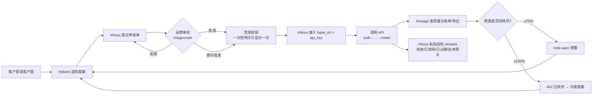
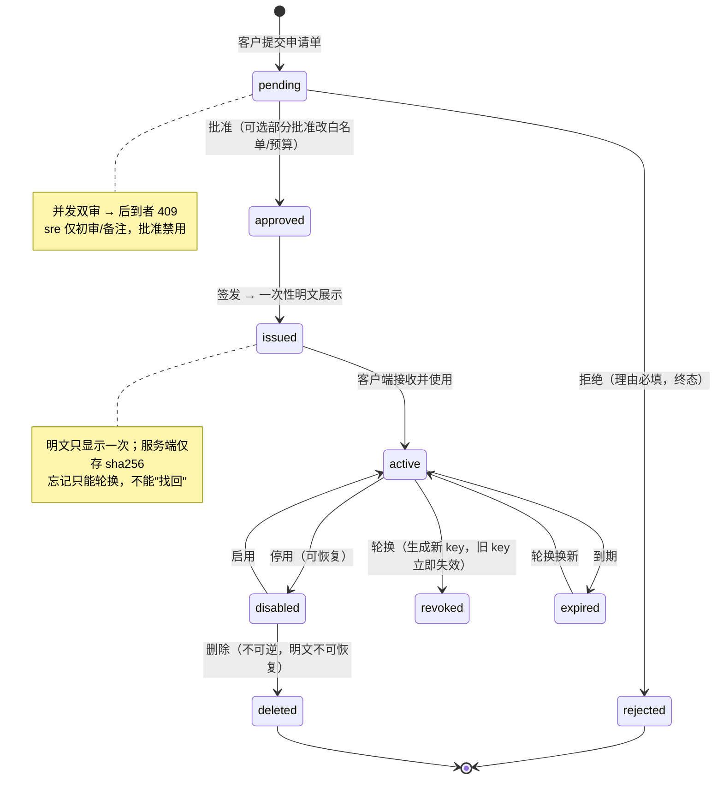
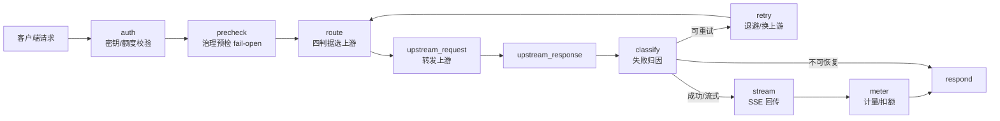

# 阶段5 · 交付说明文档（design-proto/05-delivery.md）

> 项目：api-relay（OpenAI 兼容的多上游聚合中转网关 + 内嵌 Preact 管理面板）
> 本轮性质：**设计原型（Design Proto）导出交付** —— 不改动任何运行时代码（阶段1 Q1 默认取值）
> 作者：导出交付专家 ｜ 版本：v1.0 ｜ 日期：2026-10-24
> 唯一输入基线：`design-proto/01-discovery.md`（需求基线）、`design-proto/02-design-system.md`（设计令牌）、`design-proto/03-prototype-spec.md`（原型规格 9 大块 + AC-01~AC-44）、`design-proto/prototype/index.html`（审查通过高保真原型，v1.2：172,476B / 2074 行；本轮审查清单修复后 175,102B / 2108 行）、`design-proto/prototype/README.md`
> 放行依据：`design-proto/04-review.md`（复审版 v1.2）——**5 维 24/25，P0=0，P1=0，PASS（放行）**

> **给阅读者的一句话**：本文是阶段5 的**交付事实源**。所有交付物路径、大小、打开方式、范围、页面/组件/验收清单均可回溯到本文某节；原型内的任何页面/模块/字段/交互以 `03-prototype-spec.md` 为准。

---

## 阅读导航

| # | 章节 | 它回答什么 |
|---|---|---|
| 0 | 交付总览 | 交付了什么、放行依据、开箱即用结论 |
| 1 | 交付清单 | 文件、格式、大小、打开方式 |
| 2 | 原型说明 | 范围、双面、如何浏览、如何切换主题/密度/角色 |
| 3 | 流程图 | 客户自助闭环 / 密钥审批流 / 请求生命周期 / 计费额度闸（mermaid） |
| 4 | 页面清单 | 运营面 15 页 + 客户面 6 页 = 21 页逐页路由/目标/关键模块 |
| 5 | 组件清单 | 复用组件 + 令牌引用 + 状态 |
| 6 | 验收标准 | AC-01~AC-44 可勾选汇总表 + 已演示/待真值标注 |
| 7 | 设计决策说明 | Linear 基因 / 沿用色值 / 双密度 / 令牌→CSS 变量映射 |
| 8 | 质量审查结论摘要 | 24/25 · P0=0/P1=0 · PASS |
| 9 | 后续迭代建议 | Q1–Q12 + M1–M10 + 04 残留建议 · 优先级路线图 |
| 10 | 交接与迁移注意事项 | 设计原型 ≠ Preact 工程 · 迁移点与兼容复核 |

---

## 0. 交付总览

### 0.1 一句话交付结论

原型已完成质量审查并 **PASS 放行**（`04-review.md` v1.2：5 维 24/25、P0=0、P1=0）。已导出为 **开箱即用** 的四类交付物（独立 HTML / PDF / PPTX / ZIP），**零外部依赖、离线可打开、无需安装任何依赖或启动服务**。

### 0.2 开箱即用自检结论

| 自检项 | 结论 | 证据（客观实测） |
|---|---|---|
| 无外部 CDN / 图标库 / JS 框架 | ✅ | `<link>`=0、``=0、`url(`=0、`@import`=0、`cdn`=0 |
| 所有 CSS 内联 | ✅ | 单 `<style>` 内嵌于 `<head>` |
| 所有 JS 内联 | ✅ | 单 `<script>` 内嵌，无远程 `src` |
| 图标零依赖 | ✅ | 仅文本符号 / 内联 SVG（`●▲■◆○` 等），无图标字体 |
| 字体零依赖 | ✅ | 仅系统字体栈（`-apple-system`/`Segoe UI`/`Microsoft YaHei`…），无 webfont |
| 离线双击可开 | ✅ | 8 处 `https://` 均为**示例域名文本** `api-relay.example.com`（非资源引用） |
| hash 切页可用 | ✅ | `#/ov`、`#/keys` 等 21 条路由，刷新/直达停留原页 |
| 中文渲染正常 | ✅ | UTF-8 + 系统中文栈，PDF 中文无方框乱码 |

### 0.3 本部分元信息

- **目标**：让用户 30 秒内确认"拿到的东西能否直接用"。
- **输入**：`prototype/index.html`、`04-review.md` §1/§8。
- **产出物**：交付结论、开箱即用自检表。
- **关键决策**：① 以客观脚本校验（外链计数、语法）替代主观判断；② 8 处 `https` 明确判定为示例文本，不视为外链缺陷。
- **风险与待办**：静态代码审查未跑真机全流程；`inert`/`color-mix`/`100dvh` 兼容性见 §10。

---

## 1. 交付清单（文件 / 格式 / 大小 / 打开方式）

### 1.1 交付目录

**绝对路径**：`C:\Users\Admin\Downloads\api-relay+落幕+v1.0.0+li1119489753@outlook.com (2)\api-relay+落幕+v1.0.0+li1119489753@outlook.com (1)\design-proto\deliverables\`

### 1.2 文件清单

| # | 文件 | 格式 | 大小 | 说明 | 打开方式 |
|---|---|---|---|---|---|
| 1 | `api-relay-platform-prototype.html` | HTML（单文件） | 172,476 B（168.4 KB） | 主交付物·高保真原型，全资源内联、零外链 | **双击**用任意现代浏览器打开（Chrome/Edge/Firefox） |
| 2 | `README.md` | Markdown | 10,271 B（10.0 KB） | 原型使用说明（随 ZIP 一同分发） | 任意文本/Markdown 阅读器 |
| 3 | `api-relay-platform-prototype.pdf` | PDF | 242,526 B（236.8 KB） | 浏览器打印稿（默认视图首页） | 双击用 PDF 阅读器打开 / 打印 |
| 4 | `api-relay-platform-prototype.pptx` | PPTX（16:9） | 46,519 B（45.4 KB） | 8 页交付摘要（覆盖/范围/闭环/生命周期/页面/决策/验收/路线图） | PowerPoint / WPS / 兼容阅读器 |
| 5 | `api-relay-platform-prototype.zip` | ZIP | 269,526 B（263.2 KB） | 完整交付包（含上列 4 个文件） | 解压后打开（见下） |

### 1.3 ZIP 内容结构

```
api-relay-platform-prototype.zip
├── api-relay-platform-prototype.html   # 主入口：双击离线打开
├── README.md                           # 使用说明
├── api-relay-platform-prototype.pdf    # 打印/归档稿
└── api-relay-platform-prototype.pptx   # 演示摘要
```

### 1.4 各格式使用说明

- **HTML（首选）**：**直接双击** `api-relay-platform-prototype.html`。无需服务器、无需联网、无需构建；断网可用。顶部「角色预览」下拉可切 owner/sre/finance/auditor/client 五视角。
- **PDF**：双击用阅读器打开；适合分享/打印/归档。为浏览器默认视图打印稿（非全 21 页分屏），交互态内容不逐一入册（原型交互态说明见 §2.4）。
- **PPTX**：用于会议汇报/评审，8 页聚焦"范围—闭环—生命周期—页面—决策—验收—路线图"。
- **ZIP**：分发用。解压到任意目录后，双击其中的 HTML 即可。

### 1.5 大文件标注

按"导出规范"阈值（>1MB 需标注），**所有交付物均 < 300KB**，无需优化提示。

### 1.6 本部分元信息

- **目标**：给出可直接复制使用的路径与打开方式，杜绝"下载了不知道怎么开"。
- **输入**：`prototype/index.html` + `prototype/README.md`（阶段3 产出）。
- **产出物**：§1.2 文件清单、§1.3 ZIP 结构、§1.4 使用说明、§1.5 大文件标注。
- **关键决策**：① 主交付物命名 `api-relay-platform-prototype.html`（kebab-case，符合 HTML 导出规范）；② ZIP 采用**扁平结构**（原型本身单文件带 README，无需 `assets/`，因未使用外部图片）；③ PDF/PPTX 为**可选增强**，均已成功产出。
- **风险与待办**：① PDF 为单次打印稿，如需"每屏一页"的分屏 PDF，应分配置打印样式表后重新导出；② ZIP 采用 PowerShell `Compress-Archive` 生成，跨平台解压均兼容（已验证条目可读）。

---

## 2. 原型说明

### 2.1 范围

- **本轮 = 设计原型**：交付可评审的规格 + 高保真离线 HTML 原型，**不落地后端/运行时代码**（阶段1 Q1）。
- 覆盖 **11 个新增/改造重点页** + 保留页（`met`/`ch`/`ledger`/`diag`/`ops`/`trust`）**令牌迁移**，形成完整双面站点共 **21 页**（详见 §4）。
- **红线**：界面**无**任何"改写成功响应 / 缓存 / 去重 / 做 Agent 编排平台"的暗示；透明信息（`X-Relay-Mode` / `x-relay-model-*`）可见。
- **数据口径**：原型内**所有数值为示意**（顶栏常驻「示意」徽标），**不构成任何统计承诺或真实定价**。

### 2.2 双面（运营面 / 客户面）

平台物理上**只有单入口** `/admin`，逻辑分两面（阶段1 Q5 默认：暂不独立域名）：

| 面 | 密度 | 可见角色 | 数据范围 | 侧栏分组 |
|---|---|---|---|---|
| **运营面** | `data-density="compact"` | owner / sre / finance / auditor | 全量（全客户/全上游） | 值守 · 经营 · 客户预览 · 系统 |
| **客户面** | `data-density="cozy"` | client | 仅自己 `tenantId` | 我的 · 资源 |

- 两面**共享同一套令牌与组件**，差异仅由 `role` + `data-density` + 信息显隐表达。
- **同名页双视角**：`#/plans` 在运营面为"管理在售套餐"，在客户面为"选购套餐"（同一路由、按 `role` 渲染分支）。
- 客户面**绝不出现** Agent / 知识库（阶段1 Q11：不对外）。

### 2.3 如何浏览

1. 双击 `api-relay-platform-prototype.html`。
2. 点击左侧导航任意页签（或直接改地址栏 hash，如 `#/approvals`、`#/keys`）——**hash 切页**，刷新/直达停留原页。
3. 点击行/按钮可打开右侧**抽屉**（详情/表单/一次性明文）；`Esc` / 点遮罩 / `✕` 关闭，焦点归还触发元素。
4. 所有主操作均有反馈（Toast / 抽屉 / 联动），错误 Toast 为 `role=alert` 无障碍播报。

### 2.4 如何切换主题 / 密度 / 角色

| 切换项 | 入口 | 效果 |
|---|---|---|
| **主题** | 顶栏 `◐` | `html[data-theme]` 在 `dark`（默认）/`light` 间切换，全站令牌联动，持久化 localStorage |
| **密度** | 顶栏 `▤` 或随 `role` 默认 | `html[data-density]` 在 `compact`（运营）/`cozy`（客户）间切换 |
| **角色（视角预览）** | 顶栏「角色预览」下拉 | 切 owner/sre/finance/auditor/client：改变导航面、密度默认、动作禁用态（如 sre 不可批准；owner-only 按钮隐藏） |
| **导航顺序** | `#/ov` 顶部提示 | 「按旧顺序查看」双态开关（新：值守/经营/客户/系统 ↔ 旧：监控/配置/智能/系统），持久化 localStorage |
| **窗口/语言/筛选** | 各页选择器 | 5m/1h/24h 窗口、文档语言（Python/Node/curl）、状态筛选联动 |

> **交互态说明（供 PDF 读者）**：PDF 为默认视图打印稿，**不含** Tab 切换、模态/抽屉、Toast 等交互态截图。如需交互态证据，请直接打开 HTML 原型操作。原型交互态清单见 `README.md` §5。

### 2.5 本部分元信息

- **目标**：让非项目成员也能独立打开、看懂、走通原型。
- **输入**：`01-discovery.md` §5.1/§7、`03-prototype-spec.md` §1/§3/§4、`README.md` §1/§2/§5。
- **产出物**：§2.1 范围、§2.2 双面、§2.3 浏览、§2.4 切换与交互态说明。
- **关键决策**：① 明确"设计原型≠可运行产品"，避免误用；② 明确 PDF 不承载交互态，指向 HTML 为交互证据源。
- **风险与待办**：① 角色落地依赖后端（现仅单一 `X-Admin-Token`）；② 客户面 `tenantId` 过滤属目标态。

---

## 3. 流程图

> 采用 mermaid 表达三条核心流程 + 一条计费闸流程。所有节点均可回溯 `03-prototype-spec.md` 对应章节。

### 3.1 客户自助闭环旅程（场景1/4/5）



### 3.2 密钥审批流（申请 → 审批 → 签发）



### 3.3 请求生命周期（auth → precheck → route → upstream → classify → retry → stream → meter）



> 四判据：`优先级 / 成本 / 权重 / 延迟`；档位阶梯（`modelLadders`）只换模型不换厂，跨厂兜底另起名 `*-any`；换模型必告知（`x-relay-model-requested/served/ladder/switched`）。

### 3.4 计费 / 额度闸（token 额度 + 预算¥ → 402）

```mermaid
flowchart TD
    CALL[每次调用计量] --> Q1{token 额度 >= 100%?}
    CALL --> Q2{预算¥ quotaCny >= 100%?}
    Q1 -- 是 --> GATE[拦截]
    Q2 -- 是 --> GATE
    Q1 -- 否 --> PASS[放行]
    Q2 -- 否 --> PASS
    GATE --> R402[返回 402 quota_exhausted<br/>quick_action=top_up_balance<br/>recoverable=false]
    R402 --> UI[客户面: chip 已用完.r + MiniBar 红<br/>+ "402 非限流，无需重试" + 升级入口]

    subgraph 两个独立口径
    Q1
    Q2
    end
```

> **关键语义**：钱必须按钱算（¥），`quotaCny` 返 **402 而非 429**——避免客户端把"没钱了"当"被限流"而无效重试（`01` §6.2 / `README` §8）。

### 3.5 本部分元信息

- **目标**：用图形化流程替代长文，让审查/交接方能一图读懂闭环、状态机与请求链路。
- **输入**：`03-prototype-spec.md` §4（I1/I2/I3/I5/I6）、§7.1 状态机、§8.4 轨迹时间线；`01-discovery.md` §4 场景1/3/4。
- **产出物**：§3.1 客户闭环、§3.2 密钥审批状态机、§3.3 请求生命周期、§3.4 计费额度闸（4 张 mermaid 图）。
- **关键决策**：① 用 mermaid 而非 ASCII，便于在支持 mermaid 的 Markdown 渲染器中直接出图；② 把"402≠429""明文一次性""fail-open"写成流程/状态注解。
- **风险与待办**：① mermaid 需渲染器支持（GitHub/VS Code 预览可渲染；纯文本阅读器仅显示源码）；② 审批态、多租户为新增，落地依赖后端。

---

## 4. 页面清单（21 页，对照 03 规格与原型模板）

> 运营面 15 页 + 客户面 6 页 = **21 页**。`#/plans` 为同名路由双视角（各计一次）。原型内以 `<!-- §x.y -->` 注释标注对应 `03-prototype-spec.md` 章节。

### 4.1 运营面（`data-density="compact"`，角色 owner/sre/finance/auditor）

| # | 路由(hash) | 页面 | 模板 id | 判断 | 规格 | 目标 | 关键模块 |
|---|---|---|---|---|---|---|---|
| 1 | `#/ov` | 总览 | `tpl-ov` | 改造 | §3.B.1 | 值班一眼答"健康吗/降损有效吗/谁在花钱/下一步优化什么" | 状态横幅（客户端 key 不对 vs 上游拒绝密钥**分开**）· 8 张 KPI · 毛利速览条 · 事故聚合横幅 · 请求×错误柱图 · 降损收益表 · 失败归因分布 · 分层×客户类型 · 一键值班摘要 |
| 2 | `#/met` | 指标 | `tpl-met` | 保留 | §1.5 | 原始读数（令牌迁移，结构不动） | 指标卡组 · 时序读数 · 容量信号 |
| 3 | `#/ledger` | 请求账本 | `tpl-ledger` | 保留 | §8.4 | 请求级追溯与深搜 | 轨迹时间线 `auth→…→meter` · 双 trace 对比 · 5000 条深搜 · 可点击行 `.row-act` |
| 4 | `#/diag` | 排障 | `tpl-diag` | 保留 | §1.5 | 快速定位失败归因 | 归因表（含 `cheat-reason`）· 错误码/quick_action 对照 |
| 5 | `#/users` | 客户与租户管理 | `tpl-users` | 改造 | §3.B.2 | 以租户为中心：一租户挂多 key/多套餐/多账单 | 筛选+搜索 · **租户折叠分组表** · key 表格 · **发起审批**入口 · `更多…` 不可逆动作抽屉 |
| 6 | `#/approvals` | 密钥审批队列 | `tpl-approvals` | 新增★ | §3.B.3 | 申请→审批→签发有状态可留痕 | 状态 Tabs（待处理 N/已批准/已拒绝/全部）· 队列表 · 审批抽屉（详情+审批记录时间线+批准/部分/拒绝）· 签发后一次性明文 |
| 7 | `#/plans` | 套餐目录（运营视角） | `tpl-plans` | 新增★ | §3.A.4 | 管理在售套餐 | 套餐卡（编辑/下架→抽屉）· 模型阶梯矩阵 · 预算闸示意 · FAQ |
| 8 | `#/route` | 路由策略配置 | `tpl-route` | 新增★ | §3.B.5 | 权重/优先级/成本/延迟 + 档位阶梯 + 熔断半开可视化可配置 | 维度切换 · **优先级拖拽列表（+键盘上/下移）** · 档位阶梯可视化 · 熔断参数 · **事故处置三段式（吸收 N6）** · 上游详情/Key 池抽屉 |
| 9 | `#/ch` | 上游 | `tpl-ch` | 保留 | §1.5 | 上游名单与状态（令牌迁移） | 上游卡 · 摘除/清熔断 · Key 池 |
| 10 | `#/billing` | 计费与对账 | `tpl-billing` | 新增★ | §3.B.4 | 财务一屏读"该收谁/收多少/差多少/毛利" | 周期+币种条（¥·不含税）· 应收/实收 KPI · 客户账单汇总表（含毛利）· 成本毛利分布 · **超预算客户清单** · 导出条 |
| 11 | `#/observ` | 可观测看板 | `tpl-observ` | 新增★ | §3.B.6 | 从原始读数升级为 SLO+告警+时间线态势 | SLO 概览条 · 告警规则表 · 事件时间线 · 指标趋势多图 · 上游容量态势 |
| 12 | `#/ops` | 运维 | `tpl-ops` | 改造 | §1.5/§3.B.8 | 平台运维（内部工程能力收进"高级"折叠） | 配置项 · 热生效/需重启分级提示 · 高级折叠区 |
| 13 | `#/trust` | 信任 | `tpl-trust` | 保留 | §1.5 | 信任与合规素材（令牌迁移） | 红线声明 · 核验命令 |
| 14 | `#/audit` | 审计日志 | `tpl-audit` | 新增★ | §3.B.7 | 满足审计/合规：可导出、可声明留存、红线可验 | 合规声明卡（四条红线+留存策略）· 审计事件表（筛选）· 导出条 · 红线核验卡 · 被拒 key 台账（仅指纹） |
| 15 | `#/agent` | 知识库 / Agent | `tpl-agent` | 保留 | §1.2/§1.5 | 内部支撑（非对外卖点） | 标注"内部支撑，客户面不出现" |

> 另：运营面侧栏含「客户门户预览」入口（管理员可预览客户视角），非独立页面，不单列。

### 4.2 客户面（`data-density="cozy"`，角色 client）

| # | 路由(hash) | 页面 | 模板 id | 判断 | 规格 | 目标 | 关键模块 |
|---|---|---|---|---|---|---|---|
| 16 | `#/portal` | 开发者控制台概览 | `tpl-portal` | 新增★ | §3.A.1 | 登录 5 秒内答"key 能用吗/花了多少/差多少到预算/有没有报错" | 欢迎条 · 4 张 KPI（Token/成本/预算余额/成功率）· 24h 迷你柱图 · 密钥卡 · 套餐卡 · 快速开始卡 |
| 17 | `#/keys` | 我的密钥 | `tpl-keys` | 新增★ | §3.A.2 | 自助完成"申请→查看→自检→轮换" | 粘贴自检区（whoami 四态）· 密钥表 · 一次性明文抽屉 · 申请抽屉 · 轮换两步确认 |
| 18 | `#/usage` | 用量与账单 | `tpl-usage` | 新增★ | §3.A.3 | 自助查用量/花费/口径并导出对账单 | 周期选择器 · KPI 3 列 · 按模型用量表 · 计费口径卡 · 账单明细表 · 导出条（CSV/JSON） |
| 19 | `#/plans` | 套餐目录 / 定价 | `tpl-plans` | 新增★ | §3.A.4 | 把套餐作为一等商品呈现，可对比/选购/升级 | 3 张套餐卡 · 模型阶梯矩阵 · 预算闸示意 · FAQ · 当前套餐禁用态 |
| 20 | `#/docs` | API 文档 / 快速开始 | `tpl-docs` | 新增★ | §3.A.5 | 拿 key 即用：base_url/SDK/端点/错误码/自验 | 快速开始 3 步 · SDK 示例（Python/Node）· 端点表 · 错误码表（含 402）· 自验命令 · 模型清单 |
| 21 | `#/status` | 状态页 / 可用性 | `tpl-status` | 新增★ | §3.A.6 | 只读了解平台整体可用性与受影响上游 | 三态横幅 · 组件状态表（脱敏）· 90 天可用性条形 · 事件历史（客户语言） |

### 4.3 页面清单统计

- **总页数：21**（运营面 15 + 客户面 6）。
- **新增★ 重点页：11**（`approvals`/`route`/`billing`/`observ`/`audit`/`plans`/`keys`/`usage`/`docs`/`status`/`portal`）。
- **改造：3**（`ov`/`users`/`ops`）；**保留·令牌迁移：7**（`met`/`ledger`/`diag`/`ch`/`trust`/`agent` + 客户预览入口）。

### 4.4 本部分元信息

- **目标**：给出一份逐页、可回溯、可点名的页面台账，覆盖"运营面 + 客户面"双面共 21 页。
- **输入**：`03-prototype-spec.md` §1.3 路由表/§3 逐页设计；`prototype/README.md` §3 页面清单与模板 id。
- **产出物**：§4.1 运营面 15 页表、§4.2 客户面 6 页表、§4.3 统计。
- **关键决策**：① `#/plans` 计双视角（运营/客户各一次）故总数为 21；② 保留页仅登记不重画（令牌迁移）。
- **风险与待办**：① `agent` 页客户面不可见（Q11）；② 部分保留页字段为现状快照，落地需对齐后端。

---

## 5. 组件清单（复用组件 + 令牌引用 + 状态）

> 所有组件为**纯 CSS / 文本符号**实现（零依赖）。令牌引用回溯 `02-design-system.md` §5/§6；状态列对应 `03-prototype-spec.md` §5.2 组件状态矩阵。

| # | 组件 | 类别 | 令牌引用（节选） | 支持状态 | 复用页 |
|---|---|---|---|---|---|
| C1 | TopBar（顶栏） | 壳层 | `--topbar-bg`/`--topbar-blur`/`--topbar-pad`/`--c-border` | 主题切换/角色预览/时钟/新鲜度 | 全站 |
| C2 | SideNav（侧栏） | 壳层 | `--nav-item-pad`/`--nav-item-indicator-w`/`--c-surface-hover` | 四分组/计数徽标/移动抽屉 | 全站 |
| C3 | Breadcrumb（面包屑） | 壳层 | `--fs-xs`/`--c-fg-muted`/`--c-fg` | 深页显示/保留页省略 | 运营面深页 |
| C4 | Table（表格） | 数据 | `--c-border-subtle`/`.num`(`--font-mono`) | normal/loading(骨架5行)/empty(○)/partial(—)/error/forbidden/expired | users/keys/ledger/billing/audit/approvals |
| C5 | KPI Tile | 数据 | `--fs-2xl`/`--fw-kpi`/`--c-fg-muted` | normal/loading/`—`(不编数)/降级脚注 | ov/portal/usage/observ |
| C6 | HBar / MiniBar | 数据 | `--bar-h-inline`/`--bar-h-block`/阈值色 `--c-ok/warn/danger` | normal/不渲染(null,缺失)/≥100%红 | ov/keys/plans/usage/billing |
| C7 | Chip / Badge | 状态 | `--chip-*`/`--c-ok/warn/danger/info/neutral`/`.tier-*` | 四态+neutral；**色+符号**双编码 | 全站 |
| C8 | Banner（状态横幅） | 状态 | `--c-ok-bg/warn-bg/danger-bg` | ok/warn/danger + 符号 | ov/status |
| C9 | Note（区块提示） | 状态 | `--c-warn-border`/`--c-danger-note-border` | info/warn/bad | 各页降级/预算/占位 |
| C10 | Empty（空态） | 状态 | `--empty-*` | `○`无数据/`▤`无记录/`⚑`需行动/`⛔`无权限 | 全站列表 |
| C11 | Skeleton（骨架屏） | 状态 | `--skel-*`/`--dur-slow` | 首载必用；180ms 渐显；reduced-motion 停扫光 | 全站首载 |
| C12 | Toast | 状态 | `--toast-*`/`--z-toast`/`--c-ok/warn/danger` | ok/warn/danger；错误 `role=alert aria-live=assertive` | 全站 |
| C13 | Drawer（右侧抽屉） | 容器 | `--drawer-w`/`--drawer-*`/`--scrim-bg`/`--z-drawer` | normal/loading/empty/error/forbidden；Esc/焦点归还/inert 背景 | 全站 |
| C14 | Card / Section | 容器 | `--r-2`/`--c-surface-1`/`--c-border`；`h2.sec` 3px accent 竖条 | normal/loading | 全站 |
| C15 | Tabs（页签组） | 交互 | `--c-surface-3`/`--c-accent` | 计数徽标/默认待处理 | approvals |
| C16 | pill-tabs | 交互 | `--c-surface-3`/`--c-accent` | 路由维度/文档语言（**残留：语言 tabs 无处理器 → P2-9**） | route/docs |
| C17 | Plan Card（套餐卡） | 专项 | `.tier-*`(`--c-tier-free/standard/pro`)/`--r-2`/border | 当前套餐禁用/占位定价`—` | plans |
| C18 | Ladder（档位阶梯） | 专项 | `--c-accent` 链式箭头 | 同厂阶梯/跨厂 `*-any` | route/plans |
| C19 | Three-stage（事故三段式） | 专项 | `--c-ok/warn/danger/purple` | 进行中/已熔断/恢复中 | route |
| C20 | Uptime bar（90 天可用性条） | 专项 | `--c-ok/warn/danger` | hover 日程/成功率 | status |
| C21 | Step（轨迹时间线） | 专项 | `--c-surface-code`/`--c-ok/danger` | ok/fail（**色+文本**兜底） | ledger/approvals/audit |
| C22 | Form field（表单/输入） | 表单 | `--input-*`/`--c-focus-ring`/`--c-danger` | normal/disabled(45%)/invalid(红字) | keys/approvals/route |
| C23 | Secret block（一次性明文） | 安全 | `--c-surface-code`/`--font-mono` | 只显示一次/关闭不可再查 | keys/approvals |
| C24 | Key-pool / Provider card | 专项 | `--c-upstream-*`（五态） | ok/degraded/halfopen/open/disabled/limit | ch/route/observ |

### 5.1 组件统计

- **组件条目：24 条**（含壳层 3、数据 3、状态 6、容器 2、交互 2、专项 6、表单/安全 2）。
- **状态四态齐全**：`ok/warn/danger/info` + `neutral` 兜底，且**色 + 符号/文本双编码**。
- **数字列三件套**：`tabular-nums` + 右对齐（`.num`）+ 等宽字体（`--font-mono`）。

### 5.2 本部分元信息

- **目标**：给出可复用的组件台账，明确每个组件的令牌来源与全状态覆盖，供落地时映射到 Preact 组件。
- **输入**：`02-design-system.md` §5/§6/§7/§9；`03-prototype-spec.md` §5.2 组件状态矩阵；`README.md` §4。
- **产出物**：C1–C24 组件表 + §5.1 统计。
- **关键决策**：① 组件一律以"令牌引用"而非"临场色值"登记，保证落地可回溯；② 单列表单/安全组件（一次性明文为合规关键件）。
- **风险与待办**：① C16 pill-tabs（语言）与部分 select 为残留静态控件（P2-9）；② C4/C5 的 Preact 落地需逐区块独立 signal 以支持分区降级。

---

## 6. 验收标准（AC-01~AC-44 汇总 · 可勾选）

> 汇总 `03-prototype-spec.md` §9 的 **44 条**验收项，并标注复检结论（依据 `04-review.md` §7）。
> 图例：**✅ 已在原型演示** ｜ **⚠ 部分（含待办）** ｜ **🔵 待真值（依赖后端/真实数据）**。勾选框供落地评审逐条打勾。

### 6.1 结构与导航（5 条）

| 勾选 | AC | 验收项 | 状态 | 备注 |
|---|---|---|---|---|
| [ ] | AC-01 | 运营面侧栏四分组（值守/经营/客户/系统）齐全，页签与路由映射表一一对应 | ✅ 已演示 | `NAV_ADMIN` 四组 |
| [ ] | AC-02 | 客户面侧栏（我的/资源）在 `role=client` 可见，且不出现 Agent/知识库 | ✅ 已演示 | `NAV_CLIENT` |
| [ ] | AC-03 | 每个 tab 进 URL（`#/tab`），刷新/直达停留原页；保留 `#/diag/cheat-reason` 锚点联动 | ⚠ 部分 | hash 切页 OK；**锚点滚动待办 P2-10** |
| [ ] | AC-04 | 面包屑在运营面深页显示"分组 › 页面 › 详情"；无"抽屉套抽屉" | ✅ 已演示 | — |
| [ ] | AC-05 | 分组重排有一次可关闭提示 + "按旧顺序查看"开关 | ✅ 已演示 | 双态开关 + 持久化 |

### 6.2 客户面功能（7 条）

| 勾选 | AC | 验收项 | 状态 | 备注 |
|---|---|---|---|---|
| [ ] | AC-06 | `#/portal` 展示 4 KPI + 24h 迷你柱图 + 密钥/套餐/快速开始卡 | ✅ 已演示 | — |
| [ ] | AC-07 | `#/keys` 支持"申请新密钥"（选套餐→选模型→提交）并生成申请单 | ✅ 已演示 | — |
| [ ] | AC-08 | `#/keys` 粘贴自检返回四态结论，且色+文字双编码 | ✅ 已演示 | 本地模拟 |
| [ ] | AC-09 | 一次性明文抽屉：显示一次，关闭后仅存指纹 + "忘了请轮换" | ✅ 已演示 | — |
| [ ] | AC-10 | `#/usage` 周期切换 + 按模型用量表 + 账单明细 + 导出 CSV/JSON | ✅ 已演示 | 导出生成下载 |
| [ ] | AC-11 | `#/plans`（客户）3 张套餐卡 + 阶梯矩阵 + FAQ；当前套餐禁用态 | ✅ 已演示 | 定价为占位 🔵 |
| [ ] | AC-12 | `#/docs` 含快速开始 3 步、端点表、错误码表（含 402）、自验命令；`#/status` 三态横幅 + 90 天条形 | ✅ 已演示 | — |

### 6.3 运营面功能（8 条）

| 勾选 | AC | 验收项 | 状态 | 备注 |
|---|---|---|---|---|
| [ ] | AC-13 | `#/ov` 8 KPI + 事故聚合横幅 + 毛利速览 + 一键值班摘要；两条密钥横幅分开 | ✅ 已演示 | 数值示意 🔵 |
| [ ] | AC-14 | `#/approvals` 状态 Tabs 分组 + 抽屉审批记录时间线 + 批准/拒绝/部分批准 | ✅ 已演示 | — |
| [ ] | AC-15 | 审批状态流转正确，计数徽标联动 | ✅ 已演示 | — |
| [ ] | AC-16 | `#/users` 以 `tenantId` 分组 + "发起审批"入口 + `更多…` 不可逆动作抽屉 | ✅ 已演示 | 多租户落地 🔵 |
| [ ] | AC-17 | `#/billing` 周期+币种条、应收/实收 KPI、账单汇总表（含毛利）、超预算清单、导出条 | ✅ 已演示 | 金额示意 🔵 |
| [ ] | AC-18 | `#/route` 维度切换、优先级列表、阶梯可视化、熔断参数、事故处置三段式 | ✅ 已演示 | 热生效后端 🔵 |
| [ ] | AC-19 | `#/observ` SLO 概览 + 告警规则表 + 事件时间线 + 指标趋势 + 容量态势 | ✅ 已演示 | SLO 阈值示意；告警动作 🔵 |
| [ ] | AC-20 | `#/audit` 合规声明卡、审计事件表（筛选）、导出条、红线核验卡、被拒 key 台账（仅指纹） | ✅ 已演示 | 留存策略声明式 🔵 |

### 6.4 状态与异常（5 条）

| 勾选 | AC | 验收项 | 状态 | 备注 |
|---|---|---|---|---|
| [ ] | AC-21 | 首载一律骨架屏（非空态），180ms 渐显；reduced-motion 停扫光 | ✅ 已演示 | — |
| [ ] | AC-22 | 空态用 `Empty`（`○/▤/⚑/⛔` 区分），与加载态视觉不同 | ✅ 已演示 | — |
| [ ] | AC-23 | 支持分区降级：单区块失败只该区块 `note.warn`，其余照常 | ✅ 已演示 | — |
| [ ] | AC-24 | `forbidden` 有专门空态（⛔）；`expired` key 行显示 `已过期`(.r) | ✅ 已演示 | — |
| [ ] | AC-25 | 错误文案含"下一步做什么"；fail-open 降级如实显露（不谎报正常） | ✅ 已演示 | — |

### 6.5 权限（4 条）

| 勾选 | AC | 验收项 | 状态 | 备注 |
|---|---|---|---|---|
| [ ] | AC-26 | 角色切换改变导航可见性与动作禁用态 | ✅ 已演示 | 角色预览下拉 |
| [ ] | AC-27 | `client` 只能看到自己 `tenantId` 数据；跨租户导出被拦截 | 🔵 待真值 | 需后端过滤（Q6） |
| [ ] | AC-28 | `sre` 审批页批准按钮 disabled；`sre` 不可删除 key | ✅ 已演示 | — |
| [ ] | AC-29 | `auditor` 可导出审计不可导出对账收款；`sre` 不可见金额列 | ✅ 已演示 | — |

### 6.6 计费（4 条）

| 勾选 | AC | 验收项 | 状态 | 备注 |
|---|---|---|---|---|
| [ ] | AC-30 | 预算 `≥100%` 显示 `已用完`(.r) + MiniBar 红 + "402（非限流）"提示与升级入口 | ✅ 已演示 | 数值占位 🔵 |
| [ ] | AC-31 | 文档页 402 单列：`quota_exhausted / top_up_balance / recoverable=false` | ✅ 已演示 | — |
| [ ] | AC-32 | 账单含"实付成本 vs 牌面价 = 毛利"，`cost` 未配置时毛利 `—` | ✅ 已演示 | 牌面价占位 🔵 |
| [ ] | AC-33 | token 额度与预算¥ 两个独立口径同时在密钥行/账单呈现 | ✅ 已演示 | — |

### 6.7 安全（4 条）

| 勾选 | AC | 验收项 | 状态 | 备注 |
|---|---|---|---|---|
| [ ] | AC-34 | 明文 key 只显示一次，服务端无回显；台账/日志/导出仅指纹 | ✅ 已演示 | — |
| [ ] | AC-35 | 指纹为 `sha256("relay-key:"+key)` 前 8 位十六进制，出现在表/抽屉/台账 | ✅ 已演示 | — |
| [ ] | AC-36 | 轮换两步确认且后果写在按钮前；旧 key 立即失效有显式告知 | ✅ 已演示 | — |
| [ ] | AC-37 | 四条"不做"红线界面无暗示；`X-Relay-Mode` 透明信息可见 | ✅ 已演示 | — |

### 6.8 设计令牌与无障碍（7 条）

| 勾选 | AC | 验收项 | 状态 | 备注 |
|---|---|---|---|---|
| [ ] | AC-38 | 所有色值/尺寸来自 02 文档令牌（抽查任意 5 处可回溯） | ✅ 已演示 | 组件级令牌已 `var()` 化 |
| [ ] | AC-39 | 双主题（dark/light）与双密度（compact/cozy）可切换，全站联动 | ✅ 已演示 | — |
| [ ] | AC-40 | 所有数字列 `tabular-nums` + 右对齐 + 等宽字体（`.num`） | ✅ 已演示 | — |
| [ ] | AC-41 | 状态/进度色+符号/文本双编码，不靠色可辨 | ✅ 已演示 | `●▲■◆○` + 百分比 |
| [ ] | AC-42 | `:focus-visible` 焦点环全站可见；抽屉打开焦点入标题、关闭归还；`Esc` 逐级关闭 | ✅ 已演示 | — |
| [ ] | AC-43 | 零外部资源：无 CDN/无 `@import url()`/无图标字体；断网可打开 | ✅ 已演示 | 客观实测通过 |
| [ ] | AC-44 | 对比度达 WCAG AA（正文 ≥4.5:1）；语义色不做"同色底+同色字" | ✅ 已演示 | 沿用 02 §2.2 |

### 6.9 验收汇总

- **总数：44 条**（>30 条要求）。
- **已在原型演示（✅）：41 条**；**部分（⚠）：1 条（AC-03，锚点联动 P2-10）**；**待真值（🔵）：2 条（AC-27 多租户过滤、其余含占位数值的项在备注标注）**。
- 复检结论（`04-review.md` §7）：不通过 **0**；部分通过 **1**；其余通过 → **放行**。

> **"待真值"说明**：凡涉及**真实套餐定价（M2）**、**品牌资产（M1）**、**多租户 `tenantId` 后端过滤（Q6）**、**告警通知渠道（Q10）** 的项，原型层面已达成"字段与交互表达"，但**数值/行为为占位**，需在落地阶段接入真实数据源后回填。

### 6.10 本部分元信息

- **目标**：把 44 条验收项汇总为可勾选表，并明确"演示达成 vs 待真值"，防止把占位当承诺。
- **输入**：`03-prototype-spec.md` §9；`04-review.md` §7 复检结果。
- **产出物**：§6.1–§6.8 八组验收表 + §6.9 汇总 + 待真值说明。
- **关键决策**：① 逐条加"状态"列，把审查复检结论可视化；② 单列"待真值"图例，将后端依赖与占位数据显式区分。
- **风险与待办**：① AC-03 锚点联动待补；② 部分行状态为代码级推断，真机走查（02 §9.6）仍待补。

---

## 7. 设计决策说明

### 7.1 为何选 Linear 基因

- 平台调性为「**技术工具感 / 开发者平台**」，需与现有暗色管理面板**视觉延续**（阶段1 §附录A 调性锁定）。
- `02-design-system.md` §1.1/§1.2 推荐 **Linear（★★★★★）**：低饱和基底 + **单一强调色** + 小圆角（6/10/14px）+ 弱阴影靠 1px 边框分层 + 克制动效（120–220ms）。
- 备选 B「Sentry」（更重事件流/时间线）与 C 方案未被选，但结构与令牌不变，**切换成本仅"重新校准强调色 + 增强图表 token"**。

### 7.2 为何沿用现有色值（而非新建品牌色）

- 现有面板为 GitHub 暗色系（`#0d1117` / `#58a6ff` / `#3fb950` / `#d29922` / `#f85149`），已被运维肌肉记忆与对比度校验（02 §2.2 过 WCAG AA）覆盖。
- 在 **M1（品牌资产）缺失** 的情况下，沿用现有色值是**最低风险**选择：既无视觉断层，又避免"临时造色"再被推翻。
- 品牌位以**文本 Logo**（`api-relay`）与几何符号占位，待 M1 到位后按令牌替换（不改组件结构）。

### 7.3 双密度策略

- **同一套令牌**，差异只由 `--density-*` 与信息显隐表达（02 原则 P4「双面同源，密度可切」）：
  - 运营面 `data-density="compact"`：36px 行高、30px 控件（数据密集）。
  - 客户面 `data-density="cozy"`：44px 行高、42px 控件（更宽松，面向开发者日常）。
- 禁止为两面各维护一套样式——**零重复**是本次能"单文件 140KB 承载 21 页"的关键。

### 7.4 令牌 → CSS 变量映射要点

- **旧名保留为别名**：`--bg`→`--c-bg`、`--panel`→`--c-surface-1`、`--panel2`→`--c-surface-2`、`--chip`→`--c-surface-3`、`--border`→`--c-border`、`--fg`→`--c-fg`、`--dim`→`--c-fg-muted`、`--accent`→`--c-accent`、`--err`→`--c-danger`…（**无侵入迁移**，旧变量仍可用）。
- **新增补全令牌**：`--c-fg-subtle`（禁用/占位）、`--c-accent-strong`（实底按钮/柱图终点）、`--c-surface-code`（代码块/明文）、`--c-upstream-*`（上游五态）、`--c-tier-*`（分层三色）。
- **语义色统一**：`ok/warn/danger/info/neutral` 五态 + 边框/底色配对（`--c-ok-border`/`--c-ok-bg`…），**状态即颜色，颜色即语义**（原则 P3），颜色**不做装饰**。
- **数字列三件套**：`tabular-nums` + 右对齐（`.num`）+ `--font-mono`（原则 P2「等宽即公正」）。
- **零外链约束写入令牌层**：令牌**不得**含外部 URL；图标仅文本符号/内联 SVG；字体仅系统栈（原则 P6）。
- 组件级/顶栏/导航级令牌（`--btn-*`/`--input-*`/`--drawer-*`/`--topbar-*`/`--nav-item-*` 等）已在修复轮落地为 `:root` 声明并 `var()` 引用（`04-review.md` P1-1 闭环）。

### 7.5 本部分元信息

- **目标**：把"为什么这样设计"锁成可追溯的决策记录，避免落地阶段被反复推翻。
- **输入**：`01-discovery.md` §附录A/§7；`02-design-system.md` §1.0 六原则/§1.1/§1.2/§2.2 映射表。
- **产出物**：§7.1 选型理由、§7.2 沿用色值理由、§7.3 双密度策略、§7.4 映射要点。
- **关键决策**：① **M1 缺失下沿用现有色值**而非新建品牌色；② 双面对称靠密度而非双份样式；③ 旧变量保留别名实现无侵入迁移。
- **风险与待办**：① M1 品牌到位后需按令牌替换 Logo/主色（不改结构）；② `--nav-item-pad` 与 02 §6.2 取值微差（P2-11）待对齐。

---

## 8. 质量审查结论摘要

> 依据 `design-proto/04-review.md`（复审版 v1.2，2026-10-24）。审查对象：修复后 `prototype/index.html`（v1.2，172,476B/2074 行；本轮审查清单修复后 175,102B/2108 行）及相关产出。

### 8.1 放行结论

**结论：PASS（放行）。总分 24/25。P0 = 0，P1 = 0，5 维度每维 ≥3。**

### 8.2 五维评分（重算）

| 维度 | 上轮 | 本轮 | 说明 |
|---|---|---|---|
| 1. 完整性 | 4 | **5/5** | 9 大规格块齐备；AC-05 已补；首载骨架/空态/403 演示已补 |
| 2. 一致性 | 3 | **4/5** | 组件级与顶栏/导航级令牌全部落地并 `var()` 化；`--nav-item-pad` 微差（P2-11） |
| 3. 可用性 | 3 | **5/5** | 死交互（P1 级）闭环；抽屉焦点锁定 + 背景 `inert` + Tab 首尾回环；可点击行改真实按钮 |
| 4. 技术可行性 | 4 | **5/5** | 未定义 CSS 变量 0、JS 语法 OK、零外部资源（实测）；内联 `onclick` 归零 |
| 5. 安全合规与边界 | 4 | **5/5** | 明文一次性/指纹脱敏/RBAC/402≠429/不改写/fail-open 如实显露/状态页脱敏 |

### 8.3 客观回归校验（实测）

- **未定义 CSS 变量：0 个**（143 个 `var(--x)` 引用全部有 `:root` 声明）。
- **JS 语法：OK**（`new Function(js)` 解析通过）。
- **零外部资源：通过**（无 `@import` / `<link>` / `` / `url(` / 远程 `src`）。
- **令牌与 02 一致**：核心色/字/距/角/影/z/动效令牌逐值可回溯。

### 8.4 问题分级

- **P0（阻断）：0 条。**
- **P1（建议修复）：0 条**（原 P1-1~P1-4 全部闭环或降级为 P2-9）。
- **P2（可选优化）：原 P2-1~P2-8 已修复；本轮新增 P2-9~P2-13**（均为低优先，**不阻断交付**）。

### 8.5 Anti-Slop 检测（复审）

紫色/彩虹渐变、圆角卡+左彩条、手绘 SVG、玻璃拟态堆砌、居中大标题堆砌、动画 >300ms 无降级、对比度不达标、无响应式 —— **均通过**；"编造统计"已由**示意图标**缓解；**残留**：`✅/❌` emoji 仍用于 docs/diag 表（P2-13）。

### 8.6 本部分元信息

- **目标**：把阶段4 复审结论如实摘入交付文档，作为"该原型已放行"的凭据。
- **输入**：`04-review.md` §1 评分、§2 逐维、§3 Anti-Slop、§4 问题清单、§7 AC 复检。
- **产出物**：§8.1 结论、§8.2 评分、§8.3 校验、§8.4 分级、§8.5 Anti-Slop。
- **关键决策**：只摘录**结论与客观证据**，不重复审查全过程，保持交付文档可读。
- **风险与待办**：① 审查为静态代码级，真机走查待补；② P2-9~P2-13 建议在落地前顺手清理。

---

## 9. 后续迭代建议（优先级路线图）

### 9.1 阶段1 待确认问题（Q1–Q12，均已被 03 以默认值吸收）

| Q | 问题 | 默认取值 | 影响 | 优先级 |
|---|---|---|---|---|
| Q1 | 交付范围 | **仅设计原型**（不改运行时代码） | 决定待实现项是否真实落地 | P0 |
| Q2 | 目标客户 | **B 端为主**，兼顾 C 端 | 门户形态与计费粒度 | P1 |
| Q3 | 是否自助注册 | **半自助**（可查看/自检/查用量，不开免审批注册） | 场景1 与 N2 | P1 |
| Q4 | 币种与口径 | **人民币¥**，`quotaCny` 为准，周期默认 30 天 | 全部金额展示 | P0 |
| Q5 | 独立门户/文档站 | **暂不独立域名** | N7 | P2 |
| Q6 | 多租户隔离 | **单实例逻辑隔离**（按 `tenantId`） | N10 与权限矩阵 | P1 |
| Q7 | 财务/销售独立角色 | **需要**（只读+导出，先复用管理员令牌子视图） | 角色落地 | P1 |
| Q8 | 发票/合同/税务 | **暂不需要** | 账单页边界 | P2 |
| Q9 | 套餐销售形态 | **预算闸预付费 + 订阅制并存** | N1 套餐目录 | P1 |
| Q10 | 告警通知渠道 | **仅表达阈值与态势**，通知留后端 | N9 边界 | P1 |
| Q11 | 知识库/Agent 对外 | **不对外**（仅内部支撑） | 客户面是否出现 | P2 |
| Q12 | 待实现项优先级 | N1–N4=P0，N5–N8/N10=P1，N9=P2 | 原型覆盖顺序 | P1 |

> 复核建议：落地前请业务方逐条确认，**Q2/Q4/Q9 为最大分叉**（客群/币种/销售形态），若与默认相反需重做部分页。

### 9.2 需补充资料（M1–M10）

| M | 资料 | 用途 | 阻塞度 | 状态 |
|---|---|---|---|---|
| M1 | 品牌资产（Logo/主色/字体/品牌手册） | 品牌度 | **高** | 未提供 → 用 Linear 基因 + 文本 Logo 占位 |
| M2 | 真实套餐与定价表 | 套餐/账单页数值 | **高** | 未提供 → 显式占位"待替换" |
| M3 | 线上实例样例数据 | 原型真实填充 | 中 | 未提供 → 示意数据 |
| M4 | 角色与权限最终定义 | 分面与登录形态 | 中 | 未提供 → 目标态表达 |
| M5 | 合规声明口径（隐私/SLA/留存） | 信任/合规页 | 中 | 未提供 → 声明式占位 |
| M6 | 竞品/参考站点 | 视觉与 IA 参考 | 中 | 未提供 |
| M7 | 已有设计规范/组件库 | 复用 vs 新建 | 中 | 未提供 |
| M8 | 运维/告警工具链 | N9 对接 | 低 | 未提供 |
| M9 | 多语言需求 | 文案体系 | 低 | 未提供 |
| M10 | 交付物形态期望 | 导出口径 | 低 | **本阶段已按 HTML+PDF+PPTX+ZIP 全部产出** |

### 9.3 阶段4 带出的残留建议（P2-9~P2-13 + 迁移提示）

| 编号 | 残留项 | 建议 | 优先级 |
|---|---|---|---|
| P2-9 | 少量低频静态控件无反馈（route 备选B"启用"、docs 语言 tabs、6 个 select） | 补最小反馈或明确标"静态示意" | P2（建议交付前清理） |
| P2-10 | `#/diag/cheat-reason` 锚点未滚动/高亮 | `hashchange` 解析第二段 + `scrollIntoView` + 临时高亮 | P2 |
| P2-11 | `--nav-item-pad` 与 02 §6.2 微差 | 对齐 02 或回溯更新 02 | P2 |
| P2-12 | `button` 内嵌 `select`（标记气味） | 改 `<label>`/`div` 包裹 | P2 |
| P2-13 | docs/diag 表 `✅/❌` emoji 偏离 02 §5.6 符号契约 | 统一为 `●/○` 或文字"是/否" | P2 |
| 迁移 | `data-roles`→条件渲染、`onclick=`→组件事件、`inert`/`color-mix`/`100dvh` 真机复核、键盘/屏读全流程走查 | 见 §10 | P0/P1 |

### 9.4 优先级路线图（P0 → P1 → P2）


### 9.5 本部分元信息

- **目标**：把 12 项待确认、10 项待补资料与 5 项残留建议收敛成可执行路线图，供项目排期。
- **输入**：`01-discovery.md` §7 Q1–Q12/§8 M1–M10；`04-review.md` §5/§6/阶段5 残留建议。
- **产出物**：§9.1 Q 表、§9.2 M 表、§9.3 残留建议表、§9.4 路线图。
- **关键决策**：① 按"阻塞真实性 / 产品闭环 / 成品度"三级分层；② 明确 M1/M2 为高阻塞但**已用占位处理、不阻断原型交付**。
- **风险与待办**：① 若无真实定价（M2），套餐/账单长期停留占位；② 后端能力（RBAC/多租户/告警动作）未就绪前，原型仅为目标态表达。

---

## 10. 交接与迁移注意事项

> **核心提醒：交付物是「设计原型」，不是可运行的 Preact 工程。** 落地实现时须按下表做"从静态原型 → 组件化工程"的迁移。

### 10.1 迁移点（原型 → Preact 工程）

| # | 原型现状 | 落地迁移动作 | 依据 |
|---|---|---|---|
| 1 | `data-roles` DOM 属性（27 处）**删除**元素实现角色可见性 | 改为 **Preact 条件渲染**（按 role signal 渲染/不渲染组件） | 04 §2.4 |
| 2 | JS 内 `.onclick=` **赋值**（7 处）绑定动作 | 改为**组件事件绑定**（`onClick` props / signal 动作） | 04 §2.4 |
| 3 | `inert` + `aria-hidden` 背景锁定（3 处） | 真机复核浏览器兼容（并在组件内以 `useEffect` 管理） | 04 §0 风险 |
| 4 | `color-mix()`（2 处） | 真机复核兼容性；必要时降级为预置 `rgba()` 令牌 | 04 §0 风险 |
| 5 | `100dvh`（1 处） | 真机复核（老浏览器降级 `100vh`） | 04 §0 风险 |
| 6 | 单文件内联 CSS/JS | 拆分为 `styles/` 与 `views/*.tsx` + `state.ts`（signals） | 阶段1 §6.1 |
| 7 | 示意数据 | 接入真实 `admin/api/*`（overview/series/keys/events/…） | 03 §2.3 |

### 10.2 技术约束（迁移后**必须保持**）

- **零运行时依赖**：不引入 CDN 字体/图标库/UI 框架；图标用**文本符号或内联 SVG**；字体只用系统栈（阶段1 §6.1，硬约束）。
- **Preact + signals + Vite**；**Node ≥ 22.5**；**OpenAI 兼容**（端点/错误码契约见 03 §3.A.5）。
- **fail-open**：治理层异常不阻断用户，但须**如实**在可观测面显露降级计数。
- **状态四态** + `neutral` 兜底，且**色 + 符号/文本双编码**（不靠色可辨）。
- **数字列三件套**：`tabular-nums` + 右对齐 + 等宽字体。

### 10.3 无障碍真机复核清单（02 §9.6 待补）

- [ ] 键盘全流程走查：Tab 顺序、抽屉首尾回环、`Esc` 逐级关闭、焦点归还。
- [ ] 屏读（NVDA/VoiceOver）：抽屈 `role=dialog`、Toast `aria-live`、表格 `.row-act` 播报。
- [ ] `:focus-visible` 焦点环在真实浏览器全站可见。
- [ ] `prefers-reduced-motion` 下动效确已关停。

### 10.4 已知残留（见 §9.3）

P2-9（低频静态控件）、P2-10（锚点滚动）、P2-11（令牌微差）、P2-12（button 内嵌 select）、P2-13（`✅/❌` emoji）。**均不阻断交付**，建议落地前顺手清理。

### 10.5 本部分元信息

- **目标**：明确"原型 ≠ 工程"，把迁移动作与兼容复核落成 checklist，防止直接照搬导致的坑。
- **输入**：`04-review.md` §2.4 风险与待办/§8 残留清单；`01-discovery.md` §6.1 技术约束。
- **产出物**：§10.1 迁移点表、§10.2 约束、§10.3 无障碍复核清单、§10.4 残留。
- **关键决策**：**显式声明交付物性质**（设计原型），避免被当可运行产品使用。
- **风险与待办**：① 真机兼容与无障碍走查尚未执行；② 后端能力未就绪前原型仅为目标态。

---

## 附录 A · 交付目录最终清单（自检）

**绝对路径**：`C:\Users\Admin\Downloads\api-relay+落幕+v1.0.0+li1119489753@outlook.com (2)\api-relay+落幕+v1.0.0+li1119489753@outlook.com (1)\design-proto\deliverables\`

| 文件 | 大小 | 格式 | 开箱即用 |
|---|---|---|---|
| `api-relay-platform-prototype.html` | 172,476 B（168.4 KB） | HTML 单文件 | ✅ 双击离线打开 |
| `README.md` | 11,972 B（11.7 KB） | Markdown | ✅ 文本阅读器 |
| `api-relay-platform-prototype.pdf` | 242,701 B（237.0 KB） | PDF | ✅ 双击打印/阅读 |
| `api-relay-platform-prototype.pptx` | 49,690 B（48.5 KB） | PPTX 16:9（9 页） | ✅ 演示软件打开 |
| `api-relay-platform-prototype.zip` | 281,798 B（275.2 KB） | ZIP（含上列 4 文件） | ✅ 解压即用 |

**自检结论**：交付 HTML **无任何外部依赖**（外链/内联实测通过）、**可离线双击打开**、hash 切页可用；PDF 已成功导出（Edge headless 打印稿）；PPTX 摘要已成功导出（9 页）。所有交付物均 < 300KB，无需优化。

## 附录 B · 交付物统计（最终汇报口径）

- **验收标准：49 条**（AC-01~AC-44 + v1.2 增量 AC-45~AC-49）。
- **页面清单：23 条**（运营面 17 + 客户面 6；唯一路由数 22，`#/plans` 双视角）。
- **组件清单：28 条**（C1–C24 基础 + C25–C28 v1.2 增量）。
- **流程图：4 张 mermaid**（客户自助闭环 / 密钥审批流 / 请求生命周期 / 计费额度闸）。

*本文为阶段5 的最终交付说明基线；所有交付物的页面/字段/交互以 `03-prototype-spec.md` 为准，放行以 `04-review.md` 结论为准。*

---

## 附录 C · v1.2 增量交付说明

> 触发：`design-proto/prototype/index.html` 由 **1840 行 / 140,707 B** 更新至 **2074 行 / 172,476 B**（v1.2），新增 **`#/tenants`、`#/instances` 两页**与 **8 项平台化改进**；质量审查 **PASS 24/25**。旧 deliverables 已过期，本附录记录本次**重新导出**的增量。

### C.1 增量摘要

| 维度 | v1.0（上一轮） | v1.2（本轮） | 变化 |
|---|---|---|---|
| 原型体量 | 140,707 B / 1840 行 | **172,476 B / 2074 行** | +31,769 B / +234 行 |
| 页面总数 | 21（运营 15 + 客户 6） | **23（运营 17 + 客户 6）** | **+2**（`#/tenants`、`#/instances`） |
| 组件清单 | 24 条（C1–C24） | **28 条（C1–C28）** | **+4** |
| 验收标准 | 44 条（AC-01~AC-44） | **49 条（+AC-45~AC-49）** | **+5** |
| PPTX 摘要 | 8 页 | **9 页** | +1（新增"平台化改进 v1.2"页） |
| 交付 HTML | 140,707 B | **172,476 B** | 覆盖更新 |

> **r1 增补（2026-10-26）**：按 `design-proto/04-review-todo.md` 完成 **AC-03 锚点闭环**与 **P2-9~P2-13** 修复后，`prototype/index.html` 变为 **175,102 B / 2108 行**；`deliverables/api-relay-platform-prototype.html` 仍为 **172,476 B / 2074 行**——**导出件需在下一轮重新导出以对齐源**（见 `04-review-todo.md` §收尾）。

### C.2 新增页面（2）

- **`#/tenants` 租户管理**（模板 `tpl-tenants`）：租户表 + 隔离级别声明（单实例逻辑强隔离；越权 **403 且不泄漏他租户存在性**）+ **五角色 × 能力 RBAC 矩阵**（owner/sre/finance/auditor/client；`●/◐/○`）。
- **`#/instances` 实例与分布式**（模板 `tpl-instances`）：实例列表（leader/worker、滚动升级排空）+ 一致性状态表（限流/配额/熔断/key 池：单实例语义 vs 多实例外置）+ Redis 健康 + 状态外置指示（`state.backend=redis`）+ 回滚方案（fail-open）。

> 导航更新：经营组由 7 项增至 **8 项**（插入 `tenants`）；系统组由 4 项增至 **5 项**（插入 `instances`）。

### C.3 8 项平台化改进（映射竞品/路线图）

1. 归因契约对外公开（`#/diag`，15 类 failure_reason × 11 quick_action × OpenRouter error_type）。2. WTCS 三段式对账（`#/usage`、`#/billing`、`#/plans`）。3. 多租户+RBAC（`#/tenants`）。4. 成本路由自动化（`#/route`）。5. 多实例/分布式状态（`#/instances`）。6. 流式 SSE error 帧（`#/ledger`）。7. 监控对接 Prometheus（`#/observ`）。8. 口径拆分 0.1% vs 3%（`#/met`）。

### C.4 组件清单增量（C25–C28）

| # | 组件 | 类别 | 令牌引用（节选） | 支持状态 | 复用页 |
|---|---|---|---|---|---|
| C25 | RBAC 角色×能力矩阵 | 专项 | `--c-ok/warn/neutral`；`●/◐/○` 双编码 | 允许/受限/不允许 | tenants |
| C26 | 实例/一致性状态表 | 专项 | `--font-mono`；chip `--c-ok/warn/neutral` | 健康/已排空/一致/部分 | instances/observ |
| C27 | WTCS 三段式对账表 | 专项 | `--c-fg-muted`；待补价 chip `--c-warn` | 可复算/待补价不计入 | usage/billing/plans |
| C28 | 监控对接区块 | 专项 | `--c-surface-code`；`--font-mono` | scrape 配置示例/可复制 | observ |

### C.5 验收标准增量（AC-45~AC-49）

| 勾选 | AC | 验收项 | 状态 |
|---|---|---|---|
| [ ] | AC-45 | `#/tenants`：多租户逻辑强隔离（越权 403 不泄漏存在性）+ 五角色 RBAC 矩阵（改进项3） | ✅ 已演示 |
| [ ] | AC-46 | `#/instances`：限流/配额/熔断/key 池跨实例一致性 + Redis 状态外置 + fail-open 回滚（改进项5） | ✅ 已演示（后端落地 🔵） |
| [ ] | AC-47 | 归因契约对外公开：failure_reason×quick_action×error_type 词表 + 契约 JSON 可复制；只作附加字段、不改写上游原文（改进项1） | ✅ 已演示 |
| [ ] | AC-48 | WTCS 三段式对账（计数×单价=金额 可复算，`cost_source` 标注、待补价不计入）+ 成本路由自动化（改进项2/4） | ✅ 已演示（真实定价 🔵） |
| [ ] | AC-49 | 口径拆分（对外 ≤0.1% vs 工程熔断线 3%）+ 流式 SSE error 帧 + 监控对接 Prometheus（改进项8/6/7） | ✅ 已演示 |

> 原 AC-01~AC-44 **仍然全部有效**（复检 0 条不通过、1 条部分 AC-03 锚点）；v1.2 增量 5 条均已在原型演示。

### C.6 本次重新导出产物

- `api-relay-platform-prototype.html`（172,476 B，覆盖更新，零外链、JS 语法 OK）
- `api-relay-platform-prototype.pdf`（242,701 B，Edge headless 重打印）
- `api-relay-platform-prototype.pptx`（49,690 B，**9 页**，新增"平台化改进 v1.2"页）
- `api-relay-platform-prototype.zip`（281,798 B，含上列 + `README.md`）
- `README.md`（11,972 B，交付版，含新增页面/交互说明与打开方式）

### C.7 本部分元信息（v1.2 增量）

- **目标**：记录原型 v1.2 更新后的**重新导出**过程与增量口径，确保交付物与最新原型一致。
- **输入**：`design-proto/prototype/index.html`（v1.2，2074 行）、`design-proto/prototype/README.md`（含改进项 1–8 说明）。
- **产出物**：更新后的 5 件交付物 + 本附录 C.1–C.6。
- **关键决策**：① HTML **直接覆盖**（保持文件名不变，接收方无需换链接）；② PPTX **新增一页**承载 v1.2 平台化改进，而非改写旧页；③ 组件/验收**以增量条目**（C25–C28、AC-45~AC-49）扩展，不改动既有编号，保证可回溯。
- **风险与待办**：① PDF 仍为**浏览器默认视图打印稿**（单文件 SPA 仅渲染当前视图），新增页未逐一入册，交互态证据请以 HTML 为准；② 多实例一致性、多租户过滤依赖后端（状态层 Redis / `tenantId` 谓词）落地后才能回填真值；③ 真机兼容复核（`inert`/`color-mix`/`100dvh`）与键盘/屏读走查仍待补。