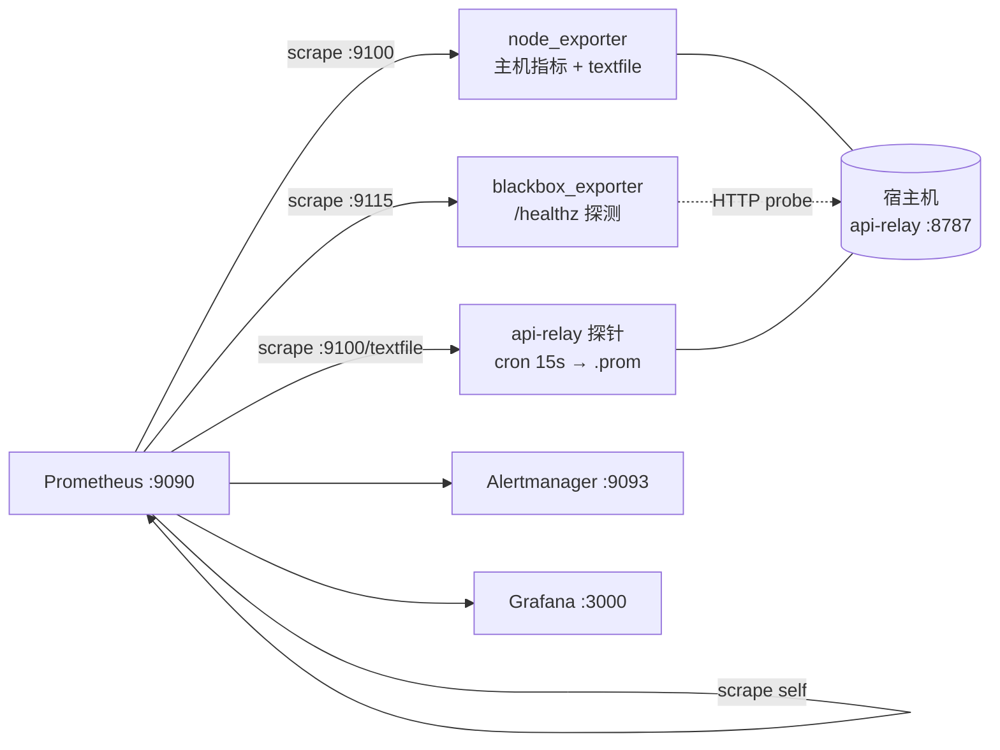

# 阶段6 · 部署 + 监控运行手册（design-proto/06-deploy-monitoring-runbook.md）

> 项目：api-relay（OpenAI 兼容的多上游聚合中转网关 + 内嵌 Preact 管理面板）
> 文档类型：**运维运行手册（Deployment & Monitoring Runbook，可执行步骤 + 可核对清单）**
> 作者：导出交付专家 ｜ 版本：v1.0 ｜ 日期：2026-10-25
> 唯一输入基线：`project/README.md`（§1/§5/§8/§11）、`project/docs/DEPLOYMENT.md`、`readme/线上部署说明.md`、`readme/api-relay.service`、`project/scripts/{keepalive,db_backup,ops-check,smoke}.sh`、`design-proto/04-review.md`（口径：OH ≤0.1% 对外 / 3% 工程熔断线）、`deliverables/product-strategy/_parts/multi-instance-tech-plan.md`（REQ-01/02/09、§4 迁移路径）

> **给执行者的一句话**：本文只描述**可执行、可回滚、可核对**的动作。所有密钥**一律通过环境变量/受保护文件注入**，**绝不在终端或对话里明文粘贴**。每一步都标注 目标 / 输入 / 产出物 / 关键决策 / 风险与待办。

---

## 阅读导航

| # | 章节 | 它回答什么 |
|---|---|---|
| 0 | 前置约束与范围 | 本轮改造成果到哪了、可部署什么、硬约束是什么 |
| 1 | 部署对象与形态 | 三类对象（原型静态站 / 改造后平台代码 / 现有网关服务）分别怎么部署 |
| 2 | 部署步骤（S1–S14） | 从本地验证到灰度的可执行步骤、构建/配置/启动/健康检查/回滚 |
| 3 | 监控接入 | node_exporter / Prometheus / blackbox / 告警规则 / Grafana |
| 4 | 安全注意 | 最小权限、SSH Key、端口、绑定、令牌、复用线上实例风险 |
| 5 | 需用户提供的凭证/信息清单 | 部署前必须由用户确认/提供的表单（15 项） |
| 附 A | 端口与命令速查 | 一页速查 |
| 附 B | 关键决策汇总 / 风险登记册 | 决策与风险一览 |

---

## 0. 前置约束与范围

### 0.1 本轮改造成果的实情（决定"能部署什么"）

| 事实 | 出处 | 含义 |
|---|---|---|
| 本轮**仅完成 REQ-01 切片**（分布式限流/配额的**语义与可视化**），完整分布式改造是 **2026Q4–2027Q2 分阶段工程** | 任务背景；`multi-instance-tech-plan.md` §6.1 | 现阶段**单实例部署语义正确**；多实例"语义一致性"需等 REQ-01/02/09 落地 |
| 状态层外置（限流/配额/熔断/key 池 → Redis）为**目标态**；当前判定仍在**实例内** | `multi-instance-tech-plan.md` §0.1/附录B | **首个多实例部署必须阻塞于 REQ-01/02**（否则 rpm/额度被稀释 N 倍） |
| 运行时**零第三方依赖**（`dependencies: {}`），仅构建期用 typescript/@types/node | `package.json`；`DEPLOYMENT.md` §1 | 构建产物 `dist/` 自包含，**无需 `npm install --production`** |
| 现有线上实例：华为云 ECS（1C2G/Ubuntu），`121.36.29.96:8787`，systemd 单元 `api-relay.service`，SQLite `data/relay.db` | `readme/线上部署说明.md` §5 | 用户希望**复用**该实例 → 必须按"就地升级 + 可回滚"执行 |

### 0.2 硬约束（不可破）

1. **运行时零第三方依赖**、**内网 / CDN-free**：本手册所有组件（node_exporter 等）如无内网镜像，须**离线安装包**。
2. **不在对话/终端明文粘贴私钥**：密钥一律走环境变量或 `chmod 600` 的文件，通过 `{ENV:NAME}` 插值。
3. **不改写成功响应**：部署/监控改造不得触碰红线（success 路径零改写、fail-open、402≠429）。
4. **复用线上实例 = 高影响面**：任何重启/重载都会中断在途请求（含流式），必须**先看健康、再分批、留回滚**。

### 0.3 本部分元信息

- **目标**：把"本轮到底能部署什么"与"哪些是目标态"说清，避免把未完成的分布式能力当既成事实部署。
- **输入**：任务背景（REQ-01 切片、Q4–Q2 分阶段）、`multi-instance-tech-plan.md`、`DEPLOYMENT.md` §1/§4.2。
- **产出物**：§0.1 实情表、§0.2 硬约束。
- **关键决策**：**现阶段以"单实例就地升级"为主路径**，不宣传多实例；多实例路径标注为"待 REQ-01/02 完成后启用"。
- **风险与待办**：① 若用户坚持立即多实例，需先确认 `state.backend` 切片是否真实可用（见 §5 待确认 M-C）；② 1C2G 实例承载 Prometheus/node_exporter 需评估内存。

---

## 1. 部署对象与形态

### 1.1 三类对象的判定与建议

| 对象 | 形态 | 是否"本轮可执行" | 部署建议 |
|---|---|---|---|
| **A. 设计原型静态站**（`design-proto/deliverables/*.html`） | 单文件静态 HTML（零外链、可离线） | ✅ 立即可做 | 作为**内网静态页**托管（nginx / `python3 -m http.server`），**只读、无后端**。用于评审/演示，**不承载真实流量**。 |
| **B. 改造后平台代码**（`project/dist` + `config/relay.yaml`） | Node ≥22.5 单进程服务 | ✅ 立即可做（单实例） | 走 §2 的"本地验证 → 灰度 → 线上"。**先本地跑通再动线上**。 |
| **C. 现有网关服务**（`121.36.29.96:8787`，已在跑） | systemd `api-relay.service` | ⚠️ 就地升级（高影响） | **变更前必备份**（配置/DB/单元），**分批重启**、**留回滚点**；先跑 `ops-check.sh` 确认现状。 |

> **推荐顺序**：A（内网演示，零风险）→ B（本地/沙箱跑通 + `smoke.sh`）→ C（就地升级，灰度 + 回滚）。

### 1.2 本轮可执行的三段路径

```
① 本地验证（零影响线上）
   npm run build  →  dist/cli.js check  →  bash demo.sh / scripts/smoke.sh（mock 上游，端口 18787/18899）
   目标：证明"构建成功、配置可装载、请求能跑通、SSE/归因/预检/看板都在岗"

② 灰度（对线上最小影响）
   配置侧：precheck=observe、attribution=header（先不 enforce/full）
   状态侧：state.backend 保持 local（外置 Redis 待 REQ-01 落地）
   观察 1~2 周误拦率/错误率后再逐项收紧

③ 线上（就地升级现有实例）
   备份 → 构建 → check → 重启 → 健康检查 → 监控接入 → 观察窗口 → （异常则回滚）
```

### 1.3 本部分元信息

- **目标**：让执行者先分清"部署哪一个对象"，再选路径。
- **输入**：`readme/线上部署说明.md`、`DEPLOYMENT.md` §2/§5.2、`design-proto/deliverables/`（原型静态站）。
- **产出物**：§1.1 对象表、§1.2 三段路径。
- **关键决策**：① 原型静态站与网关服务**分离部署**（互不依赖）；② 线上变更**默认走"就地升级 + 回滚点"**，不做大爆炸。
- **风险与待办**：① 复用线上实例时，构建需在目标机或同架构机器上完成（`node:sqlite` 与 Node ≥22.5 强绑定）；② 1C2G 机器上同时跑网关 + Prometheus 需内存核算（见 §3.6）。

---

## 2. 部署步骤（S1–S14）

> 下列 14 步为**可执行清单**；S1–S4 为准备，S5–S8 为**本地验证**，S9–S12 为**上线 + 监控 + 观察**，S13–S14 为**回滚与交接**。

### 2.0 部署步骤总览

| 步骤 | 名称 | 影响面 | 可回滚 |
|---|---|---|---|
| **S1** | 确认主机与接入方式 | 无 | — |
| **S2** | 校验运行环境（Node ≥22.5 / OS / 磁盘 / 出网） | 无 | — |
| **S3** | 备份现有实例（配置 / DB / systemd 单元） | 无 | — |
| **S4** | 获取代码/制品（git pull 或拷贝 dist） | 无 | ✅ |
| **S5** | 构建（`npm ci` → `npm run build`） | 无 | ✅ |
| **S6** | 配置与密钥注入（`relay.yaml` + `chmod 600` env 文件） | 无 | ✅ |
| **S7** | 部署前校验（`dist/cli.js check`） | 无 | ✅ |
| **S8** | 本地冒烟（`scripts/smoke.sh` / `demo.sh`） | 无（另起端口） | ✅ |
| **S9** | 启动/重启服务（systemd） | **中断在途请求** | ✅ |
| **S10** | 健康检查与验收（`/healthz` + 出网清单） | 无 | — |
| **S11** | 监控接入（node_exporter / Prometheus / blackbox） | 无 | ✅ |
| **S12** | 灰度观察窗口 | 无 | ✅ |
| **S13** | 回滚（config / dist / `state.backend` / DB 快照） | 中断在途请求 | ✅ |
| **S14** | 交接与存档 | 无 | — |

### 2.1 S1 · 确认主机与接入方式

- **动作**：确认目标主机 IP/域名、SSH 接入方式（**建议密钥**，见 §4.2）、是否复用 `121.36.29.96`、端口 `8787` 是否被占用、是否有灰度窗口。
- **口令**：`ssh -i ~/.ssh/<key> <user>@<host>`（**密钥路径由用户提供，不在本手册中登记私钥**）。
- **完成判据**：能登录并执行 `systemctl status api-relay`、`ss -ltnp | grep ':8787'`。

### 2.2 S2 · 校验运行环境

```bash
node --version                     # 必须 >= 22.5.0（node:sqlite 依赖）
node -e 'console.log(process.versions.node)' 
uname -a                           # Linux（Windows 未验证）
df -h /                            # 磁盘余量（SQLite + 日志 + 备份）
curl -sI https://<上游域名> -o /dev/null -w '%{http_code}\n'   # 出网到上游 HTTPS 通
```

> ⚠️ **PATH 陷阱**：`/usr/bin/node` 可能是旧版（如 v12）。`scripts/keepalive.sh` 里已显式把 Node22 的 bin 放到 PATH 最前（`NODE22_BIN`）；手工执行时也请注意 `which node`。

- **完成判据**：Node ≥22.5，OS 为 Linux，磁盘 > 20% 余量，出网可达上游。

### 2.3 S3 · 备份现有实例（**复用线上实例必做**）

```bash
# 1) 配置与密钥（受保护，勿打印内容）
cp -a /root/api-relay/config/relay.yaml /root/switch-bak-config-$(date +%F-%H%M).yaml
cp -a /root/api-relay/.relay.env      /root/switch-bak-env-$(date +%F-%H%M)
# 2) systemd 单元
cp -a /etc/systemd/system/api-relay.service /root/switch-bak-unit-$(date +%F-%H%M).service
# 3) 账务库一致性快照（全量 key/额度/账本，丢不起）
bash scripts/db_backup.sh          # → data/backups/relay-YYYYMMDD-HHMM.db（保留 14 份）
# 4) 记录现状（供回滚后对拍）
bash scripts/ops-check.sh          # 退出码 0 = 当前全部正常
```

> `db_backup.sh` 用 `sqlite3 .backup`（无 sqlite3 时自动 checkpoint + cp 兜底），并**校验完整性**；坏备份会被删除，避免"最新一份是坏库"。

- **完成判据**：备份文件存在且 `sqlite3 <bak> 'PRAGMA integrity_check;'` 返回 `ok`；`ops-check.sh` 退出码为 0。

### 2.4 S4 · 获取代码/制品

```bash
# 方式一：就地拉取（目标机有 git 与出网）
cd /root/api-relay && git fetch --all && git log --oneline -1

# 方式二（推荐，内网/受限环境）：本机构建后只拷 dist 制品
# 本机：npm ci && npm run build   → 打包 dist/ 与 config/ 模板
# 目标机：解压到 /root/api-relay/（覆盖 dist/，保留既有 config/relay.yaml 与 .relay.env）
```

- **完成判据**：`dist/cli.js` 存在；`config/relay.yaml` 为你自己的配置（**不覆盖用户既有配置**）。

### 2.5 S5 · 构建

```bash
npm ci                 # 仅安装构建期依赖（typescript、@types/node）；运行时零依赖
npm run build          # = tsc -p tsconfig.json → 产出 dist/
```

- **说明**：`npm run build` 即任务要求的构建命令；产物 `dist/` **自包含，无 `node_modules`**——这是"运行时零依赖"的实际收益（更小攻击面）。
- **完成判据**：`npm run build` 退出码 0；`test -f dist/cli.js`。

### 2.6 S6 · 配置与密钥注入（**不得明文**）

```bash
# 1) 生成密钥文件（权限 600，属主=服务运行用户）
sudo install -d -m 0750 /etc/api-relay
sudo bash -c 'umask 077; cat > /etc/api-relay/env <<EOF
RELAY_CONFIG=/opt/api-relay/config/relay.yaml
RELAY_HOST=::
RELAY_PORT=8787
RELAY_ADMIN_TOKEN=<由 openssl rand -hex 24 生成，勿回显>
RELAY_DB_PATH=/opt/api-relay/data/relay.db
# 上游厂商 key（名字与 config 里 {ENV:...} 一致）
DEEPSEEK_API_KEY=<厂商 key>
# 多实例必须一致（单实例可省略）
RELAY_HASH_SALT=<随机盐>
EOF'
sudo chmod 600 /etc/api-relay/env
sudo chown relay:relay /etc/api-relay/env      # 属主随服务用户
```

配置要点（`config/relay.yaml`，YAML 子集，**所有密钥用 `{ENV:NAME}` 插值**）：

```yaml
server:
  host: "::"          # 双栈；同机隧道/反代部署必须再设 behindProxy: true
  port: 8787
  adminToken: "{ENV:RELAY_ADMIN_TOKEN}"
  behindProxy: true   # 被同机隧道/反代前置时必设（C-04：不再信 remoteAddress）
storage:
  driver: sqlite
  path: "{ENV:RELAY_DB_PATH}"
providers:
  - id: upstream-a
    protocol: openai
    baseUrl: "https://<上游>/v1"
    apiKey: "{ENV:UPSTREAM_A_KEY}"
    models: [ ... ]
    cost: { inputPerMTok: 1, outputPerMTok: 2 }
clients:
  - id: demo
    key: "{ENV:DEMO_CLIENT_KEY}"
    tier: standard
    tenantId: acme
    enabled: true
```

- **关键点**：密钥**只**存在于 `chmod 600` 文件/环境变量；`config/relay.yaml` 里**只出现 `{ENV:...}`**，可安全入库。
- **完成判据**：`grep -c '{ENV:' config/relay.yaml` > 0，且配置中**无**明文 `sk-`。

### 2.7 S7 · 部署前校验

```bash
node --disable-warning=ExperimentalWarning dist/cli.js check --config config/relay.yaml
```

- **说明**：`check` 会**校验配置并列出缺失的环境变量**，退出码非 0 即停止部署。
- **完成判据**：退出码 0；无 "missing env" 输出。

### 2.8 S8 · 本地冒烟（**上线前必跑**）

```bash
bash scripts/smoke.sh          # 启动 mock 上游(:18899) + 网关(:18787)，11 组断言（端口/环境变量/CLI/信号/看板）
# 或单进程零密钥演示（限流/余额不足/内容过滤等）
bash demo.sh
```

> `smoke.sh` 覆盖：构建、`/healthz`、`/v1/models`、无 key 401、成功响应零改写、流式 `data:`/`[DONE]`、429 归因、预检拦截、免费层纯管道、管理接口 401、`providers/toggle` 后 503/200、SIGTERM 优雅退出、重启后度量仍在。

- **完成判据**：`== 冒烟结果：通过 N，失败 0 ==`。

### 2.9 S9 · 启动/重启服务（systemd）

```ini
# /etc/systemd/system/api-relay.service
[Unit]
Description=api-relay (OpenAI-compatible LLM gateway)
After=network-online.target
Wants=network-online.target

[Service]
Type=simple
User=relay                        # 最小权限：非 root（见 §4.1）
WorkingDirectory=/opt/api-relay
EnvironmentFile=/etc/api-relay/env            # chmod 600
ExecStartPre=/usr/bin/node dist/cli.js check  # 启动前再校验一次
ExecStart=/usr/bin/node --disable-warning=ExperimentalWarning dist/cli.js serve --config config/relay.yaml
Restart=always
RestartSec=2
KillSignal=SIGTERM                # 优雅退出：flush 度量、关库
TimeoutStopSec=15
NoNewPrivileges=true
PrivateTmp=true
ProtectSystem=strict
ProtectHome=true
ReadWritePaths=/opt/api-relay/data
LimitNOFILE=65535

[Install]
WantedBy=multi-user.target
```

```bash
sudo systemctl daemon-reload
sudo systemctl enable api-relay
# 变更前先看健康与在途（ADR-022 教训：改配置/重启前先看在途请求）
curl -s http://127.0.0.1:8787/healthz
sudo systemctl restart api-relay
systemctl status api-relay --no-pager
journalctl -u api-relay -n 50 --no-pager
```

> ⚠️ 现有线上单元（`readme/api-relay.service`）以 `User=root` 运行、`WorkingDirectory=/root/api-relay`。**建议借本次变更为非 root 用户**（`relay`），但需同步调整目录属主与 `ReadWritePaths`；若暂不改，至少保持 `NoNewPrivileges` 与 `chmod 600` 的 env。

- **完成判据**：`systemctl is-active api-relay` = `active`；`ss -ltnp | grep ':8787'` 有监听。

### 2.10 S10 · 健康检查与验收

```bash
# 本机健康（有熔断/存储降级时 status=degraded）
curl -s http://127.0.0.1:8787/healthz | head -c 400
# 对外可用性清单（按 DEPLOYMENT §2.5）
BASE=http://127.0.0.1:8787
curl -s -o /dev/null -w '%{http_code}\n' $BASE/healthz                      # 200
curl -s -o /dev/null -w '%{http_code}\n' $BASE/admin/api/overview           # 401（必须挡住）
curl -s -o /dev/null -w '%{http_code}\n' $BASE/v1/quota                     # 403/404（不得外泄）
curl -s -o /dev/null -w '%{http_code}\n' $BASE/v1/chat/completions          # 401（没 key 挡住）
```

- **`/healthz` 关注字段**：`status`（ok/degraded）、`requestCount`、`store.ok`、`degradedEvents`（`precheckDegraded`/`redis_unavailable` 应恒为 0）。
- **完成判据**：上列 4 个状态码与注释一致；`healthz` 里 `store.ok=true`。

### 2.11 S11 · 监控接入

见 §3（node_exporter + Prometheus + blackbox_exporter + 探针 + 告警 + Grafana）。

### 2.12 S12 · 灰度观察窗口

- **动作**：按 `DEPLOYMENT §5.2` 顺序收敛——先纯转发 → 开 `meter` 建基线 → `standard` 开 `attribution=header`/`precheck=observe` → 误拦率 <1% 后 `pro` 开 `precheck=enforce`。
- **观察指标**：误拦率、`byFailureReason`（`unknown` 占比）、`precheckDegraded`、p95、错误率。
- **完成判据**：观察窗口（建议 ≥24h，重保 ≥1 周）内无回归、降级事件为 0。

### 2.13 S13 · 回滚方案

| 层级 | 回滚动作 | 触发条件 | 结果 |
|---|---|---|---|
| **配置** | 还原 `config/relay.yaml` + `/etc/api-relay/env` 备份 → `systemctl restart` | 配置错误/行为异常 | 立即回旧行为 |
| **代码** | 切回上一份 `dist/`（构建前打包留存）→ `restart` | 新版本回归 | 回到旧构建 |
| **单元** | 还原 `api-relay.service` → `daemon-reload` + `restart` | 单元改动引发问题 | 回到旧单元 |
| **判定源** | `state.backend` 切回 `local`（若已启用外置） | 外置判定超发/误拒 | 退回每实例语义（宽松但不误拒） |
| **DB** | 用 `data/backups/relay-*.db` 快照恢复（**先停服**再替换） | 额度/哈希错位 | 回到快照；**key 指纹不变** |
| **上游** | 面板「摘除坏上游」/「清熔断」，或配置改回 | 单上游故障 | 流量切兜底 |

> **回滚不变量**：任何回滚都**不得**导致"客户手上的 key 失效"或"成功响应被改写"（`multi-instance-tech-plan.md` §4.4）。

```bash
# 回滚演练（务必在灰度前做过一次）
sudo systemctl stop api-relay
cp -a /root/switch-bak-config-<ts>.yaml /opt/api-relay/config/relay.yaml
sudo systemctl start api-relay
curl -s http://127.0.0.1:8787/healthz   # 确认恢复
```

### 2.14 S14 · 交接与存档

- 存档：变更记录（时间/版本/操作者）、备份路径、回滚点、观察结论。
- 交接：`ops-check.sh` 加 cron（`0 9 * * *`）；`keepalive.sh` 守护（`setsid nohup bash scripts/keepalive.sh &`）确保"挂了有人拉起、账务库每日备份"。

### 2.15 本部分元信息

- **目标**：给出从本地验证到线上、含回滚的**14 步可执行清单**。
- **输入**：`DEPLOYMENT.md` §2/§5/§7、`readme/api-relay.service`、`scripts/{smoke,db_backup,ops-check,keepalive}.sh`、`package.json` scripts。
- **产出物**：§2.0 步骤总览、§2.1–§2.14 逐步骤、§2.13 回滚矩阵。
- **关键决策**：① 构建用 `npm run build`，**只拷 dist 制品**（守住运行时零依赖）；② systemd 单元**建议非 root + 加固**；③ 复用线上实例**强制 S3 备份 + S13 回滚点**。
- **风险与待办**：① 1C2G 机器上重启期间在途流式请求会中断（需灰度窗口）；② 若外部有反代/隧道，必须 `behindProxy: true` 且设 `adminToken`，否则启动可能拒绝或面板暴露（C-04）；③ 演示默认凭据 `admin/admin` **必须在生产前更换**。

---

## 3. 监控接入（Prometheus + node_exporter + blackbox_exporter）

### 3.1 方案总览与拓扑

用户选定方案：**Prometheus + node_exporter +（blackbox 探针）**。Grafana 作可视化，Alertmanager 作告警路由（建议）。

> **关键实情（务必知悉）**：api-relay **当前没有原生 `/metrics` 端点**（分布式可观测导出属 `multi-instance-tech-plan.md` 的 **REQ-12（P2）**，尚未实现）。因此本方案用**两条腿**取数，既**不臆造端点**、又**不引入运行时依赖**：
> - **可用性/延迟/TLS** → `blackbox_exporter` 主动探测 `/healthz`（HTTP 2xx + 响应时延）。
> - **业务指标**（请求数/错误率/p95/降级/熔断/开销占比）→ **轻量探针脚本**读 `/healthz` 与 `/admin/api/overview`，以 **node_exporter textfile collector** 暴露为文本指标（Prometheus 原生可抓）。探针为**纯 shell + curl**，无新依赖。



**端口约定（全部绑定 `127.0.0.1` 或内网，见 §4.4）**：node_exporter `9100` · blackbox_exporter `9115` · Prometheus `9090` · Alertmanager `9093` · Grafana `3000` · api-relay `8787`。

### 3.2 node_exporter 安装（含离线安装包校验）

> 无内网镜像时走**离线安装**：在有网机器下载 → **校验 sha256** → 拷到目标机安装。

```bash
# —— 步骤 1：在有网机器下载并校验（v1.8.2 为示例版本，请以实际版本替换）——
VER=1.8.2
curl -LO https://github.com/prometheus/node_exporter/releases/download/v${VER}/node_exporter-${VER}.linux-amd64.tar.gz
curl -LO https://github.com/prometheus/node_exporter/releases/download/v${VER}/sha256sums.txt
sha256sum -c sha256sums.txt --ignore-missing        # 必须输出 OK，否则丢弃重下
# 记录校验值：sha256sum node_exporter-${VER}.linux-amd64.tar.gz | tee node_exporter.sha256

# —— 步骤 2：拷到目标机（scp 走用户提供的密钥，勿明文私钥）——
scp -i ~/.ssh/<key> node_exporter-${VER}.linux-amd64.tar.gz <user>@<host>:/tmp/

# —— 步骤 3：目标机安装 ——
sudo tar -xzf /tmp/node_exporter-${VER}.linux-amd64.tar.gz -C /tmp
sudo install -m 0755 /tmp/node_exporter-${VER}.linux-amd64/node_exporter /usr/local/bin/node_exporter
sudo useradd --no-create-home --shell /usr/sbin/nologin --system prometheus 2>/dev/null || true
sudo install -d -o prometheus -g prometheus -m 0755 /var/lib/node_exporter/textfile
```

```ini
# /etc/systemd/system/node_exporter.service
[Unit]
Description=Prometheus node_exporter
After=network-online.target
Wants=network-online.target

[Service]
User=prometheus
Group=prometheus
Type=simple
ExecStart=/usr/local/bin/node_exporter \
  --web.listen-address=127.0.0.1:9100 \
  --collector.textfile.directory=/var/lib/node_exporter/textfile \
  --collector.systemd \
  --no-collector.wifi
NoNewPrivileges=true
ProtectSystem=strict
ProtectHome=true
ReadWritePaths=/var/lib/node_exporter/textfile
Restart=always
RestartSec=3

[Install]
WantedBy=multi-user.target
```

```bash
sudo systemctl daemon-reload && sudo systemctl enable --now node_exporter
curl -s http://127.0.0.1:9100/metrics | head -5          # 有 node_* 指标即成功
curl -s -o /dev/null -w '%{http_code}\n' http://127.0.0.1:9100/metrics   # 200
```

- **完成判据**：服务 `active`、`9100` 仅监听本机、`/metrics` 返回 200。

### 3.3 api-relay 探针（textfile collector · 补齐业务指标）

> 因无原生 `/metrics`，用探针把"网关业务健康"转成 Prometheus 可抓文本指标。**纯 shell + curl + node（已在机）**，零新依赖。

```bash
#!/usr/bin/env bash
# /usr/local/bin/api-relay-probe.sh —— 每 15s 由 cron 触发
set -uo pipefail
OUT=/var/lib/node_exporter/textfile/api_relay.prom
TMP=$(mktemp)
HZ=$(curl -s -m 5 http://127.0.0.1:8787/healthz 2>/dev/null)
# 业务口径（需 adminToken；令牌从受保护文件读，避免出现在进程参数/日志）
TOKEN=$(cat /etc/api-relay/monitor.token 2>/dev/null)   # chmod 600，只含一行令牌
OV=$(curl -s -m 5 -H "X-Admin-Token: $TOKEN" \
      'http://127.0.0.1:8787/admin/api/overview?window=5m' 2>/dev/null)

num(){ printf '%s' "$1" | grep -oE "\"$2\"[[:space:]]*:[[:space:]]*[0-9.]+" | head -1 | grep -oE '[0-9.]+$'; }
UP=0; printf '%s' "$HZ" | grep -q '"status":"ok"' && UP=1
DEG=$(printf '%s' "$HZ" | grep -oE '"degradedEvents"[[:space:]]*:[[:space:]]*[0-9]+' | grep -oE '[0-9]+$'); DEG=${DEG:-0}
STORE=$(printf '%s' "$HZ" | grep -q '"ok":true' && echo 1 || echo 0)
REQ=$(num "$OV" requestCount); REQ=${REQ:-0}
ERR=$(num "$OV" errorRate);    ERR=${ERR:-0}
P95=$(num "$OV" p95Ms);        P95=${P95:-0}
PREDEG=$(num "$OV" precheckDegraded); PREDEG=${PREDEG:-0}
BREAK=$(num "$OV" breakerOpen);       BREAK=${BREAK:-0}
OH=$(num "$OV" overheadPromille);     OH=${OH:-0}

{
  echo "# HELP api_relay_up 网关健康（1=ok, 0=异常/degraded）"
  echo "# TYPE api_relay_up gauge";            echo "api_relay_up $UP"
  echo "api_relay_store_ok $STORE"
  echo "api_relay_degraded_events_total $DEG"
  echo "api_relay_requests_total $REQ"
  echo "api_relay_error_rate $ERR"
  echo "api_relay_latency_p95_ms $P95"
  echo "api_relay_precheck_degraded_total $PREDEG"
  echo "api_relay_breaker_open_total $BREAK"
  echo "api_relay_oh_promille $OH"
} > "$TMP"
mv -f "$TMP" "$OUT"     # 原子替换，避免抓取到半截文件
```

```bash
sudo install -m 0755 api-relay-probe.sh /usr/local/bin/api-relay-probe.sh
printf '%s' '<RELAY_ADMIN_TOKEN>' | sudo tee /etc/api-relay/monitor.token >/dev/null
sudo chmod 600 /etc/api-relay/monitor.token && sudo chown prometheus:prometheus /etc/api-relay/monitor.token
# cron（与 node_exporter textfile 目录同机）
( crontab -l 2>/dev/null; echo '* * * * * sleep 15; /usr/local/bin/api-relay-probe.sh' ) | crontab -
```

> 说明：字段名以**实际 `overview` 响应**为准（示例中用 `requestCount/errorRate/p95Ms/precheckDegraded/breakerOpen/overheadPromille` 占位，落在实现时按真实键名调整）。**若某字段缺失，探针不编造**（保持 0 或省略）。

- **完成判据**：`curl -s http://127.0.0.1:9100/metrics | grep api_relay_up` 有值且为 1。

### 3.4 Prometheus 安装与 scrape_configs

**离线安装**（同 node_exporter：下载 → `sha256sum -c` 校验 → 解压 → 装二进制 → systemd）：

```ini
# /etc/systemd/system/prometheus.service（要点）
[Service]
User=prometheus
ExecStart=/usr/local/bin/prometheus \
  --config.file=/etc/prometheus/prometheus.yml \
  --storage.tsdb.path=/var/lib/prometheus \
  --storage.tsdb.retention.time=15d \
  --web.listen-address=127.0.0.1:9090
Restart=always
```

```yaml
# /etc/prometheus/prometheus.yml
global:
  scrape_interval: 15s
  evaluation_interval: 15s
  external_labels:
    service: api-relay
    env: prod

alerting:
  alertmanagers:
    - static_configs:
        - targets: ['127.0.0.1:9093']   # Alertmanager（可选）

rule_files:
  - /etc/prometheus/rules/api-relay.rules.yml

scrape_configs:
  # 1) Prometheus 自身
  - job_name: prometheus
    static_configs:
      - targets: ['127.0.0.1:9090']

  # 2) 主机指标（node_exporter，含 textfile 探针指标）
  - job_name: node
    static_configs:
      - targets: ['127.0.0.1:9100']
        labels: { instance_role: relay-host }

  # 3) 网关可用性/延迟/TLS（blackbox_exporter 主动探测）
  - job_name: api-relay-blackbox
    metrics_path: /probe
    params:
      module: [http_2xx]
    static_configs:
      - targets:
          - http://127.0.0.1:8787/healthz      # 本机健康
          - https://<对外域名>/healthz          # 对外入口（隧道/反代）
    relabel_configs:
      - source_labels: [__address__]
        target_label: __param_target
      - source_labels: [__param_target]
        target_label: instance
      - target_label: __address__
        replacement: 127.0.0.1:9115
```

> `api-relay-blackbox` 通过 `blackbox_exporter` 探测 `/healthz`，得 `probe_success`（可用性）与 `probe_duration_seconds`（端到端时延）。
> **多实例口径**：若日后多实例部署，`node` job 用多 target + `instance` 标签区分；探针指标带 `instance` 标签聚合（对齐 `multi-instance-tech-plan.md` REQ-12）。

### 3.5 blackbox_exporter 安装与探测

**离线安装**（同前）：二进制装 `/usr/local/bin/blackbox_exporter`，配置 `/etc/blackbox_exporter/blackbox.yml`：

```yaml
modules:
  http_2xx:
    prober: http
    timeout: 5s
    http:
      valid_status_codes: [200]
      preferred_ip_protocol: ip4
      fail_if_body_not_matches_regexp:
        - '"status":"ok"'        # /healthz 必须回 ok（degraded 不算健康）
  http_post_2xx:
    prober: http
    http: { method: POST }
  tcp_connect:
    prober: tcp
```

```ini
# /etc/systemd/system/blackbox_exporter.service（要点）
[Service]
User=prometheus
ExecStart=/usr/local/bin/blackbox_exporter \
  --config.file=/etc/blackbox_exporter/blackbox.yml \
  --web.listen-address=127.0.0.1:9115
Restart=always
```

- **完成判据**：`curl -s 'http://127.0.0.1:9115/probe?module=http_2xx&target=http://127.0.0.1:8787/healthz' | grep -E 'probe_success|probe_duration'`。

### 3.6 告警规则示例（`/etc/prometheus/rules/api-relay.rules.yml`）

> 阈值对齐 `design-proto/04-review.md`：**降损层开销对外承诺 ≤0.1%（=1‰）**、**工程自动降级熔断线 3%（=30‰）**。单位用 **‰（promille）**避免小数歧义。

```yaml
groups:
  - name: api-relay-availability
    rules:
      - alert: ApiRelayDown
        expr: api_relay_up == 0
        for: 1m
        labels: { severity: critical }
        annotations:
          summary: "api-relay 网关不健康（status≠ok / 无响应）"
          runbook: "先 systemctl status api-relay；再 /healthz 看 store.ok 与 degradedEvents"

      - alert: ApiRelayProbeDown
        expr: probe_success{job="api-relay-blackbox"} == 0
        for: 2m
        labels: { severity: critical }
        annotations:
          summary: "api-relay /healthz 探测失败（{{ $labels.instance }}）"

      - alert: ApiRelayStoreDegraded
        expr: api_relay_store_ok == 0 or api_relay_degraded_events_total > 0
        for: 5m
        labels: { severity: warning }
        annotations:
          summary: "存储/治理层降级（fail-open 已放行，需如实证伪）"

  - name: api-relay-quality
    rules:
      - alert: ApiRelayHighErrorRate
        expr: api_relay_error_rate > 0.05          # 5%
        for: 10m
        labels: { severity: warning }
        annotations:
          summary: "错误率 >5%（看 byFailureReason 定位上游/模式）"

      - alert: ApiRelayP95LatencyHigh
        expr: api_relay_latency_p95_ms > 2000      # 2s
        for: 10m
        labels: { severity: warning }
        annotations:
          summary: "p95 延迟 >2s（容量/上游变慢）"

      - alert: ApiRelayP95LatencyCritical
        expr: api_relay_latency_p95_ms > 5000
        for: 5m
        labels: { severity: critical }
        annotations:
          summary: "p95 延迟 >5s（疑似上游 TTFB 卡住）"

  - name: api-relay-upstream
    rules:
      - alert: ApiRelayUpstreamBreakerOpen
        expr: api_relay_breaker_open_total > 0
        for: 2m
        labels: { severity: warning }
        annotations:
          summary: "有上游处于熔断（流量已切兜底）"
          runbook: "面板上游页「清熔断」；确认恢复后再恢复权重"

      - alert: ApiRelayPrecheckDegraded
        expr: api_relay_precheck_degraded_total > 0
        for: 5m
        labels: { severity: critical }       # 应恒为 0；≠0 是 bug 信号
        annotations:
          summary: "预检降级放行数 ≠0（治理层异常，绝不能谎报正常）"

  - name: api-relay-loss-reduction
    rules:
      - alert: ApiRelayOverheadOverWarranty
        expr: api_relay_oh_promille > 1        # 对外承诺 0.1% = 1‰
        for: 15m
        labels: { severity: warning }
        annotations:
          summary: "降损层开销占比 >0.1%（对外承诺线）—— 需排查"

      - alert: ApiRelayOverheadBreakerLine
        expr: api_relay_oh_promille > 30       # 工程自动降级熔断线 3% = 30‰
        for: 5m
        labels: { severity: critical }
        annotations:
          summary: "降损层开销占比 >3%（工程熔断线）—— 应自动降级为 observe/off"
```

```bash
promtool check rules /etc/prometheus/rules/api-relay.rules.yml     # 规则语法自检
curl -s http://127.0.0.1:9090/-/healthy                            # Prometheus healthy
curl -s http://127.0.0.1:9090/api/v1/rules | grep -c api-relay     # 规则已加载
```

### 3.7 Grafana 建议面板

| 面板 | 关键指标 | 用途 |
|---|---|---|
| **网关概览（Row 1）** | `api_relay_up`、`probe_success`、`api_relay_requests_total`、`api_relay_error_rate` | 一眼看"是否在岗、请求量、错误率" |
| **上游健康与熔断** | `api_relay_breaker_open_total`、`api_relay_precheck_degraded_total`、byFailureReason（若接入） | 定位坏上游与治理层异常 |
| **延迟（SLO）** | `api_relay_latency_p95_ms`、`probe_duration_seconds` | 对照 SLO（p95 < 2s） |
| **降损层开销** | `api_relay_oh_promille`（1‰/30‰ 参考线） | 对照"对外 0.1% / 工程 3%"双口径 |
| **主机资源** | `node_load1`、`node_memory_MemAvailable_bytes`、`node_filesystem_avail_bytes` | 1C2G 容量水位 |
| **可用性热图** | `probe_success` 7/30 天 | 对外可用性复盘 |

> Grafana 经反代挂内网域名 + 强口令；**勿对公网暴露**（见 §4.4）。

### 3.8 资源与部署位置建议

| 情形 | 建议 |
|---|---|
| 仅 1C2G 单机 | node_exporter + Prometheus（retention 15d）+ blackbox 同机可行，但需监控内存（Prometheus 约 200–400MB）；Grafana 可另机/容器 |
| 复用线上实例 | 监控组件**只读**、绑定 127.0.0.1；**不要**给 Prometheus 开公网端口 |
| 未来多实例 | Prometheus 独立主机 + 服务发现；探针指标按 `instance` 聚合 |

### 3.9 本部分元信息（监控）

- **目标**：给出可直接执行的监控接入方案（含离线安装、scrape 配置、告警规则、面板建议）。
- **输入**：用户选定方案（Prometheus + node_exporter + blackbox）；`04-review.md` 双口径（0.1%/3%）；`multi-instance-tech-plan.md` REQ-12；`DEPLOYMENT.md` §4/§5。
- **产出物**：§3.1 拓扑、§3.2–3.7 安装与配置、§3.8 资源建议。
- **关键决策**：① **诚实处理"无原生 /metrics"**——用 blackbox 探 `/healthz` + **textfile 探针**补业务指标，**不臆造端点**；② 所有监控端口**绑定本机/内网**；③ 告警阈值直接用 **0.1% / 3% 双口径**。
- **风险与待办**：① 探针字段名需按**真实 `overview` 响应**校准（M-D 待确认）；② 探针需 adminToken 只读权限（**最小权限令牌**，勿用 owner 全权）；③ 1C2G 内存需实测。

---

## 4. 安全注意

### 4.1 最小权限账号

- 服务运行用户：**非 root**（`relay`/`prometheus`），`NoNewPrivileges=true`、`ProtectSystem=strict`、`ProtectHome=true`、`ReadWritePaths` 只放 `data/`。
- 监控组件独立低权用户（`prometheus`），只读访问探针所需文件。
- `monitor.token` 只读、`chmod 600`、属主=监控用户；**只用只读/最小权限管理令牌**。

### 4.2 SSH 访问（**建议密钥，勿明文粘贴**）

- 用 **SSH Key**（`ssh -i ~/.ssh/<key>`），禁用密码登录（`PasswordAuthentication no`）、禁用 root 直登（`PermitRootLogin no` + `AllowUsers`）。
- **私钥永不进入对话/终端命令回显/仓库**；`scp` 传安装包同样走密钥。
- 建议 `ssh-agent` + `ProxyJump` 收敛跳板。

### 4.3 防火墙 / 端口

| 端口 | 现状 | 建议 |
|---|---|---|
| 22 | 线上安全组放行 `0.0.0.0/0` | **收窄**到运维出口 IP 段 |
| 8787 | 线上安全组放行 `0.0.0.0/0` | 若经隧道/反代对外，**关闭直连 8787 的公网入站**，只留反代/隧道 |
| 9100/9115/9090/9093/3000 | 未开 | **仅绑 127.0.0.1（或内网）**，**绝不**开公网 |

```bash
# 本机核查监听绑定（应全部 127.0.0.1 / ::1 / 内网地址）
ss -ltnp | grep -E ':(8787|9100|9115|9090|9093|3000)\b'
# 若出现 0.0.0.0:9100 等 → 立即改回 127.0.0.1 并重启对应服务
```

### 4.4 node_exporter 绑定（**硬要求**）

- `--web.listen-address=127.0.0.1:9100`（**不得** `0.0.0.0`）。
- 若必须跨机抓取，绑定**内网私网 IP**（如 `10.x/172.x`）+ 安全组只放行 Prometheus 主机；**绝不开公网**。
- 同理：blackbox/Prometheus/Alertmanager/Grafana 一律 `127.0.0.1` 或内网。

### 4.5 不暴露管理令牌

- `/admin/api/*` 需令牌/登录；**`/v1/quota`、`/v1/panel` 不得外泄**（`403/404`）。
- `adminToken` 走 `{ENV:RELAY_ADMIN_TOKEN}`，**不出现在**命令行参数、进程环境列表可见日志、或 git。
- **更换演示默认凭据**：当前登录固定 `admin/admin`，**生产前必须**改为安全的服务端配置（`DEPLOYMENT.md` §2.5）。
- 被同机隧道/反代前置时**必须** `behindProxy: true`（C-04），否则回环地址被当"可信"、面板可能整段放行。

### 4.6 复用线上实例的风险（重载/重启影响面）

| 风险 | 说明 | 缓解 |
|---|---|---|
| 重启中断在途请求 | 含**流式**响应会被断开 | 选灰度窗口；重启前看 `/healthz` 的 `inflight` |
| 配置错误导致拒绝启动 | `behindProxy: true` + 空 `adminToken` 会**拒绝启动** | S3 备份 + `check` 预校验；回滚点 |
| 磁盘写放大 | SQLite + 日志 + 备份同盘 | `retentionDays ≤ 30`、备份保留 14 份、磁盘告警 |
| 监控抢资源 | 1C2G 上 Prometheus 占内存 | 限 retention、必要时监控另机 |
| 变更无人知晓 | "改了源码没重建/重建了没重启"静默失效 | 上 `ops-check.sh`（会报 `dist 不比 src 旧` 与"没重启"） |

### 4.7 本部分元信息（安全）

- **目标**：把"最小权限、密钥、端口、绑定、令牌、复用风险"落成可核对清单。
- **输入**：`DEPLOYMENT.md` §2.5/§6、`readme/线上部署说明.md` §5、`04-review.md`（脱敏/红线）、`ops-check.sh`。
- **产出物**：§4.1–§4.6。
- **关键决策**：① 监控组件**一律本机/内网绑定**；② 复用线上实例**强制备份 + 灰度窗口 + 回滚点**；③ **生产前更换 `admin/admin`**。
- **风险与待办**：① 现有安全组 `0.0.0.0/0` 放行 22/8787 属高风险，建议本轮一并收窄；② 与隧道方案的 `behindProxy` 配置需现场核对（M-B）。

---

## 5. 需用户提供的凭证 / 信息清单（表单 · **15 项**）

> ⚠️ **安全红线**：**请勿在对话中明文粘贴私钥/密钥/令牌**。请把密钥写入受保护文件（`chmod 600`）或通过安全渠道交付；对话中只需确认"已提供/将提供"与**非敏感**信息。

| # | 项 | 类型 | 是否敏感 | 用途 | 示例/说明 | 状态 |
|---|---|---|---|---|---|---|
| 1 | **目标主机 IP / 域名** | 非敏感 | 否 | 部署定位 | 如 `121.36.29.96`（复用现有实例？） | ☐ 待确认 |
| 2 | **SSH 访问方式** | 方式说明 | **敏感** | 登录/传包 | **建议密钥**；私钥**不得**在对话中粘贴 | ☐ 待确认 |
| 3 | **SSH 用户名** | 非敏感 | 否 | 权限与属主 | 如 `root` / `deploy`（建议非 root 运维账号） | ☐ 待确认 |
| 4 | **是否已有 Prometheus / node_exporter** | 事实 | 否 | 决定安装 or 复用 | 已装则提供版本与抓取地址（内网） | ☐ 待确认 |
| 5 | **监控组件安装位置** | 事实 | 否 | 同机/另机 | 1C2G 同机 or 独立监控机 | ☐ 待确认 |
| 6 | **服务端口 / 对外域名** | 非敏感 | 否 | 探测与反代 | 如 `8787`、对外是否有域名/TLS | ☐ 待确认 |
| 7 | **上游厂商密钥（注入方式）** | **敏感** | ✅ | 网关调用上游 | 通过 `{ENV:...}` + 受保护文件注入；**勿明文** | ☐ 待确认 |
| 8 | **客户端 key / 演示 key** | **敏感** | ✅ | 冒烟与验收 | 走环境变量；明文只显示一次 | ☐ 待确认 |
| 9 | **管理令牌（adminToken）策略** | 策略 | 部分敏感 | 管理接口与探针 | 由 `openssl rand -hex 24` 生成，**不回显**；探针用**只读**令牌 | ☐ 待确认 |
| 10 | **是否已在运行旧版本（版本号/commit）** | 事实 | 否 | 决定增量与回滚点 | 现有 `v1.0.0`/`package.json version` | ☐ 待确认 |
| 11 | **灰度窗口（时间窗/时长）** | 非敏感 | 否 | 重启与观察 | 建议低峰 30–60 分钟变更窗口 | ☐ 待确认 |
| 12 | **回滚容忍度（可接受多长中断）** | 非敏感 | 否 | 决定重启策略 | 如"<5 分钟"、是否允许二次重启 | ☐ 待确认 |
| 13 | **数据保留/备份要求** | 非敏感 | 否 | `retentionDays`、备份份数 | 现 30 天明细 / 14 份备份 | ☐ 待确认 |
| 14 | **告警通知渠道** | 非敏感 | 否 | Alertmanager 路由 | 邮件/IM/Webhook（渠道留待用户提供） | ☐ 待确认 |
| 15 | **合规/审计要求** | 非敏感 | 否 | 留存与导出 | 审计留存周期、是否需不可篡改 | ☐ 待确认 |

**交付方式（三选一，均不涉明文）**：① 密钥写入目标机 `chmod 600` 文件（推荐）；② 通过安全渠道（密码管理器/密文）传递；③ 由用户自行在目标机执行注入步骤，仅回传"已完成"。

### 5.1 本部分元信息（凭证清单）

- **目标**：用一张表单把"部署前必须由用户确认/提供的 15 项"列清，并强调密钥**不明文**。
- **输入**：`DEPLOYMENT.md` §2/§3（环境变量/配置项）、`readme/线上部署说明.md` §5（服务器/凭据位置）。
- **产出物**：§5 表单（15 项）+ 交付方式。
- **关键决策**：**敏感与非敏感分列**，敏感项只确认"提供方式"，**绝不要求明文**。
- **风险与待办**：① 缺 M-B（反代/隧道与否）会直接影响 `behindProxy` 配置；② 缺 M-D（`overview` 真实字段）会导致探针指标名需现场校准。

---

## 附录 A · 端口与命令速查

| 项 | 值/命令 |
|---|---|
| 网关端口 | `8787`（`ss -ltnp \| grep ':8787'`） |
| 健康检查 | `curl -s http://127.0.0.1:8787/healthz` |
| 构建 | `npm run build`（= `tsc -p tsconfig.json`） |
| 配置校验 | `node --disable-warning=ExperimentalWarning dist/cli.js check` |
| 本地冒烟 | `bash scripts/smoke.sh`（:18787 + mock :18899） |
| 运维自检 | `bash scripts/ops-check.sh` |
| 账务库备份 | `bash scripts/db_backup.sh`（→ `data/backups/`，保留 14 份） |
| 守护 | `setsid nohup bash scripts/keepalive.sh &`（健康检查驱动 + 每日备份） |
| 监控端口 | node_exporter `9100` · blackbox `9115` · Prometheus `9090` · Alertmanager `9093` · Grafana `3000`（**全部 127.0.0.1/内网**） |
| 探针指标 | `api_relay_up` / `_store_ok` / `_degraded_events_total` / `_requests_total` / `_error_rate` / `_latency_p95_ms` / `_precheck_degraded_total` / `_breaker_open_total` / `_oh_promille` |
| 双口径参考线 | 对外承诺 `≤0.1%`（=1‰） · 工程熔断线 `3%`（=30‰） |

## 附录 B · 关键决策汇总 / 风险登记册

### B.1 关键决策

| # | 决策 | 依据 |
|---|---|---|
| D1 | 现阶段以**单实例就地升级**为部署主路径，**不宣传多实例** | REQ-01 切片；`multi-instance-tech-plan.md` §6 |
| D2 | 构建产物**只拷 `dist/`**，不装 `node_modules` | 运行时零依赖（`package.json` / `DEPLOYMENT.md` §1） |
| D3 | 密钥**一律** `{ENV:...}` + `chmod 600` 文件注入 | 硬约束（不明文） |
| D4 | 监控用 **blackbox 探 `/healthz` + textfile 探针**，因无原生 `/metrics` | 诚实处理；REQ-12 未实现 |
| D5 | 监控组件**一律本机/内网绑定** | 安全（§4.4） |
| D4' | 告警阈值直接用 **0.1% / 3% 双口径**（‰） | `04-review.md` |
| D6 | 复用线上实例**强制 S3 备份 + S13 回滚点 + 灰度窗口** | 影响面（§4.6） |

### B.2 风险登记册

| # | 风险 | 等级 | 缓解 |
|---|---|---|---|
| R1 | 重启中断在途/流式请求 | 中 | 灰度窗口 + 重启前看 `inflight` |
| R2 | `behindProxy` 漏配 → 面板暴露/启动拒绝 | **高** | 现场核对隧道/反代；空 `adminToken` + `behindProxy` 会拒绝启动 |
| R3 | 默认凭据 `admin/admin` 被猜中 | **高** | 生产前更换服务端登录配置 |
| R4 | 安全组 `0.0.0.0/0` 放行 22/8787 | **高** | 收窄到运维 IP / 走隧道 |
| R5 | 1C2G 内存不足（网关+Prometheus） | 中 | 限 retention；监控另机；内存告警 |
| R6 | 探针字段名与实际 `overview` 不符 | 中 | 落地前按真实响应校准（M-D） |
| R7 | 多实例未完成即上多实例 → rpm/额度稀释 | **高** | 首个多实例部署阻塞于 REQ-01/02 |
| R8 | "重建了没重启"静默失效 | 中 | 上 `ops-check.sh`（含该项） |
| R9 | 备份同盘，防不了磁盘坏 | 中 | `export-secrets.sh` + 拷到本机之外（`ops-check.sh` 盯导出时间） |
| R10 | 监控端口误开公网 | **高** | §4.3/§4.4 监听核查 |

---

*本手册为阶段6 的部署+监控执行基线；所有步骤均要求"先本地验证、再灰度、后线上"，且**任何密钥不得明文出现**。落地前请先完成 §5 的 15 项确认。*